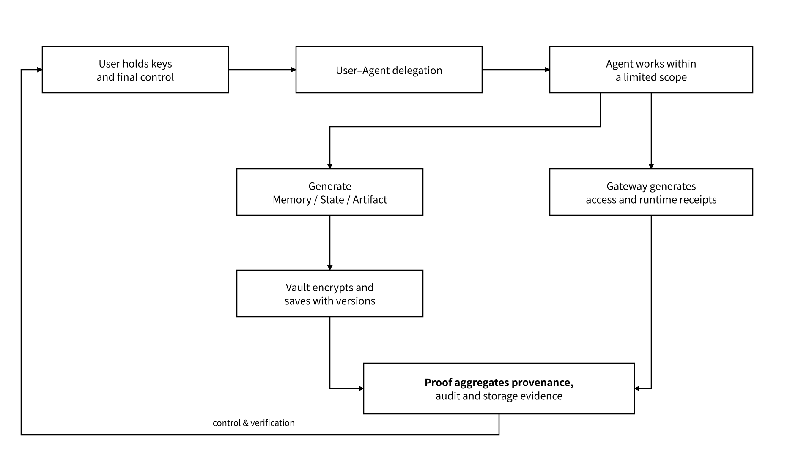

# 1.1 Welcome and Positioning

## 1.1.1 A Trusted State Layer for the Age of Agents

> **Vision and mission: let your AI agent remember, pick up where it left off, and stay under your control. Its memories, half-finished work and results carry over even when you switch models, and you always hold the keys.**

When working context depends on an application's internal format or session mechanism, changing the model, framework or executing principal may mean reorganizing materials, decisions and to-dos from scratch. Collaboration across principals also requires being clear about where memory lives, who controls it, and which Agent accessed it under which delegation. MEMO addresses two needs: **working state can resume in an agreed format; and the ownership, authorization and access records of that state can be inspected.**

The MEMO Agent State Layer is independent of any particular model, agent framework or application. It stores long-term state, distinguishes user and Agent principals, enforces delegation and authorization, records provenance and runtime evidence, and completes handoffs across models or Agents within the scope of a delegation signed by the Owner. Open objects, exportable state and explicit permission semantics are the core of the design; the resume flow matches clients, schemas, tools and external dependencies through compatibility descriptors, and inputs that fail to match go through quarantine or conversion.

For users, MEMO has to keep answering four questions:

1. What has the Agent remembered, and who owns that state;
2. Which Agent accessed what, and under which authorization;
3. Where did memory, tool results and outputs originate, and have they been modified;
4. Is the state still being kept, and can third parties verify the key records.

In one sentence:

> MEMO gives agent state ownership, authorization, records and evidence, and lets it resume across models when the user allows.

MEMO does not replace models or agent frameworks, is not responsible for all business orchestration, and does not move the entire runtime on-chain. State plaintext and high-frequency reads and writes stay off-chain by default; the chain mainly carries commitments, audit roots, proof results, necessary registrations and dispute adjudication. This is the engineering principle MEMO has carried forward since the storage era: plaintext stays off-chain, evidence can go on-chain.

_Figure 02: Agent State and Evidence Loop Under User Control_

<figure><figcaption></figcaption></figure>

**How the foundation capabilities carry over**: MEFS provides long-term storage, challenges and storage proofs, Meeda provides data availability, and FileProof and Attestation provide proofs and statements respectively. The Agent State Layer connects these capabilities through object identifiers, versions, delegation references and run identifiers. The integration process verifies the behavior of each adapter with replayable payloads, fault injection, recovery validation and policy tests, and the results are bound to a specific configuration and validation scope.

**Design principles**:

* User control: keys, authorization, export, revocation and deletion are controlled by the user or a legitimate organizational principal.
* Separation of two principals: the user identity expresses control; the Agent DID expresses the executing principal under the "identity signing key + execution instance" scheme; `instance_id` identifies the execution instance and `run_id` identifies one task run.
* Least privilege: permissions are scoped precisely to principal, namespace, operation, term and purpose.
* Off-chain by default: plaintext does not go on-chain; the chain keeps only the necessary verification material.
* Open access: MCP, REST and SDK reuse the same object, authorization and receipt semantics.
* Discoverable interfaces: the service manifest declares component responsibilities, protocol versions, schemas, permitted operations and deployment configuration, and clients automatically choose an access path through signatures, compatibility matching and health probes.

## 1.1.2 From Data Layer to State Layer

The Data Layer's responsibilities cover storage, verification, trading and computation, and organize network services through mechanisms such as the division of roles among users, providers and guardians, settlement flows and RAFI risk-aware failure detection. Agent scenarios further require recording the controlling principal, the origin of generation, the purpose of access, the object version, the expiry time, revocation and migration conditions. The State Layer adds persistent state semantics on top of these foundation capabilities and connects the components through object contracts, a version graph, policy enforcement and automated validation.

| Problem handled by the Data Layer          | State problem handled by the State Layer                                 | Technical mapping                                                              |
| ------------------------------------------ | ------------------------------------------------------------------------ | ------------------------------------------------------------------------------ |
| How files are stored durably               | How Memory, Task State and Artifacts persist                             | MEFS continues to provide storage, and Vault adds object and version semantics |
| How users and files are identified         | How users, Agents and run instances are distinguished                    | MEMO DID is extended into the dual principals of user identity and Agent DID   |
| Whether files are intact and still present | Whether memory provenance, access behavior and run results are traceable | FileProof, Meeda and Attestation enter the Proof evidence chain                |
| How data applications upload and read      | How an Agent reads and writes state within its delegation                | Storage Middleware and the MEFS MCP Server are carried over into Gateway       |
| How data is authorized or traded           | How reading, export, training and resharing are authorized separately    | Data Wallet continues to hold keys, and Data Market carries selective delivery |

The core of State is not "more files" but working context that can be reused persistently:

* **Memory**: facts, preferences, knowledge and decision context that have been filtered and can be reused by later tasks;
* **Task State**: the current phase, input references, dependency versions, to-dos and recovery conditions;
* **Artifact**: deliverable results such as documents, code, reports and datasets;
* **Trace**: the run trace formed by model and tool calls, observable results and external actions;
* **Policy**: who may perform which operations, for what term and purpose;
* **Evidence**: provenance, receipts, object commitments, audit roots and storage proofs.

Protocol is the protocol and network foundation, and MEFS is the decentralized storage product; the Agent State Layer composes the underlying capabilities through unified object and permission contracts. Cross-framework recovery depends on explicit state mappings and recovery conditions, permission consistency is constrained by shared policy semantics, and cost and runtime quality are managed through metering records and configurable thresholds.
