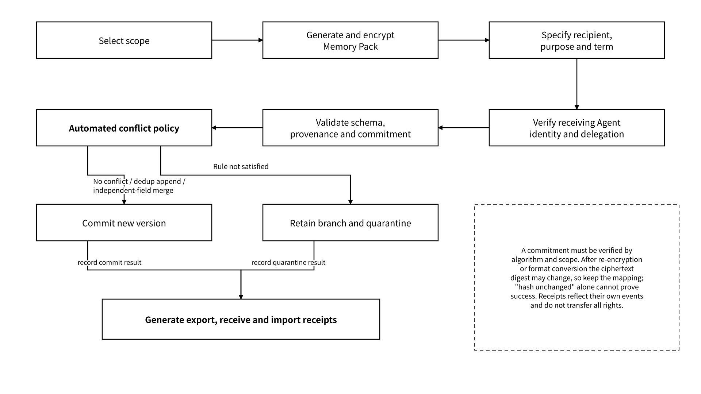

# 3.2 State Model and Lifecycle

## 3.2.1 Memory, State Object and Artifact

Agent State is the umbrella term, State Object is the general carrier in Vault, and Memory, Task State, Checkpoint, Trace and Artifact can be carried by different types of State Object. Memory is information that later tasks can reuse, and an Artifact is a result such as a document, code, report or dataset. Only when the user explicitly chooses rights confirmation, authorized delivery or trading does an Artifact or Memory Pack go on to establish a state asset representation; being storable, deliverable and tradable are different capabilities, and it does not mean every piece of state should be assetized in turn.

| Type         | Definition                                                                                      | Examples                                            | Write requirements                                                                    |
| ------------ | ----------------------------------------------------------------------------------------------- | --------------------------------------------------- | ------------------------------------------------------------------------------------- |
| Memory       | Information that has passed validation by the admission policy and can be reused by later tasks | Preferences, project facts, decisions and rationale | Distinguish source facts, summaries, inferences and policy admission records          |
| Task State   | Business state from which the current task can be recovered                                     | Phase, dependencies, to-dos, constraints            | Bound to a specific version and task identifier                                       |
| State Object | The general carrier in Vault                                                                    | Any managed state record                            | Uses a unified schema\_version, owner, namespace, version, policy\_ref and commitment |
| Artifact     | A deliverable result                                                                            | Documents, code, reports, datasets                  | Retains input references, the generating principal, version and acceptance result     |

The schema of a persisted State Object uses `schema_version=memo.state_object/1`, and its common fields include `object_id`, `type`, `owner`, `namespace`, `version`, `parent_refs`, `provenance`, `policy_ref`, `content_ref`, `commitment`, `created_at`, `expires_at` and `proof_refs`. Section 4.1.1 gives a complete object example; the write command and the client-side pre-encryption payload are described separately, and a command that omits server-generated fields is not to be treated as a complete persisted object.

| Field            | Semantics and constraints                                                                                                                                                                                   |
| ---------------- | ----------------------------------------------------------------------------------------------------------------------------------------------------------------------------------------------------------- |
| `object_id`      | Stable logical object identifier; an object update keeps this identifier                                                                                                                                    |
| `schema_version` | Version of the object encapsulation format, distinct from the business object version                                                                                                                       |
| `version`        | An opaque, unique and immutable version identifier assigned by the server, such as `v_001`; clients must not increment it or sort it lexically                                                              |
| `parent_refs`    | References (`object_id` / `version`) to direct parent versions; an empty array for the initial version                                                                                                      |
| `provenance`     | Provenance record in object form; sources and dependencies are placed here, separate from version parent-child relationships                                                                                |
| `content_ref`    | Encrypted content reference, resolved by the content location interface; the decryption location, wrapping type and recipient are bounded by key policy                                                     |
| `commitment`     | Contains `algorithm`, `scope` and `value`; the example is `sha256` with `scope=ciphertext`, verifying consistency only for the specified ciphertext envelope                                                |
| `proof_refs`     | Immutable snapshot of the evidence known when this object version was created; asynchronous evidence is stored in the Proof Registry indexed by `(object_id, version)` and merged for display at query time |

Memory uses an automatic admission mechanism. Extraction results are first saved as candidate records with their provenance, and the policy engine, based on the purposes and scope signed in advance by the Owner, validates in order the source signature, input dependencies, field schema, sensitive data rules, write permission and conflict policy; those that pass produce a canonical memory version that can be retrieved, and those that fail are rejected or kept in a quarantine namespace with the reason recorded.

`confirmation_status=confirmed` means the specified admission policy was passed, `confirmation_method=policy_validation` means automated policy validation, `confirmed_by` records the identity of the service that performed the validation, and `confirmation_policy_ref` binds the specific admission rule. This status does not replace fact verification, and summaries and inferences still keep their own source types. Records that are corrected, superseded, revoked or deleted are expressed through independent lifecycle events; retrieval by default uses only versions that satisfy the validity period, authorization and admission conditions.

## 3.2.2 Checkpoint, Version and Trace

The three kinds of records together explain how to save work at agreed boundaries and restore business state when dependencies are satisfied:

| Object     | Problem solved                                             | Minimum recorded requirements                                                            | Boundary                                                 |
| ---------- | ---------------------------------------------------------- | ---------------------------------------------------------------------------------------- | -------------------------------------------------------- |
| Checkpoint | Where to resume after a task is interrupted                | Task phase, input references, dependency versions, to-dos and recovery conditions        | Not a complete image of an arbitrary runtime environment |
| Version    | How state evolves, is compared and rolled back             | Parent versions, modifier, time, change digest, object commitment                        | A version number is not a storage proof                  |
| Trace      | How the Agent called models and tools and produced results | Agent DID, instance\_id, run\_id, tool versions, calls, result digests, external actions | Not equivalent to the model's private chain of thought   |

A Checkpoint references a set of State Objects at definite versions; a Trace records how those versions were generated; Proof provides verification material for defined claims. The scope of recovery is constrained by the schema, adapters, accessible dependencies and the status of external actions. Cross-model recovery does not promise identical output, nor does it mean that an arbitrary runtime environment can continue from the same checkpoint.

Concurrent updates use optimistic locking and an expected-parent-version condition. Without conflict, a new version is committed; independent fields are merged by type rules; append-type data is deduplicated and appended by a stable business key. When merge rules cannot be satisfied, an isolated branch is retained, and reads continue to use the admitted version selected by policy, or are rejected if no qualified version exists; a write returns an explicit conflict status and cannot silently overwrite. The new version produced by a merge records all direct parent versions in `parent_refs`.

Version relationships form a branchable parent version graph, and version strings carry no temporal or causal ordering. Traces and Checkpoints reference the object versions actually used, and the recovery flow reads according to these fixed references; asynchronous evidence is appended to the Proof Registry and does not change persisted objects and Checkpoints.

## 3.2.3 Memory Pack, Handoff and Migration

A Memory Pack is an authorized exported state package that can contain an object manifest, necessary content or content references, schemas, versions, provenance, policy and evidence pointers. It serves Handoff and migration and does not automatically carry all permissions or transfer ownership. The recipient should access managed resources using its own identity and delegation; the purpose and term descriptions inside the package do not automatically create enforced control over offline plaintext copies.

_Figure 12: Scope Selection, Receipt Verification and Conflict Handling of a Memory Pack_

<figure><figcaption></figcaption></figure>

A Memory Pack contains at least:

* The manifest, schema and package version;
* Object IDs, types, namespaces and definite versions;
* Encrypted content or restricted content references;
* Provenance, direct parent version references and runtime states such as candidate, admitted and quarantined;
* Delegation, purpose, term and disallowed operations;
* Commitments, receipts, a `proof_refs` snapshot and restricted query references to the Proof Registry;
* A report of missing, expired or incompatible fields.

The import controller performs deduplicated append, independent field merge or branch isolation within the scope of the recipient's delegation, and writes successful, rejected and quarantined objects separately into the import report. Training, resharing and marketplace delivery are validated through their own independent authorization operations and purpose rules. An export is recorded as an event, and the source object can remain available; the export result, the authorization status, the object deletion status and the data key rotation progress are expressed separately.

Migration should preserve the logical object identifier, the direct parent version graph, provenance, permission references and evidence associations. If the ciphertext is copied as-is, it can be verified against the original commitment; if it is re-encrypted or format-converted, the ciphertext commitment may change, and the old and new envelopes, the digest mapping, the related versions and the conversion receipt should be recorded. A new ciphertext digest that differs from the old one must not be directly classed as corruption, and an object that has changed must not be silently reported as an unchanged original version.
