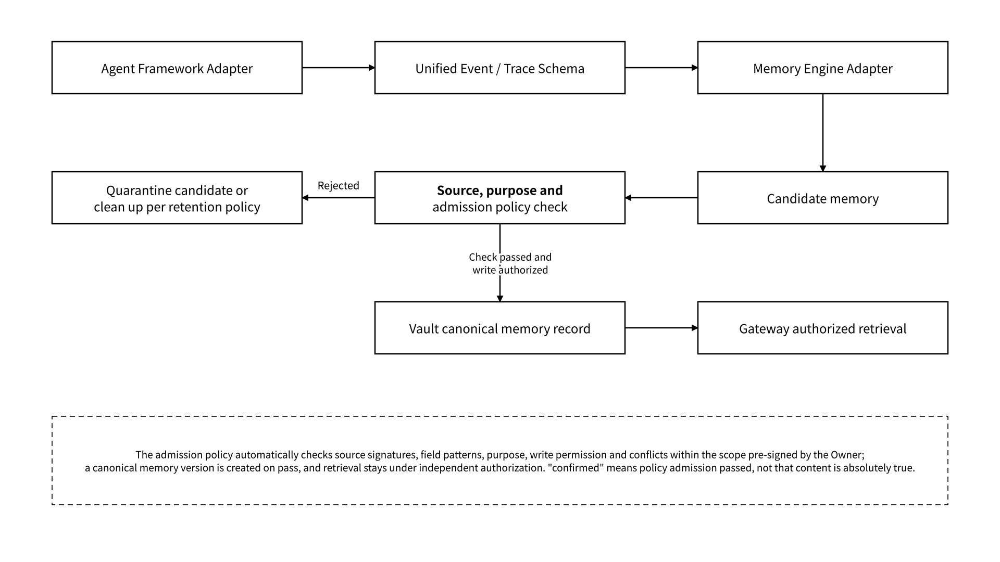
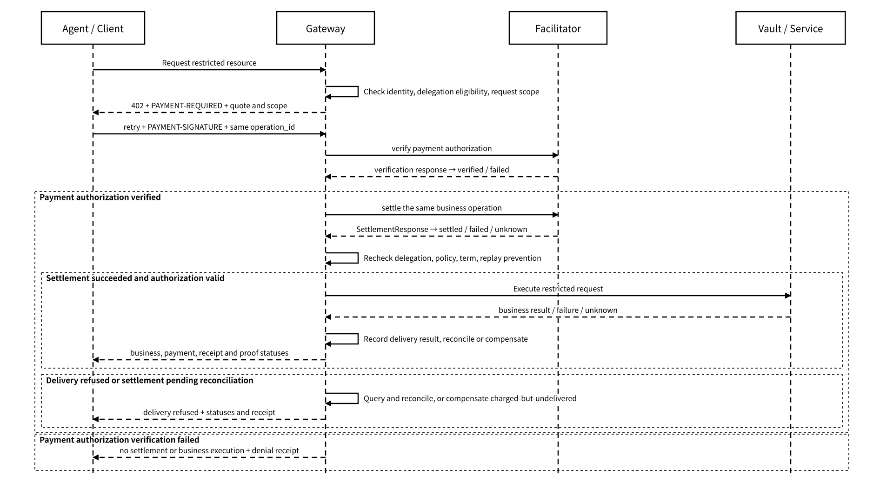

# 4.2 Integration and Adaptation

## 4.2.1 MCP and the MEFS MCP Server

The MEFS MCP Server is the access layer for file upload and for retrieval and fetching by content identifier; the Agent Gateway MCP is the access layer for state objects, authorization, revocation, handoff, receipts and Proof queries. The two use independent service identities and tool manifests. Clients load the protocol version, transport configuration, tool input and output schemas, credential audiences and the authorization operation mapping from the service manifest, and tool calls enter the corresponding backend after validation against a unified policy context.

| Tool category | Tool interface                                                    | Input, output and policy responsibility                                                                                                                                              |
| ------------- | ----------------------------------------------------------------- | ------------------------------------------------------------------------------------------------------------------------------------------------------------------------------------ |
| File storage  | upload, retrieve, fetch by CID                                    | Receives encrypted content or restricted content references and returns the content identifier, commitment and retention status; validates object scope and read/write authorization |
| State reading | list\_state / search\_memory / get\_state                         | Takes a namespace, object version or query scope and returns records that are authorized and satisfy the admission policy; enforces read / search rules                              |
| State writing | put\_state / create\_checkpoint                                   | Writes memory, checkpoint and artifact by type, binding the expected parent version and operation\_id; returns business, receipt and proof statuses                                  |
| Handoff       | build\_memory\_pack / export\_memory\_pack / import\_memory\_pack | Generates or validates the manifest, limiting recipient, purpose and term; performs migration and conflict handling under export / import authorization                              |
| Permissions   | inspect\_delegation / request\_delegation / revoke\_delegation    | Queries delegations that may be disclosed, validates authorization matching the Owner's signature, and registers revocation events under the authorizing principal's permissions     |
| Evidence      | get\_receipt / verify\_receipt / get\_proof\_reference            | Queries restricted receipts and the Proof Registry and returns the evidence type, claim, reference, issuer and independent verification result                                       |

Tool names and authorization operations are kept separate: authorization operations use `read/write/search/export/import/delete/train/share/execute_external`. For example, the `create_checkpoint` tool corresponds to the `write` operation and still requires validation of the target namespace, object scope and purpose; the existence of a tool does not mean the caller automatically obtains that operation permission.

Remote MCP uses short-term restricted credentials and audience validation, and local stdio is limited by an isolated process and a directory allowlist. The main wallet identity signature and the Agent execution credentials are kept separately. The transport adapter selects stdio, Streamable HTTP or an explicitly declared SSE compatibility configuration according to the service manifest; the protocol version and the combination of transport and authentication are validated at load time. `request_delegation` only matches or submits authorization material already signed by the Owner and cannot expand permissions on its own; without a valid authorization it returns a denial.

MCP tools return structured results and do not hide authorization policy in natural-language descriptions. Overreach, expired credentials and purpose mismatches must go into negative tests.

## 4.2.2 Adapting Agent Frameworks and Memory Engines

A framework adapter maps the host's sessions, tool calls and lifecycle events onto the unified interface, and the SDK handles the common signing, authorization context and retry logic. The memory engine is responsible for candidate memory extraction, organization or retrieval, while Vault is responsible for the canonical record, provenance, versions, permissions and deletion semantics. Vector stores, knowledge graphs or summarization models exchange object references and derived indexes through adapters; on switching, provenance, permissions, deletion propagation and the export manifest are validated automatically, and if validation fails the current index is kept and that adapter configuration is quarantined.

_Figure 14: Adaptation Path from Framework Events to Candidate Memory and Authorized Retrieval_

<figure><figcaption></figcaption></figure>

Minimum adapter requirements:

* Preserve sessions, message roles, times and branches;
* Associate tool calls and observation results through stable IDs;
* Report explicitly when an attachment is missing or expired;
* Preserve the source platform and the import batch, and do not pass off normalized records as original evidence;
* Support deletion, revocation and rebuilding of derived indexes;
* Do not export ordinary read content as training data without training authorization.

Memory engine replacement tests compare at least temporal data, provenance, permissions, deletion, conflicts and export fields. Retrieval quality may differ, but permissions and provenance must not be lost because the engine was swapped.

## 4.2.3 x402 / MEMO Facilitator Settlement Integration

x402 / MEMO Facilitator handles payment authorization verification and settlement for paid reads, storage, traffic, tasks or state asset delivery. After completing an eligibility pre-check, Gateway returns HTTP 402 with `PAYMENT-REQUIRED`; within the preset budget and purpose scope, the client generates a payment authorization and retries Gateway with `PAYMENT-SIGNATURE`. Gateway calls the Facilitator to perform verify, and after it passes performs settle, and then validates the delegation and delivery conditions. A business operation spanning multiple HTTP requests keeps the same `operation_id`; payment, identity, decryption capability and business purpose authorization are validated separately, and the Facilitator neither accesses state plaintext nor substitutes for resource authorization.

This design uses the order "verify payment authorization → settle → re-authorize → deliver". A signed quote binds the resource scope, network, asset, amount, validity period and business operation; a delivery failure, a change of authorization or an unknown settlement result go into the compensation or reconciliation path respectively.

_Figure 15: Sequence of x402 Settlement Integration and Resource Delivery Conditions_

<figure><figcaption></figcaption></figure>

The settlement adaptation configuration binds the quote validity period, network and asset, budget limit, payee, replay-prevention rules for payment authorizations, the idempotency mapping and compensation responsibility. Each payment attempt records a `request_id`, and the business ledger associates quote, authorization, settlement, delivery and refund records by `operation_id`. Retrying the same business operation queries the existing settlement result and does not consume a payment authorization that has already been used again.

MEMO's internal `payment_status` uses `not_required / required / verified / settled / failed / unknown / refund_pending / refunded`, and Gateway's payment adapter maps external responses onto these statuses. `verified` means only that the payment authorization passed, and the business remains `not_executed`; when the settlement result is unknown, `payment_status=unknown` and `business_status=not_executed` are recorded, and the order is queried and reconciled first. The request is executed only after settlement is `settled` and the current authorization recheck passes.

When settlement has succeeded but the business result is unknown, `payment_status=settled` and `business_status=unknown` are kept, and the original business operation is queried, without repeating settlement or refunding immediately as a failure. When settlement is done but the authorization has become invalid, or reconciliation determines that delivery failed, the compensator creates an idempotent refund or reversal task and records `refund_pending`; `refunded` is recorded only after a verifiable completion result matching the original operation, amount and recipient is obtained, and failure or an unknown result continues to be queried under the compensation policy. Policy decision, business result, receipt and proof statuses are saved separately. Network selection, gas sponsorship, custody and cross-chain are determined by independent adaptation configuration, and before accepting a quote Gateway automatically verifies the corresponding endpoint, chain ID, asset and responsibility parameters.
