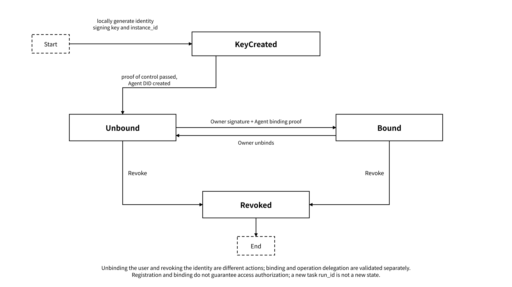
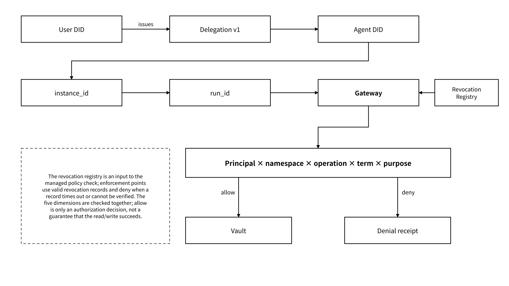

# 5.1 User Identity, Agent Identity and Policy

## 5.1.1 User Identity: Wallet, Account DID and Data Ownership

The user identity represents the data owner, the originator of authorization and the ultimate controlling principal, with the account DID, wallet and Data Wallet providing the entry points for identity and key control. In enterprise scenarios, organizational identity, member identity and administrator policy can take part together, but it must be clear who can authorize on behalf of the organization. Data Wallet generates keys locally for the user and manages content encryption keys separately for different storage systems. The key configuration records the key-holding principal, the protection method, the decryption environment, recovery authorization and validity period: local mode unseals on the Owner's device, and controlled custody mode unseals at a key enforcement point permitted by policy; the enforcement point releases time-limited content keys only to matching principals and controlled environments.

| Capability     | What the user identity is responsible for                                                                                                | What it does not automatically include                                                                                                                     |
| -------------- | ---------------------------------------------------------------------------------------------------------------------------------------- | ---------------------------------------------------------------------------------------------------------------------------------------------------------- |
| Authentication | Proving that the current requester controls the wallet or account credential                                                             | Access rights to arbitrary state                                                                                                                           |
| Ownership      | Associating the state owner or a legitimate managing principal                                                                           | That plaintext is necessarily invisible to the platform                                                                                                    |
| Authorization  | Issuing a limited delegation to a specified Agent                                                                                        | A permanent session or unlimited re-delegation                                                                                                             |
| Revocation     | The policy enforcement point applies the revocation and returns an effectiveness receipt, after which subsequent controlled access stops | Recalling plaintext, old ciphertext and corresponding keys already obtained by recipients, or guaranteeing zero propagation delay across the whole network |
| Key control    | Setting signing, encryption and decryption, replacement or custody policy by key purpose                                                 | Business purpose, training and resharing permission; replacing a data encryption key is not the same as replacing an Agent identity                        |

A login signature and an authorization signature must be kept separate. Login only proves that "the current user controls this account"; a delegation signature must bind the Agent, capabilities, namespace, purpose, term, nonce and network domain, to avoid being replayed onto another authorization.

Identity recovery and data decryption recovery are configured separately. The account recovery flow restores control of the identity; decryption recovery for historical data uses an independent key backup and recovery authorization. Custody, social recovery and enterprise emergency access are controlled through preset recovery principals, signature thresholds, purposes, time locks and audit scope, and after automated validation passes, the corresponding recovery action is executed.

## 5.1.2 Agent Identity: Agent DID, ERC-8004 and the Runtime Principal

The Agent DID identity scheme identifies the executing principal at the granularity of "Agent identity signing key + execution instance". A logical Agent can represent a persistent service or role; `instance_id` identifies its execution instance, and `run_id` identifies one specific task run, and the two must not be equated. Model, framework, name and version are mutable descriptive attributes, and a change of attributes does not by itself create a new DID; regenerating the Agent identity signing key and forming a new instance should create a new Agent DID.

The Agent DID is fixedly bound to the identity signing public key and the execution instance at creation; replacing the identity signing key creates a new `instance_id` and a new Agent DID. Old and new identities are linked through a continuity record: in the normal path, the old and new instances each sign, recording the old and new DIDs, instances, public key references, effective time and reason, and the record is validated automatically by the Owner delegation policy; when the old identity key is unavailable, a pre-configured recovery authorization signs an independent recovery statement and associates the new identity, and the recovery statement does not mean the old identity has signed. Historical credentials and reputation records remain bound to their original DID, queries can show history along the continuity record, and the original records are neither rewritten nor are authorizations copied. The Owner signs a new limited delegation for the new DID, and Gateway grants the corresponding permissions after validating the new delegation.

Task recovery creates a new `run_id` and does not automatically change the Agent DID. A controlled recovery with the original identity signing key and the same `instance_id` keeps the DID; a new concurrent instance uses an independent identity signing key and DID, so that multiple executing principals do not share an instance identity. The Vault content encryption key protects state content, and rotating it does not change the Agent DID and must not be conflated with replacing the identity signing key.

Identity resolution uses versioned identity records. An Agent identity record binds the DID, identity signing public key, `instance_id`, signing algorithm identifier, creation time, service endpoint and revocation reference; the resolver obtains the signed record from the identity registry and provides verification methods after validating the signature, digest, validity period and revocation status. The DID encoding and canonicalization rules are fixed by the identity configuration identifier in the registry, and authentication is rejected when resolution fails or the configuration does not match.

Agent identity management follows these rules:

* User DIDs use the prefix `did:memo:user:`; Agent DIDs use the prefix `did:memo:agent:`;
* The Agent identity signing key is generated locally on the Agent by the designated skill; the platform neither generates nor stores identity private keys;
* Private keys are stored encrypted by default, and without a master key they must not silently degrade to plaintext;
* Creating an Agent DID first verifies the Agent's control signature over a challenge;
* An unbound Agent can only prove control of the key and cannot prove whom it belongs to;
* The user DID and the Agent DID are created independently and are connected through binding or delegation.

_Figure 17: Creation, User Binding and Revocation States of an Agent DID_

<figure><figcaption></figcaption></figure>

The identity lifecycle distinguishes the key-created, unbound, bound and revoked states; a revoked DID stays in a terminal state. Identity rebuilding after an identity key replacement or key loss produces a new instance and a new DID, and a continuity record or an independent recovery statement associates the old and new identities in the identity registry, forming a queryable history; a controlled recovery of the same instance with the original key keeps the original DID. Removing a user binding is not the same as revoking an identity, nor does it replace the independent revocation of existing delegations; binding and operation authorization must be validated separately.

ERC-8004 can serve as an extension for cross-organization discovery, registration, reputation or verification records, but it does not take part in the basic creation, binding and verification logic of the MEMO Agent DID. Three things should be distinguished: the Agent can be discovered; the Agent has been authorized by the user; a given task has passed acceptance.

## 5.1.3 User–Agent Delegation Chain, Least Privilege and Revocation

A delegation connects the user's ultimate control with the Agent's executing identity: the Owner signs the purpose, scope, term and risk constraints before the run, and the policy engine enforces them automatically according to that authorization. The example below defines the MEMO delegation payload, with fields in snake\_case. The signature configuration and interface version are bound by the service registry; the signature covers the complete canonicalized payload other than `signature`, including the network domain, principal, scope, policy reference, term and nonce, and the verifier uses the same configuration to generate the byte sequence and verify the signature:

```json
{
  "delegation_id": "dlg_example",
  "issuer": "did:memo:user:example",
  "subject": "did:memo:agent:example",
  "scope": {
    "namespace": "project/a",
    "operations": ["read", "write"],
    "purpose": "continue_project_work"
  },
  "policy_ref": "policy_project_a_checkpoint_v1",
  "not_before": "2026-10-16T02:00:00Z",
  "expires_at": "2026-10-17T02:00:00Z",
  "allow_redelegation": false,
  "revocation_ref": "revocation://dlg_example",
  "network_domain": "<signature-domain>",
  "nonce": "<unique-nonce>",
  "signature": "<signature>"
}
```

In this example, the policy referenced by `policy_ref` limits `write` to saving Checkpoints for this task and constrains the object type, namespace and task attribution. `create_checkpoint` is a tool name and corresponds to the authorization operation `write`; commonly used authorization operations are `read/write/search/export/import/delete/train/share/execute_external`. The Agent DID, `instance_id`, `run_id` and the policy version actually used should be associated in the request and the receipt. The network domain in the template is injected from the signature-verified environment configuration, the nonce is generated by the issuer, and the signature is generated by the Owner's signer after the payload is canonicalized. Delegation registration is deduplicated by issuer and nonce: an identical payload returns the existing delegation, and reusing a nonce with a different payload is rejected. A valid delegation can be used for multiple requests within its scope and term; each request additionally binds an independent `request_nonce`, a time window, the principal, instance, service audience, network domain, method, target, the business payload digest and the `operation_id`, and replay is prevented through request proof validation. The request signature envelope and the idempotent business fingerprint follow [4.1.2](file:///5907924/04-developer-guide/4-1-quickstart.md#c4-1-2); the delegation registration nonce, the identity control challenge, the request nonce and the external payment authorization nonce are verified separately under their own protocols. Unresolved template parameters or a mismatched signing domain are rejected outright.

Least privilege requires:

* Wildcard namespaces are used only for administrator delegations pre-signed by the Owner, and are constrained by an independent operation allowlist, term and audit policy;
* Read, write, export, training, resharing, deletion and external actions are authorized separately;
* Re-delegation is off by default; when on, chain length, scope and expiry time are limited;
* Every managed request rechecks the delegation and revocation status, and conditions that may change are rechecked before actual delivery or execution;
* Delegation changes retain policy versions, and receipts bind the version actually used;
* Emergency revocation first blocks the related managed access, and data encryption key rotation and derived data handling follow according to policy; identity signing key leakage is handled separately under the identity scheme.

Revocation is applied by the relevant policy enforcement points, which return an effectiveness receipt, and then controlled requests are blocked; the policy service records the effective time, coverage, and cache and propagation delay. When revocation status that meets the time limit and signature requirements cannot be obtained, the affected managed requests and key release are rejected, and a policy status error is recorded. Plaintext, old ciphertext and corresponding keys already obtained are not recalled automatically. Read permission does not include training or resharing permission; later use of existing plaintext is constrained through controlled environments, contracts and auditing, and the purpose field by itself does not constitute a technical restriction on uncontrolled terminals.

_Figure 18: User Delegation, Execution Instance and Least-Privilege Check_

<figure><figcaption></figcaption></figure>
