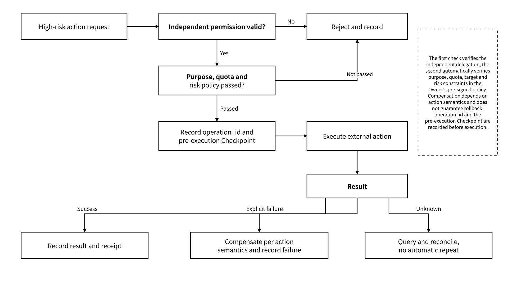

# 5.3 Agent Runtime and Risk

## 5.3.1 Run Traces, Decision Content and Observability

Observability covers requests, authorization, objects, tools, storage, proofs and external actions. Logs fall into three categories:

* **Operational logs**: service health, latency, errors and resource usage
* **Audit logs**: principals, delegations, policy decisions, objects, operations and results
* **Run traces**: model and tool calls, observation results, outputs and external actions

Logs should be correlated using the Agent DID, `instance_id`, `run_id`, `operation_id`, `request_id`, `object_id`, `version`, `receipt_id` and `proof_batch_id`. Among these:

* `request_id` identifies a request attempt.
* `operation_id` identifies the same retryable business operation and corresponds to the idempotency key.
* `receipt_id` identifies a signed receipt.

Sensitive content uses hashes, restricted references or redacted digests. Complete prompts, keys or user privacy data are not copied into ordinary log systems.

The policy `decision=allow/deny` and `business_status=not_executed/succeeded/failed/unknown` are recorded separately. The result of local receipt saving uses `receipt_status=available/pending/failed`, background proofs use `proof_status=not_requested/pending/available/failed`, and payment results are recorded independently with `payment_status=not_required/required/verified/settled/failed/unknown/refund_pending/refunded`.

Asynchronous anchoring on the proof plane does not replace local receipt persistence. When audit storage fails or the result is unknown, the affected `operation_id`, the missing record type and the retry time are written to a recovery queue, which automatically queries, completes the records or reports the failure. Evidence processing does not repeat business actions that have already succeeded.

Key metrics include:

* Authorization denial rate
* Revocation propagation time
* Version conflict rate
* Write persistence failures
* Proof latency
* Storage proof failures
* Unknown external action states
* Export and deletion backlogs

SLO thresholds are loaded from deployment policy. The telemetry service computes observed values over time windows, triggers alerts and recovery actions, and retains the measurement environment, sample window and configuration version.

## 5.3.2 Prompt Injection, Memory Poisoning and Model Drift

Agents introduce additional risks arising from the continuous accumulation of state and automatic execution, such as untrusted content influencing tool behavior or long-term memory. The risks of data loss, key leakage and service availability remain.

The following risks, control mechanisms and automated validation records apply. Threat cases, contract tests and runtime telemetry together check the effectiveness of the controls.

| Risk             | Typical consequence                                             | Control approach                                                                                                            | Evidence                                                                       |
| ---------------- | --------------------------------------------------------------- | --------------------------------------------------------------------------------------------------------------------------- | ------------------------------------------------------------------------------ |
| Prompt injection | Untrusted content changes tool or authorization behavior        | Source grading, separation of content and instructions, a second policy decision before tools                               | Input source, policy version, allow / deny receipts                            |
| Memory poisoning | Wrong inferences enter long-term state and spread repeatedly    | Typing as fact / summary / inference, automatic admission by source and signature, conflict quarantine and version rollback | Parent references, producer, admission policy, admission status, version chain |
| Model drift      | Behavior of the same task changes after a model upgrade         | Pinned versions, a compatibility matrix, benchmark evaluation and staged release                                            | Model version, configuration, evaluation results, rollback point               |
| Tool drift       | Parameters or return schemas change                             | Versioned tool schemas, contract tests and gradual rollout                                                                  | Tool version, schema, calls and errors                                         |
| Derived leakage  | A summary or graph infers facts that were originally unreadable | Permission-aware indexes, rebuilding after revocation, inference leakage tests                                              | Input permissions, derived objects and rebuild records                         |


External content is data, not system instructions, by default. Memory Packs, web pages, files and the output of other Agents cannot raise permissions, change budgets or modify system policy on their own.


## 5.3.3 Keys, Privilege Escalation, External Side Effects and Failure Recovery

Key security baseline:

* Identity private keys never leave the local or controlled signing environment they belong to.
* Identity private keys are stored encrypted by default.
* Without a master key, saving an identity private key degraded to plaintext is refused.
* Installed skills are version-pinned and their signatures or checksums are verified.
* The platform must not receive private keys in logs, telemetry or errors.
* Content encryption keys, identity signing keys and the keys that protect them are managed separately by purpose.
* The key configuration states the key holder, the decryption location, the rotation or replacement method and the recovery authorization.
* Signature, purpose and environment binding are validated at load time.

High-risk actions use independent permissions pre-signed by the Owner together with automated risk policy. These separately limit the purpose, the target domain or contract, the amount, the object scope, the validity period and the idempotency rules.

The following actions proceed to execution only after all corresponding constraints pass:

* Payments, asset transfers and contract transactions
* Sending messages, publishing content and notifying external people
* Modifying production systems or deleting data
* Bulk export, training data export and external sharing
* Creating new credentials, modifying policy or allowing re-delegation

_Figure 20: Authorization, Checkpoint and Result Handling for High-Risk External Actions_

<figure><figcaption></figcaption></figure>

Failure recovery must distinguish failures of the control plane, data plane, local audit storage, proof plane and external systems.

Recovery drills cover at least:

* Gateway unavailable
* Partial failure of the storage backend
* An unknown result of receipt saving
* Proof delay
* Key loss
* Revocation propagation failure
* Duplicate requests
* An unknown result of an external action

Whether an external action can be compensated or rolled back depends on the actual service semantics. Reversibility of failures is not promised by default.

A security incident should record the affected objects, principals, versions, time range, remediation and user notification.
