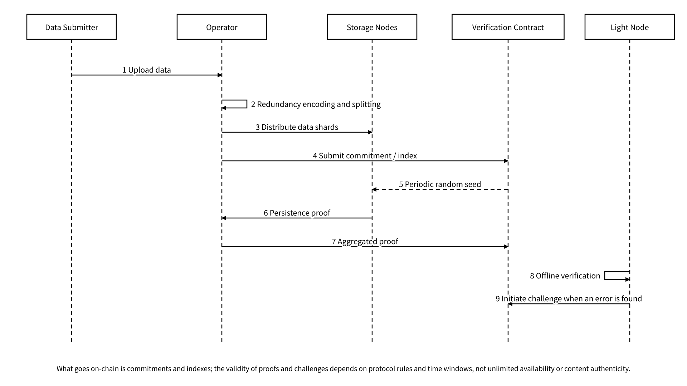
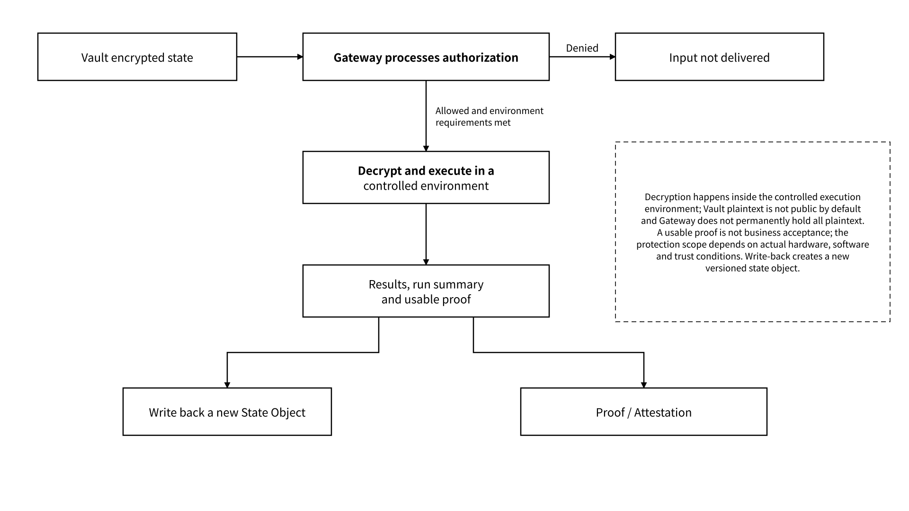

# 6.2 Meeda and Computing Infrastructure

## 6.2.1 Meeda / DA Overview and the Lightnode API

Meeda is MEMO's data availability (DA) layer, used mainly to provide storage proofs for off-chain data. Its main components are the Operator, Storage Nodes, verification contracts and Light Nodes. Its design keeps data off-chain: KZG commitments bind data within an agreed encoding scope, and the commitments and necessary metadata are registered on-chain; data is sharded and stored with erasure coding or multiple replicas, which raises the cost of node misbehavior or dereliction. Registering a commitment does not by itself prove that the data can be downloaded or that its content is authentic.

The storage proof works through the following mechanism:



## Random sampling

The verification contract generates a pseudo-random number at agreed intervals and uses it to select the files or shards to be checked in that period.



## Time-limited proving

Storage Nodes must submit availability proofs for the sampled objects within the agreed deadline; a missed deadline counts as a failed challenge and triggers a penalty.



## Aggregated submission

Proofs of the same period and verification scheme are aggregated by Storage Nodes into a verifiable batch and submitted together with the aggregated commitment and coverage, which lowers on-chain cost.



## Optimistic verification

The contract assumes submitted proofs are valid and runs verification only when they are challenged.



## Adaptive checking

The newer the data, the denser the checking; recent data can be challenged comprehensively, while older data is checked by sampling. The assurance that sampling can provide depends on protocol parameters and fault assumptions.



## Dispute adjudication

Light Nodes can verify availability without downloading all the data and can raise a challenge when they find an anomaly; a dispute is narrowed down step by step through multi-round interactive optimistic verification until the faulty commitment is located. Honest challengers are rewarded and faulty nodes are penalized.



Light Nodes validate challenge eligibility, challenge windows, reward conditions and adjudication rules according to the signature-verified network configuration, and bind challenge records to the protocol version and the corresponding commitment. This verification holds only within the protocol assumptions and time windows and does not imply indefinite availability.

The proof aggregation interface uses a fixed proof structure configuration and submits proofs, the batch commitment and the coverage. The cost model separately meters proof bytes, submission frequency, on-chain verification and challenge fees; the number of shards, the data size and the workload affect the total amount to submit and verify. Message encoding, periods, challenge windows and batch sizes are fixed by protocol configuration, and a node rejects any message that does not match.

_Figure 23: Sequence of Meeda Data Distribution, Aggregated Proof and Challenge_

<figure><figcaption></figcaption></figure>

The Lightnode API uses the service address and authentication configuration provided by the registry and organizes its interface into four kinds of operations: submission, retrieval, verification and challenge query. Requests bind the protocol version, the object or data reference, the commitment and the network domain; responses record data obtainability, the proof verification result, the expiry reason or the error code separately. Size limits, timeouts and retry budgets are loaded from the interface configuration. The Operator, Storage Nodes and Light Nodes use their own role configuration and service accounts, and health checks and capability manifests take part in client routing.

Private agent state is not made public merely because DA technology is used. Only commitments, proofs and minimal indexes suited to public verification go on-chain; content is handled under Vault's encryption and authorization rules. MEMO's own `commitment` objects should state `algorithm`, `scope` and `value`; the native commitment structures of Meeda or contracts follow their respective specifications, and the same name is not to be taken as the same algorithm or commitment scope.

## 6.2.2 FileProof and Contract Integration

FileProof is the contract interface of the Meeda storage proofs, organizing file commitments, metadata, proofs, challenges, staking and settlement. The contract registry binds the chain ID, contract address, proxy and implementation addresses, code identifier, ABI and event patterns; the caller validates the registry signature and the on-chain identifier before executing. Commitments, proofs, credentials, sampling and challenges each express a different fact; having an on-chain record does not mean the data can always be downloaded.

| Concept            | Role                                                                                   | Interface and verification constraints                                                                                                  |
| ------------------ | -------------------------------------------------------------------------------------- | --------------------------------------------------------------------------------------------------------------------------------------- |
| Commitment         | Binds blob / file content within the specified encoding or encrypted envelope scope    | Algorithm, encoding, version, plaintext or ciphertext scope, and the old-to-new mapping during migration conversion                     |
| Proof              | Supports a retention claim within the agreed time window                               | Prover, verifier, period and failure conditions                                                                                         |
| Challenge          | Disputes a proof or availability                                                       | Eligibility to initiate, time limit, cost and adjudication                                                                              |
| Credential         | A record or statement made by an issuer about an upload, verification or service event | Issuing principal, statement scope, revocation and accessibility; signature verification does not automatically prove the event is true |
| FileProof contract | Registration, submission, challenges and settlement                                    | ABI, events, permissions, proxy / implementation addresses                                                                              |

The integration configuration binds the version combination of the DA adapter, the verifier and the FileProof interface, and fixes the data retention period, verification rules and security accounts. When a data read or proof fails, the affected processing that depends on that data stops, and the data is refetched and validated within the timeout budget; beyond the budget it enters configured failure handling, and after recovery continues from the recorded index, avoiding accepting data that lacks availability evidence. Upgrade and shutdown flows first drain in-flight requests and save indexes and proofs, and then switch to a configuration that has passed automated compatibility validation. Contract addresses are resolved from the signed registry, and the chain ID and code identifier are validated before calls.

## 6.2.3 Compute Platform, TEE and Controlled Processing

The Computing Power Platform is an independent compute service that provides document parsing, vectorization, redaction, analysis, replay and training jobs for L6 Controlled Processing of the Agent State Layer. Task scheduling selects an execution environment according to the workload configuration, Gateway validates the purpose and delegation, the key enforcement point releases a time-limited content key after validating environment evidence, the executor produces outputs and a runtime digest, and Proof receives the corresponding statements and verification material. Inputs, models, environments, outputs and evidence are uniformly associated with `run_id`, `operation_id` and state versions.

A TEE can provide isolated execution and remote attestation under specific hardware, software and trust assumptions, but "a node supports a certain TEE" does not mean all CPU / GPU workloads are within the same protection scope. The environment configuration fixes the hardware type, the trusted computing base, the measurement policy, how data enters and leaves, and operating privileges, and lists trust boundaries such as side channels. Controlled processing decrypts within the specified execution environment; the key enforcement point releases time-limited keys only to matching environments and task identities, outputs are filtered by purpose and redaction policy, and session keys and temporary plaintext are destroyed after the task ends. The environment verifier verifies the remote attestation, and the result acceptance service independently checks the business results.

_Figure 24: Authorization, Decryption and Result-Evidence Split in Controlled Computation_

<figure><figcaption></figcaption></figure>

Training use requires independent authorization, a dataset manifest, redaction, frozen evaluation and a model release provenance chain. Historical traces do not automatically become high-quality training data, and a hash-based proof of compute cannot directly represent the performance of an arbitrary model task.
