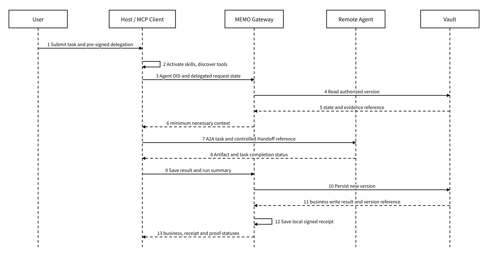
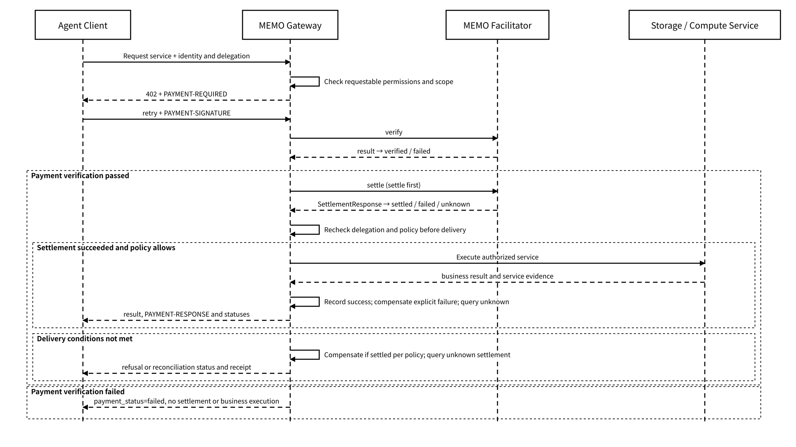

# 7.1 Standards Composition

## 7.1.1 ERC-8004, ERC-7857 and ERC-7829

The three ERCs address different problems; they cannot substitute for one another and cannot be lumped together as "Agent identity standards". The author information of the [ERC-7829 official proposal](https://eips.ethereum.org/EIPS/eip-7829) includes members of MEMO Labs, supporting the description "a data asset standard proposal in which the MEMO ecosystem participates". The proposal extends ERC-721 around data content, storage metadata and permission metadata; MEMO's asset adaptation scheme maps content references, storage terms and read policies along these dimensions.

| Standard | Main object                                                                                   | MEMO adaptation responsibility                                                                                                    | What it should not be mistaken for                                                               |
| -------- | --------------------------------------------------------------------------------------------- | --------------------------------------------------------------------------------------------------------------------------------- | ------------------------------------------------------------------------------------------------ |
| ERC-8004 | Agent registration, discovery, reputation and verification records                            | External discovery of the Agent DID, service endpoints, and reputation and verification extensions                                | A real-time authorization system from users to Agents, or a safety guarantee of Agent capability |
| ERC-7857 | AI Agent NFTs with private metadata, and verifiable transfer, cloning and usage authorization | When the user explicitly chooses assetization, protected delivery of private metadata such as models, memory and role definitions | Minting all Vault state as NFTs by default                                                       |
| ERC-7829 | Data asset NFTs, off-chain data commitments, size, expiry time, uploader and read permissions | Establishing a transferable data asset reference for an independent data object, Memory Pack or Artifact                          | Putting plaintext on-chain, or being able to read ciphertext merely by holding an NFT            |

MEMO's identity relationships consist of the user identity, the Agent DID, the execution instance and the delegation policy. The Agent identity scheme determines the Agent DID by "Agent identity signing key + execution instance": regenerating the Agent identity signing key and forming a new instance creates a new Agent DID; a change of model, framework, name or version does not by itself create a DID. `instance_id` identifies the execution instance, and `run_id` identifies one task run. The identity resolver validates the DID, public key and instance binding against the signature-verified identity configuration; the same DID pins its identity signing public key. Replacing the identity key generates a new instance and DID, and history is linked by a continuity record that is dual-signed by the old and new identities and validated by Owner policy; when the old key is unavailable, a preset recovery authorization is used to sign an independent recovery statement. Historical evidence keeps its original DID attribution, and the new identity obtains permissions through a new delegation signed by the Owner. Rotating the Vault content encryption key is an independent mechanism and does not change the Agent DID.

ERC-8004 registration, reputation and verification records can be used for external discovery and trust assessment; user binding, Agent registration and access delegation must still be handled separately. For requests that pass through the managed entry point, Gateway validates the delegation, resource, action, time and risk limits, and external registration records do not directly grant memory read permission.

ERC-7857 and ERC-7829 are both **selective assetization interfaces**. The asset policy is pre-signed by the Owner and limits objects, rights scope, recipients and actions; after a transfer, license, trade or long-term registration request passes policy validation, the adapter maps the corresponding state digest, ciphertext reference or private metadata to an on-chain asset. Everyday conversations, temporary drafts, keys, complete run traces and privacy-bearing memory are not assetized by default.

The specification references for the three ERCs are [ERC-8004](https://eips.ethereum.org/EIPS/eip-8004), [ERC-7857](https://eips.ethereum.org/EIPS/eip-7857) and [ERC-7829](https://eips.ethereum.org/EIPS/eip-7829). The adaptation configuration records the identifier, content digest, ABI and event mapping of the adopted specification; a configuration update triggers contract tests, permission boundary tests and historical object replay, and takes effect by version routing after they pass.

## 7.1.2 MCP, A2A and Agent Skills

MCP, A2A and Agent Skills respectively address "how to connect capabilities," "how Agents collaborate with each other," and "how a capability is packaged and described," while MEMO designs how the state produced by these calls is controlled, persisted and verified. Gateway enforces authorization, the Host provides a sandbox according to its runtime configuration, and Vault performs persistence; the protocol adapters map requests to these control points, and contract tests validate their call and result mappings.

| Specification | What it covers                                                                           | Connection point with MEMO                                                     | What MEMO remains responsible for                                                                                                            |
| ------------- | ---------------------------------------------------------------------------------------- | ------------------------------------------------------------------------------ | -------------------------------------------------------------------------------------------------------------------------------------------- |
| MCP           | Resource, prompt, tool and extension interaction among Host, Client and Server           | Gateway exposes state tools; the MEFS MCP Server exposes storage tools         | Agent DID, user delegation, state versions, audit receipts, backend persistence                                                              |
| A2A           | Agent Cards, tasks, messages, Artifacts, streaming updates and cross-Agent collaboration | Initiating Handoff, cross-organization task dispatch, Artifact delivery        | Memory Pack content, key wrapping, the recipient's independent authorization, revocation of subsequent controlled access, and storage proofs |
| Agent Skills  | Portable capability packages of `SKILL.md`, scripts, reference materials and assets      | Packaging MEMO's save, restore and verification flows into discoverable skills | Whether a skill is permitted to execute, which state it may operate on, and how evidence is stored after execution                           |

_Figure 26: State-Saving Sequence of MCP, Agent Skills and A2A Collaboration_

<figure><figcaption></figcaption></figure>

Proof aggregation and anchoring complete asynchronously and are not shown separately in this figure; Gateway's local receipt persistence and Vault's object write must still have their results recorded separately.

Adapters pin the protocol version, transport, authentication mode, tool manifest and extensions through compatibility configuration. The MCP adaptation configuration follows the [2026-07-28 specification](https://modelcontextprotocol.io/specification/2026-07-28) and its [change notes](https://modelcontextprotocol.io/specification/2026-07-28/changelog), adopting the stateless request core and treating Tasks as an explicit extension. The legacy initialization handshake, protocol sessions, stream resumption and capability negotiation are isolated by independent version adapters, and behaviors are not mixed by changing a version string. MEMO business state continues to be persisted by Vault, and Gateway resolves the identity, delegation, policy and idempotency association for each request.

Completion of an A2A task is not the same as a successful Vault write. A handoff should check the state write, the receipt persistence and the proof processing result separately; when `business_status=succeeded` and `proof_status=pending`, a write that has already succeeded should not be executed again. Receipt or proof material being obtainable also does not mean its content has passed verification. The A2A adaptation configuration follows the [v1.0.0 specification](https://a2a-protocol.org/v1.0.0/specification/), mapping Task, Message, Artifact and cancellation requests onto the task envelope, definite state versions and receipts; automated tests cover normal completion, cancellation, stream interruption recovery, partial delivery and duplicate requests.

The instructions, scripts and resources in Agent Skills should all be treated as input, not as inherently trusted code. The skill import pipeline automatically records the package hash, source, license, required tools, network requirements and static check results, and validates the package signature and the permitted execution scope. `SKILL.md` is parsed according to the [official format specification](https://agentskills.io/specification), with `allowed-tools` treated as tool requirement metadata, and the permitted set decided by the Host's execution policy. Managed tool calls continue to pass through Gateway, and the Host enforces sandbox, network and file permission control according to the environment configuration; calls from an external Host form managed records only after they are connected to the corresponding control points.

## 7.1.3 x402, Payment and the Boundary of Authorization

x402 uses HTTP `402 Payment Required` to express machine-readable payment requirements and can be used to purchase API, storage, computation or proof services on a per-use basis. Payment checks and resource authorization are performed separately. MEMO Facilitator is responsible for payment verification and settlement, and Gateway is responsible for managed resource authorization. The payment registry binds the scheme, network, asset, payee, Facilitator endpoint, amount unit and version; the adapter automatically validates the registry signature, network domain, quote validity period and payee conditions, and rejects configurations that are unresolved or do not match.

The client call chain is as follows; a single business operation can include multiple HTTP requests:



## Request Gateway

The client requests Gateway; Gateway first checks the permissions the caller can apply for, the resource scope and the risk policy.



## Receive payment requirements

When payment is required, Gateway returns 402 with the price, network, asset, payee and payment scheme.



## Retry Gateway with payment

The client generates a payment payload from the quote and **retries Gateway** carrying `PAYMENT-SIGNATURE`, without requesting state directly from the Facilitator.



## Verify and settle payment

Gateway calls the Facilitator to verify the payment payload and, after verification passes, calls settlement; the Facilitator bears no resource authorization and does not read business state.



## Recheck authorization before delivery

This design settles first and delivers afterwards. After settlement succeeds, Gateway rechecks the delegation, policy and revocation status before execution or delivery, and provides the service only when all pass.



## Save the business receipt

A business receipt is saved, associating the payment, business, delivery, local receipt and Proof statuses separately. A verification failure is not settled; an unknown settlement is queried and reconciled first; when settlement is done but delivery is confirmed impossible, the refund or reversal flow applies, and when the result is unknown the original operation is kept and queried, without repeating the business.



_Figure 27: x402 Payment Verification, Settlement and Pre-Delivery Authorization Recheck_

<figure><figcaption></figcaption></figure>

The [official x402 HTTP 402 documentation](https://docs.x402.org/core-concepts/http-402) confirms that V2 uses three payment communication headers, `PAYMENT-REQUIRED`, `PAYMENT-SIGNATURE` and `PAYMENT-RESPONSE`; the [client/server documentation](https://docs.x402.org/core-concepts/client-server) and the [Facilitator documentation](https://docs.x402.org/core-concepts/facilitator) confirm that the client retries against the resource server, which then verifies payment or calls a Facilitator. External header names and native object names such as `SettlementResponse` keep the specification's spelling and are not changed to MEMO's snake\_case.

This design fixes the order "payment verification → settlement → authorization recheck → execution and delivery". A payment verification failure terminates settlement; when `verified`, the business remains `not_executed`. When the settlement result is unknown, `payment_status=unknown` and `business_status=not_executed` are recorded, and the order is queried and reconciled first. The service is executed only after settlement is `settled` and the authorization recheck passes; if the business result is then unknown, `payment_status=settled` and `business_status=unknown` are kept, and the same `operation_id` is queried, without repeating settlement or refunding on an unknown result.

When authorization becomes invalid after successful settlement, or reconciliation determines that delivery failed, an idempotent refund or reversal task is created under the order compensation policy and enters `refund_pending`. `refunded` is recorded only after a verifiable completion result matching the original operation, amount and recipient is obtained; failure or an unknown result retains the compensation status and the error record and continues to be queried and reconciled. Gateway's payment adapter completes the internal status mapping, and payment communication headers, identity tokens, delegation proofs and idempotency keys are each validated separately.

MEMO associates the same business operation and the `Idempotency-Key` through `operation_id`, and each request attempt uses an independent `request_id`; `receipt_id` and `run_id` identify the receipt and the task run respectively. A retry first queries the execution and payment status of the same operation and completes the idempotent response with the original operation result, and cannot consume a payment authorization that has already been used again. MEMO's internal `payment_status` is unified as `not_required / required / verified / settled / failed / unknown / refund_pending / refunded`; it is an internal mapping of the payment flow, is not a native x402 field, and does not replace `business_status`, `receipt_status` or `proof_status`.
