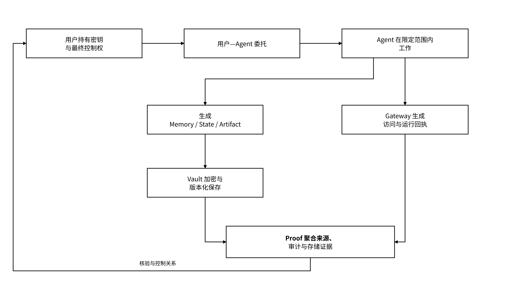

# 1.1 Agent 时代的可信状态层

> **愿景使命：让 AI 助手（Agent）“记得住、接得上、归你管”——它积累的记忆、做到一半的工作和产出的成果，换一个模型也能接着用，而且始终由你自己掌控。**

当工作上下文依赖特定应用的内部格式或会话机制时，更换模型、框架或执行主体可能需要重新整理资料、决策和待办。跨主体协作还需要明确记忆存在哪里、由谁控制，以及哪个 Agent 在什么委托下访问过。MEMO 面向两类需求：**工作状态能够按约定格式接续；状态的归属、授权和访问记录可以被检查。**

MEMO Agent State Layer 独立于具体模型、Agent 框架和应用，保存长期状态、区分用户与 Agent 主体、执行委托与授权、记录来源和运行证据，并在 Owner 签署的委托范围内完成跨模型或跨 Agent 交接。开放对象、可导出状态与明确权限语义构成方案核心；接续流程通过兼容性描述文件匹配客户端、Schema、工具与外部依赖，匹配失败的输入进入隔离或转换流程。

对用户而言，MEMO 需要持续回答四个问题：

1. Agent 记住了什么，这些状态归谁；
2. 哪个 Agent 在什么授权下访问过什么；
3. 记忆、工具结果和成果从哪里产生，是否被修改；
4. 状态是否仍被保存，关键记录是否可由第三方核验。

一句话理解：

> MEMO 让 Agent 状态有归属、有授权、有记录、有证据，并能在用户允许时跨模型接续。

MEMO 不替代模型和 Agent 框架，不负责所有业务编排，也不把全部运行搬到链上。状态原文和高频读写默认留在链下；链上主要承载承诺、审计根、证明结果、必要登记与争议裁决。这是 MEMO 从存储时代延续至今的工程原则：原文不上链，证据可上链。

_图 02｜用户控制下的 Agent 状态与证据闭环_

<figure><figcaption></figcaption></figure>

**基础能力如何承接**：MEFS 承担长期存储、挑战与存储证明，Meeda 承担数据可用性，FileProof 与 Attestation 分别提供证明和声明。Agent State Layer 通过对象标识、版本、委托引用与运行标识连接这些能力。集成流程以可重放的负载、故障注入、恢复校验和策略测试验证各适配器的行为，结果绑定具体配置与验证范围。

**设计原则**：

* 用户掌控：密钥、授权、导出、撤销与删除由用户或合法组织主体控制。
* 双主体分离：用户身份表达控制权；Agent DID 按“身份签名密钥 + 执行实例”方案表达执行主体；`instance_id` 标识执行实例，`run_id` 标识一次任务运行。
* 最小权限：权限精确到主体、命名空间、操作、期限与用途。
* 默认链下：原文不上链，链上只保存必要的验证材料。
* 开放接入：MCP、REST 与 SDK 复用同一对象、授权和回执语义。
* 接口可发现：服务清单声明组件职责、协议版本、Schema、权限操作与部署配置，客户端通过签名、兼容匹配和健康探测自动选择接入路径。

## 1.1.2 从 Data Layer 到 State Layer

Data Layer 的职责覆盖存储、验证、交易和计算，通过用户、提供者、守护者的角色分工、结算流程及 RAFI 风险感知故障识别等机制组织网络服务。Agent 场景进一步要求记录控制主体、生成来源、访问用途、对象版本、到期时间、撤销和迁移条件。State Layer 在这些基础能力上增加持续状态语义，并通过对象契约、版本图、策略执行和自动验证连接各组件。

| Data Layer 处理的问题 | State Layer 处理的状态问题               | 技术映射方式                                         |
| ---------------- | --------------------------------- | ---------------------------------------------- |
| 文件如何持久保存         | Memory、Task State、Artifact 如何持续存在 | MEFS 继续提供存储，Vault 增加对象与版本语义                    |
| 用户和文件如何标识        | 用户、Agent、运行实例如何区分                 | MEMO DID 扩展为用户身份与 Agent DID 双主体                |
| 文件是否完整、是否仍在      | 记忆来源、访问行为和运行结果是否可追溯               | FileProof、Meeda、Attestation 进入 Proof 证据链       |
| 数据应用如何上传和读取      | Agent 如何在委托范围内读写状态                | Storage Middleware、MEFS MCP Server 承接到 Gateway |
| 数据如何授权或交易        | 读取、导出、训练、再共享如何分别授权                | Data Wallet 继续持钥，Data Market 承接选择性交付           |

State 的核心不是“更多文件”，而是可持续复用的工作上下文：

* **Memory**：经筛选、可在后续任务复用的事实、偏好、知识与决策上下文；
* **Task State**：当前阶段、输入引用、依赖版本、待办与恢复条件；
* **Artifact**：文档、代码、报告、数据集等可交付成果；
* **Trace**：模型和工具调用、可观察结果与外部动作形成的运行轨迹；
* **Policy**：谁可以在什么期限和用途下执行哪些操作；
* **Evidence**：来源、回执、对象承诺、审计根和存储证明。

Protocol 作为协议与网络底座，MEFS 作为去中心化存储产品；Agent State Layer 通过统一对象和权限契约组合底层能力。跨框架恢复依赖显式的状态映射与恢复条件，权限一致性由公共策略语义约束，成本和运行质量通过计量记录与配置化阈值管理。
