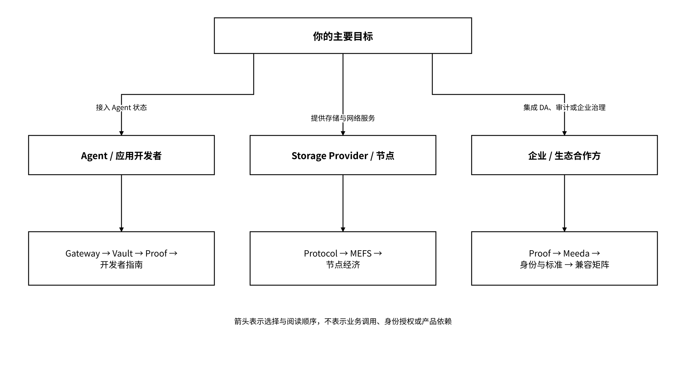

# 1.3 按角色开始

不同的读者带着不同的问题来到这份文档。下面按三类主要角色给出阅读路径，每一条路径都对应一类评估或使用目标。

_图 04｜按角色选择 MEMO 阅读路径_

<figure><figcaption></figcaption></figure>

### 1.3.1 Agent / 应用开发者

推荐路径：MEMO Agent Gateway → 快速开始 → SDK / REST 状态读写 → MCP 和框架适配 → Vault 对象模型 → Proof 回执核验。

开发者接入的自动验证闭环包括：



### 记录身份与运行信息

分别记录用户、Agent DID、`instance_id` 与 `run_id`。



### 创建委托

创建限定命名空间、操作、期限和用途的委托。



### 读写状态对象

写入并读取一个带版本和来源的状态对象。



### 验证拒绝行为

验证授权外请求被拒绝且不触及原文。



### 核对回执与审计引用

导出允许与拒绝回执并核对审计引用。



### 撤销后再次验证

撤销授权后再次访问，自动核验后续受管请求被拒绝。



Local Vault + Gateway 构成上述闭环的本地部署组合。启动器从签名服务清单加载组件版本、Schema 和安装参数，执行依赖、密钥管理、策略一致性与故障恢复检查；检查通过后开放对应接口，失败时返回配置项与错误阶段。MEFS 节点由去中心化存储配置单独接入。

### 1.3.2 Storage Provider / 节点参与者

推荐路径：MEMO Protocol → MEFS 网络角色 → 节点部署 → 存储订单 → 冗余与修复 → 存储证明、挑战与节点经济。

节点通过 MEFS 与 Protocol 参与存储、验证和结算，Vault 将状态密文及保存需求映射为存储订单。Agent 状态负载使用对象大小、版本频率、保留期限、读取量和证明频率描述，批处理与分层保存配置控制小对象和高版本率的开销。节点运行配置绑定网络版本、资源与端口、质押参数、费用、健康检查、升级回退和密钥策略；计量数据进入结算记录及容量规划。

### 1.3.3 企业与生态合作方

推荐路径：MEMO Proof → Meeda / DA → FileProof 与合约 → 身份与委托 → 标准组合 → 兼容性与部署配置。

集成配置覆盖数据可用性、状态驻留、密钥托管、审计要求、证明机制、失败责任、受控处理、外部副作用与结算边界。Meeda 通过 Lightnode API 组织承诺提交、存储性证明和核验，接口版本由兼容性描述文件匹配。企业策略分别定义组织管理员、数据所有者、Agent 和外部合作方的职责，绑定导出、删除、保留期限和事件响应规则。
