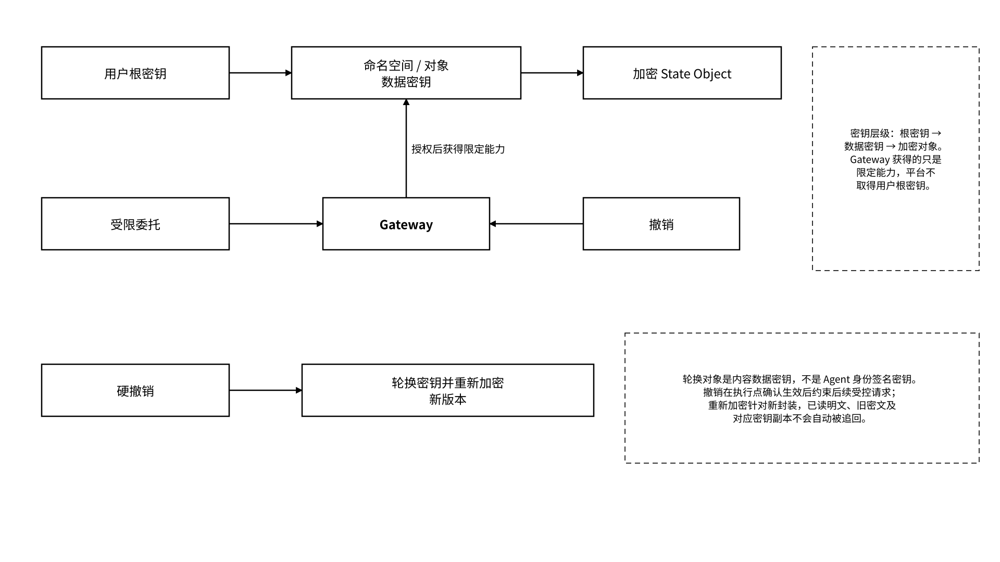

# 2.2 MEMO Vault：面向多后端的状态存储

MEMO Vault 是面向 Agent 的多后端状态对象层，将原始对话、长期记忆、任务状态、成果、轨迹和交接包组织成可标识、可版本化、可加密和可导出的对象。**状态由用户或合法组织主体控制，MEMO 对象使用统一 Schema，Local、Hosted 与 MEFS 通过后端适配器承接同一套对象和授权语义。** 适配器以声明的协议版本、字段映射和一致性校验完成框架与后端互操作。

## 2.2.1 状态对象、命名空间与版本

持久化后的 State Object 使用下列字段。完整示例见[8.1.1](/broken/pages/d95ebae3d66c3827bd692237f673751b09c18921#c8-1-1)；写入命令、客户端加密前载荷和持久化对象是不同表示层，不要求输入命令携带所有服务端生成字段。

| 字段                           | 说明                                                              |
| ---------------------------- | --------------------------------------------------------------- |
| `object_id` / `type`         | 稳定对象标识与类型，如 memory、checkpoint、artifact                          |
| `owner` / `namespace`        | 所有者与技术隔离范围                                                      |
| `schema_version` / `version` | Schema 版本与对象版本；后者由服务端分配，为不透明、唯一且不可变的字符串，如 `v_001`               |
| `parent_refs`                | 直接父版本引用列表，每项绑定 `object_id` 和 `version`；来源和业务依赖另放 `provenance`   |
| `provenance`                 | 来源对象；记录 `source_type`、`source_refs`、生产 Agent/实例/运行、转换、依赖及自动准入状态 |
| `policy_ref`                 | 适用授权策略                                                          |
| `content_ref` / `commitment` | 加密内容引用及承诺对象；承诺显式包含 `algorithm`、`scope`、`value`                  |
| `created_at` / `expires_at`  | 创建与到期信息                                                         |
| `proof_refs`                 | 对象创建时已知的回执、审计根、Attestation 或存储证明引用快照；后续证据通过 Proof Registry 关联   |

这些字段分别表达对象标识、控制主体、版本、来源、策略与证据引用；字段存在本身不证明其内容真实或控制已经有效执行。命名空间负责技术隔离，例如 `personal/preferences`、`project/a`、`team/research`。项目是业务组织方式，命名空间是权限与数据分区，两者不应混用。

对象更新生成新版本，保留直接父版本、修改主体、变更摘要与对象承诺，用于比较、回滚、并发冲突处理和审计。服务端以预期父版本条件控制提交，客户端不能递增或按字面排序版本字符串。回滚通过生成引用指定历史状态的新版本完成，历史版本保持不变。版本关系说明状态演进，存储证明核验约定时间窗口内的保存命题。

`proof_refs` 固定为对象创建时的证据快照。异步产生的回执包含证明、审计根或存储证明写入以 `(object_id, version)` 为索引的 Proof Registry；每条登记绑定证据类型、引用、签发者、适用范围与登记时间。查询端合并展示快照与注册表记录，并分别校验，不为追加证据改写对象历史。

## 2.2.2 用户持钥、加密与密钥轮换

状态原文默认在客户端或由策略指定的受控环境中加密。用户通过钱包、Data Wallet 或企业密钥系统控制数据密钥；Agent 按委托取得限定对象、用途与期限的访问或解密能力。部署配置分别登记根密钥保管主体、对象数据密钥封装、允许解密的进程或环境、运营方管理权限与审计入口。Gateway 在授予解密能力前检查这些配置及对应委托；托管解密环境按其明确的信任边界处理明文。

本节的**数据加密密钥**用于内容保护，与[2.3.1](/broken/pages/14569693adaca0178b80e3e1834db71b7a9d397a#c2-3-1)的 **Agent 身份签名密钥**不同。轮换对象或命名空间数据密钥不改变 Agent DID；身份签名密钥更换创建新的执行实例与 Agent DID，并使用连续性记录连接前后身份。

_图 06｜数据密钥、受限授权与撤销路径_

<figure><figcaption></figcaption></figure>

* **软撤销**：撤销记录带有单调递增的策略修订号和生效时间；执行点同步并持久化该记录后拒绝后续受控请求。受限凭证配置最大有效期和撤销缓存时限；无法取得符合时限的撤销状态时，受管请求按默认拒绝处理。
* **数据密钥撤销/轮换**：更换数据密钥和加密封装，使旧解密能力无法解密新封装；不自动清除旧版本、已读明文或接收方副本。
* **删除**：按策略处理原始对象、副本、缓存、派生物和备份，不与撤销授权混为一谈。
* **已读明文边界**：系统不能承诺收回第三方已经合法读取的明文，高敏感状态应使用最小披露与短期授权。

## 2.2.3 Local / Hosted / MEFS 存储后端

三种后端使用相同状态对象接口，按数据驻留、协作方式和保存周期选择；服务清单登记后端类型、适配器版本、读写能力、持久化条件与迁移规则：

| 后端     | 优势                | 适用场景            | 边界与责任                       |
| ------ | ----------------- | --------------- | --------------------------- |
| Local  | 私密、低延迟、用户直接控制     | 个人设备、开发、高敏感状态   | 可用性、备份和设备安全由用户负责            |
| Hosted | 接入便捷、易运维与协作       | 团队、企业托管服务       | 通过部署配置限定运营方、驻留区域、备份策略与管理员权限 |
| MEFS   | 去中心化长期存储、冗余、修复与证明 | 长期状态、跨域协作、可验证保存 | 解密权仍由密钥和策略决定                |

后端切换保留对象 Schema、身份引用和授权语义。内容定位映射将对象中的稳定 `content_ref` 解析到当前后端地址，物理存放位置变更通过映射登记，不改写既有对象版本。迁移控制器按清单逐项复制并校验对象、直接父版本关系、来源、权限、加密封装与证据关联；目标后端达到声明的持久化条件且清单校验通过后，才原子切换可读位置。原样复制同一密文时比较原密文承诺；重新加密或转换格式时创建新对象版本，记录旧新引用、承诺及转换回执。部分失败保留源后端可读入口和缺失项清单，通过同一迁移操作标识执行幂等续传；成功状态只覆盖已校验并完成切换的范围。
