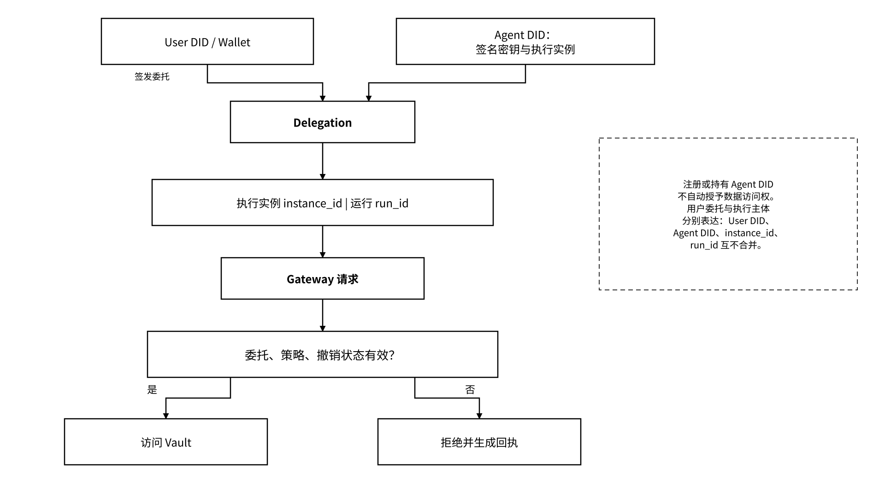

# 2.3 MEMO Agent Gateway：身份、委托与状态访问控制

Gateway 是 Agent 状态访问的统一控制面，组织 DID 认证、签名验证、委托校验、Storage Middleware 和 MCP 接入。MEMO 管理边界内的 MCP、REST 和 SDK 请求调用同一策略引擎，并共享对象范围、用途、期限与撤销语义。已经离开受控环境的明文、副本或独立第三方接口按各自访问边界管理。

## 2.3.1 用户身份、Agent 身份与委托关系

用户身份表达数据与委托的最终控制主体。Agent 作为服务或角色可以持续存在；Agent DID 按“身份签名密钥 + 执行实例”方案标识执行主体。`instance_id` 表达执行实例，`run_id` 表达该实例发起的一次任务运行；一次恢复创建新 `run_id`，不自动要求新 DID。同一 `instance_id` 与原身份签名密钥的受控恢复保持 Agent DID；并发执行实例使用独立 `instance_id`，各自绑定其 Agent DID。登记、用户绑定和访问委托分别管理，登记或绑定本身不授予数据访问权限。

模型、框架、名称和版本是身份描述中的可变属性；重新生成 Agent 身份签名密钥并形成新实例时创建新的 Agent DID。身份签名私钥由 Agent 在本地生成并加密保存，平台只接收公钥、控制权证明和必要登记信息。Agent DID 与实例身份签名公钥固定绑定；更换该签名密钥时同时生成新的 `instance_id` 与 Agent DID。

新旧 DID 通过连续性记录关联。正常接续由旧、新实例分别签名，并经 Owner 委托策略校验；旧身份不可用时，由预设恢复授权签署独立恢复声明，保留恢复依据和验证结果，不代替旧身份作签名。历史凭证继续绑定旧 DID，查询可沿连续性记录追溯；新 DID 的访问权由 Owner 签署的新委托授予，不自动继承旧委托，也不重写历史记录。

_图 07｜用户与 Agent 身份关联的请求授权判断_

<figure><figcaption></figcaption></figure>

委托至少绑定用户、Agent、命名空间、操作、用途、期限、是否允许再委托和撤销地址。Gateway 每次请求都验证当前有效委托，不依赖一次登录后的永久会话。

## 2.3.2 授权策略、撤销与生命周期

最小授权单元是：

```
主体 × 命名空间 × 操作 × 期限 × 用途
```

读取、写入、搜索、导出、导入、训练、共享、删除和外部动作使用独立授权操作。付款只代表结算成功，不代表有权解密或使用状态；普通读取也不包含训练和再共享授权。读取授权不授予训练许可；Gateway 对受控流程执行用途约束。对已在非受控终端取得的明文，还需依赖最小披露、合同和审计等措施管理后续使用。

授权生命周期包括申请、签发、生效、使用、续期、到期、撤销与审计。Owner 预先签署受限委托和用途策略，Gateway 在每次请求中自动校验委托链、签名、范围、有效期、受众与撤销状态。缺少有效身份、委托、用途或策略版本时按默认拒绝处理，不触及状态原文。撤销记录按策略修订号同步，执行点记录接收与生效时间；撤销缓存超出有效时限或断网无法校验时拒绝访问，并持久化最小拒绝回执。存量明文及旧密钥副本保持其独立的信任边界。

## 2.3.3 MCP / REST / SDK 与签名回执

MCP 面向 Agent 工具生态，REST 面向通用应用与服务，SDK 封装签名、重试、Schema 与验证逻辑。三类接口复用同一对象、授权和回执语义。MEFS MCP Server 提供文件上传与检索接口；Gateway 的状态工具负责对象版本、委托、撤销、交接与证据查询。服务清单分别登记工具 Schema、传输方式、受众与授权操作，适配器加载时自动校验版本和字段映射。

状态接口的基础能力集合：

* `list_state` / `get_state` / `search_memory`
* `put_state` / `create_checkpoint`
* `build_context` / `export_memory_pack`
* `get_receipt` / `verify_receipt`
* `request_delegation` / `revoke_delegation`
* `get_proof_reference`

回执字段记录 `receipt_id`、`request_id`、`operation_id`、`user_id`、`agent_did`、`instance_id`、`run_id`、`delegation_id`、可披露的对象范围、操作、用途、策略版本、决定、时间、结果承诺和错误码。`request_id` 对应一次请求尝试，`operation_id` 对应可重试的同一业务操作，`receipt_id` 对应一条回执。

`decision` 的 allow/deny 表示策略决定，`business_status` 表示 not\_executed/succeeded/failed/unknown，不能混称“成功”。响应可分别列 `receipt_status`、`proof_status`，付费调用再列支付状态。允许与拒绝都应留痕，但回执持久化失败必须显式报告并恢复，不得声称故障期间天然完整留证。拒绝回执不得泄露未授权对象的存在或内容。
