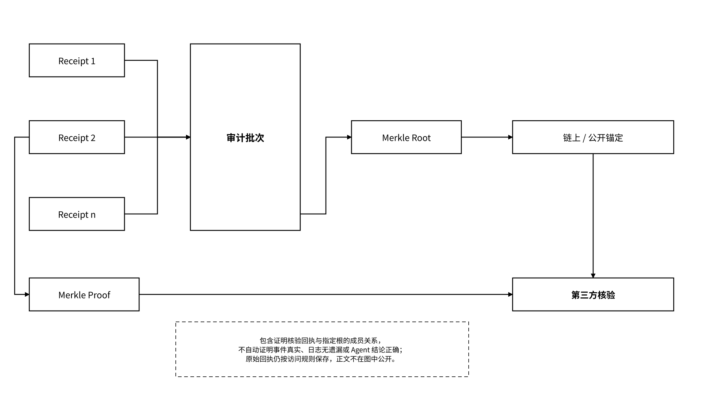

# 2.4 MEMO Proof：从存储证明到 Agent 证据

MEMO Proof 是状态证据的采集、聚合、锚定与验证层，统一组织 FileProof、Meeda、Attestation、访问回执、记忆来源和运行证据。其中，FileProof 与 Meeda 提供特定存储/可用性命题的验证材料，Attestation 记录发行者声明，访问回执记录签发者对请求、策略和结果的陈述。每项证据绑定核验命题、签发者或证明者、验证方法、时间与版本范围及信任条件；签名记录不能自动证明外部事实、业务正确性或日志完整性。

### 2.4.1 访问回执与审计根锚定

Gateway 的回执先按持久化规则写入审计日志，Proof 再对批次计算 Merkle Root，并异步锚定到链上或其他公开验证系统。核验者可以检查回执签名、指定批次的成员关系及与已锚定根的一致性。包含证明不证明所有请求都已记录，也不证明签发者陈述必然真实。日志采用单调序号、前序摘要和批次边界记录检测缺口；受管请求接收账本与业务操作账本按 `request_id`、`operation_id` 自动对账，发现缺口时生成恢复或异常记录。独立副本和周期锚定用于缩小锚定前改写的风险窗口，证据核验仍以签发者身份和记录来源为信任条件。

_图 08｜访问回执、审计根与包含证明核验_

<figure><figcaption></figcaption></figure>

锚定在后台批量进行，与业务持久化及回执写入状态分开；后台锚定异步不等于可以忽略回执本地持久化失败。链上只保留根、时间、版本和必要元数据，不保存访问内容和状态原文。

### 2.4.2 MEFS / Meeda 存储证明与挑战

MEFS 与 Meeda 负责把存储承诺、证明周期、挑战、修复和节点责任连接起来。Meeda 的设计使用聚合证明、Light Node 离线核验和交互式挑战，依赖验证参与者在约定时间窗内发现并提交异常。该机制将部分验证移到链下；实际链上 / 链下成本、挑战成本和安全性需要结合参数与参与条件评估，不能仅凭聚合机制推定成本可忽略。存储证明回答“数据是否在约定条件和时间窗口内被保存”，不回答“内容是否真实”“模型输出是否正确”或“读取者是否获得业务用途授权”。

发生证明失败时，需要区分：

* 数据暂不可达；
* 节点未响应或证明超时；
* 证明格式或验证失败；
* 对象已按策略删除或到期；
* commitment 与请求版本不一致。

不同失败分别进入重试、修复、挑战、赔付、审计或正常生命周期结束流程，不能统一标记为“数据丢失”。

### 2.4.3 Agent 记忆来源、运行证据与 ERC-7829

Memory Provenance 使用结构化 `provenance` 对象，记录 `source_type`、`source_refs`、生产 Agent / 实例 / 运行、模型和工具版本、来源与依赖、变换过程及策略准入状态；直接父版本关系由 `parent_refs` 单独记录。Runtime Evidence 记录可观察输入输出、工具调用、外部动作和结果摘要，但不默认保存模型私密思维过程。

| 证据类型        | 主要记录内容                                                                                                                                                                           | 能够支持的核验                          |
| ----------- | -------------------------------------------------------------------------------------------------------------------------------------------------------------------------------- | -------------------------------- |
| 记忆来源        | `source_type`、`source_refs`、`producer_agent_did`、`producer_instance_id`、`producer_run_id`、`confirmation_status`、`confirmation_method`、`confirmation_policy_ref` 与 `confirmed_by` | 来源与生成声明、依赖及自动准入记录是否符合指定核验规则      |
| 运行回执        | `run_id`、Agent DID、委托、策略、工具与结果摘要                                                                                                                                                 | 签发者声明哪个主体在何种授权下请求或执行了什么，以及其记录的结果 |
| 成果验收        | 输入/输出版本、验收主体、规则、结果与时间                                                                                                                                                            | 某成果是否通过指定验收                      |
| ERC-7829 登记 | 对象 commitment、Reader、expire 等实现字段                                                                                                                                                | 需要确权或交付的状态对象链上表示                 |

ERC-7829 是 MEMO 生态参与的数据资产 NFT 提案，在 ERC-721 之上描述数据承诺、读取权限与到期语义。状态资产适配器将获授权对象的 commitment、Reader 与到期规则映射到对应合约接口，并根据签名注册表校验网络、合约地址、ABI 与接口版本；外部规范映射见[7.3.2](/broken/pages/0ae4c7ee5846434c2deb9f1bcbb132952533774b#c7-3-2)。该路径服务于明确选择确权、交付或交易的对象，原文仍按 Vault 的加密和访问策略管理。
