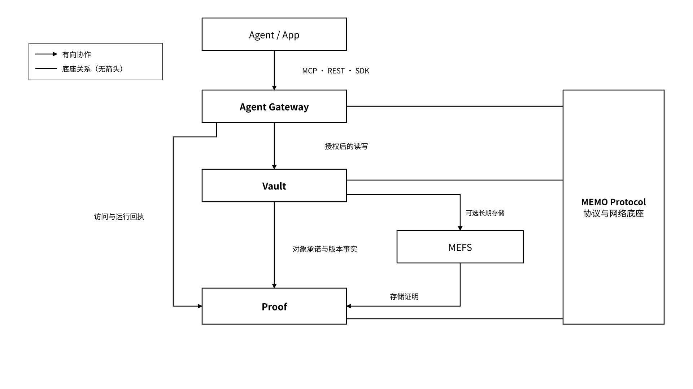

# 2 核心产品

本章回答四个核心问题：底层网络能力由谁提供、状态对象如何保存、Agent 在什么授权下访问、关键事实如何被核验。答案对应一个协议底座与三个 Agent 产品：MEMO Protocol 是共同协议底座；Vault、Agent Gateway 和 Proof 是面向 Agent 场景的三个产品入口。

它们的分工一句话可以记住：**Protocol 提供网络能力，Vault 管状态，Gateway 管权限，Proof 管证据。**


**方案范围**：Protocol 与 MEFS 的网络职责，以及 Vault、Gateway、Proof 的对象、授权和证据接口。组件通过签名服务清单公布接口版本、后端类型、策略入口与验证参数，客户端据此完成配置加载和协议协商；字段、版本和证据语义见[核心技术原则](/broken/pages/baa3d48a6219a50f3bf057b6b893b4cc58fde735)。


_图 05｜Gateway、Vault、Proof 与协议底座的协作_

<figure><figcaption></figcaption></figure>
