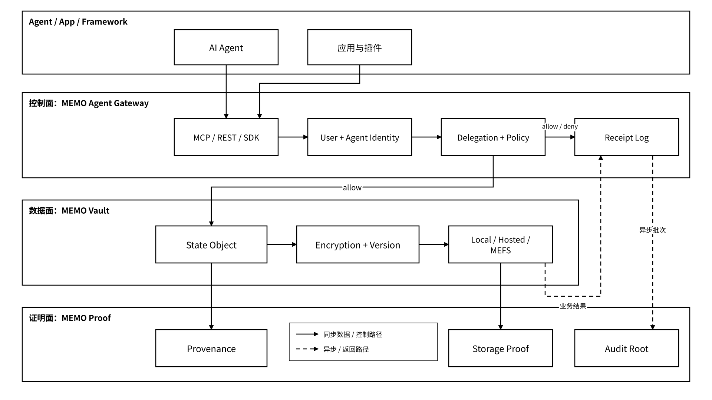
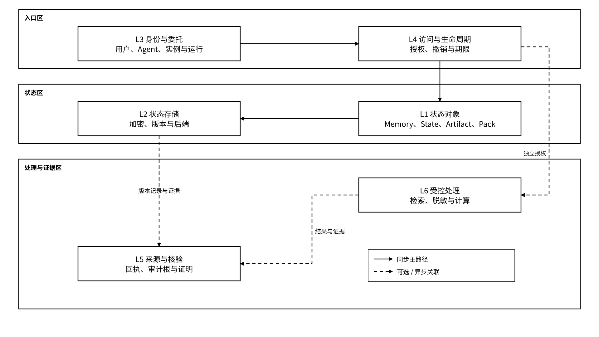

# 3.1 总体架构

## 3.1.1 控制面、数据面与证明面

MEMO Agent State Layer 将判断、保存与证明划为不同职责。适配器使用统一对象、委托和来源接口，替换记忆引擎或存储后端时执行字段映射、权限保留和迁移一致性校验；业务写入与证明处理使用独立状态。Gateway 执行经过受管入口的请求策略；外部副本或绕过该入口的第三方系统保持其独立控制范围。

_图 09｜控制面、数据面与证明面的职责及数据路径_

<figure><figcaption></figcaption></figure>

| 平面  | 主要组件                          | 主要职责                  | 不负责什么                            |
| --- | ----------------------------- | --------------------- | -------------------------------- |
| 控制面 | MEMO Agent Gateway            | 受管请求的身份、委托、授权、撤销与签名回执 | 不以长期保存状态原文为职责；解密进程与明文可见范围由部署策略限定 |
| 数据面 | Vault + Local / Hosted / MEFS | 状态对象、密文、命名空间、版本与存储    | 在授权范围内提供读写，不自行扩大访问权限             |
| 证明面 | MEMO Proof + 验证合约             | 审计根、对象承诺、来源声明与存储证明    | 不证明所有内容和结论正确                     |

受控处理作为侧路存在：检索、摘要、脱敏、轨迹转换、算力平台或 TEE 计算必须先通过控制面授权，再按最小范围访问数据面。处理结果写回状态对象，输入输出摘要、外部动作状态和证据引用进入受限审计记录；不把完整原文默认复制到证明面。

| 部署模式    | 配置与核验的信任条件                                 |
| ------- | ------------------------------------------ |
| Local   | 本地持钥者、解密进程、文件权限、回执签发者与日志保存位置；组件共置不代表独立隔离   |
| Hosted  | 用户或企业密钥系统与服务方的控制范围、解密环境、管理员权限、回执签发和审计访问边界  |
| MEFS 后端 | 上传前的加密位置、内容密钥保管者、受控读取路径，以及存储证明的节点、验证者和时间窗口 |

独立部署以不同服务账户、最小文件与网络权限、独立密钥域和审计访问规则形成更细的隔离边界。受控计算的准入另校验环境身份与证明材料；部署清单记录这些控制点，自动化检查验证配置与运行环境的一致性。三平面图本身只表示职责。

架构自动验证覆盖三类不变量：

* 受管请求先验证身份与授权再访问原文。
* 后端和记忆引擎替换保留指定对象、来源与权限语义。
* 业务写入结果与证据处理结果分别返回。

迁移切换以清单校验和持久化条件为门槛，证明延迟不改变已完成业务的结果。

## 3.1.2 六层 Agent State Layer

六层模型把一次状态请求拆成六类职责，并给出它们与 MEMO Protocol 六层能力域的承接关系。各层通过明确输入输出、策略引用和失败状态协作，适配验证分别检查对象封装、委托传递、后端保存、证据关联与受控处理范围。

| 层级                           | 职责          | 主要对象或机制                                            | 产品承接            |
| ---------------------------- | ----------- | -------------------------------------------------- | --------------- |
| L1 State Object              | 定义保存什么      | Memory、Task State、Artifact、Memory Pack             | Vault           |
| L2 State Storage             | 定义如何保存      | Encryption、Version、Local / Hosted / MEFS           | Vault + MEFS    |
| L3 Identity & Delegation     | 区分谁在行动、代表谁  | User DID、Agent DID、instance\_id、run\_id、Delegation | Gateway         |
| L4 Access & Lifecycle        | 判断能做什么      | Policy、用途、期限、撤销、删除                                 | Gateway + Vault |
| L5 Provenance & Verification | 说明从哪里来、如何核验 | Receipt、Audit Root、Attestation、Storage Proof       | Proof           |
| L6 Controlled Processing     | 在授权后处理状态    | Retrieval、Redaction、TEE、算力平台、Memory Engine         | 可选扩展            |

_图 10｜六层 Agent State Layer 的主路径与可选处理_

<figure><figcaption></figcaption></figure>

六层表示状态请求的职责模型，与 MEMO Protocol 的六层网络能力域保持映射。受管状态读写的同步主路径按 L3 → L4 → L1 → L2 组织；回执本地保存后，L5 的证明聚合与锚定异步处理。L6 只在确有处理需求且获得独立授权时参与，不是所有请求的必经路径。

## 3.1.3 一次 Agent 请求的完整路径

下面给出经过 Gateway 的受管请求路径。允许和拒绝决定均进入最小回执日志，本地持久化与后台批量锚定分别处理。Gateway 为已受理请求登记请求标识，将业务操作账本与回执日志自动对账；发现缺口时恢复可验证记录或保留异常状态。包含证明只核验指定批次的成员关系。本图展示回执本地保存成功的路径，日志写入故障按独立回执状态处理。

_图 11｜受管 Agent 请求、业务结果与异步证明时序_

<figure><figcaption></figcaption></figure>

完整步骤：



## 提交请求

Agent 通过 MCP、REST 或 SDK 提交 Agent DID、`instance_id`、`run_id`、用户委托、目标命名空间、操作与用途；`request_id` 标识请求尝试，`operation_id` 标识可幂等重试的同一业务操作。



## 验证身份与委托

Gateway 验证用户签名、Agent 身份、委托链、有效期和撤销状态。



## 计算策略决定

策略引擎计算有效权限；拒绝请求不进入状态读写，并应保存不泄露对象存在性和内容的拒绝回执。`decision=allow/deny` 只表示策略决定，不表示业务执行成功。



## 定位状态对象

对允许请求，Vault 定位对象、版本和存储后端，只返回授权范围内的密文或必要字段。



## 执行受控处理

如果需要处理，L6 在取得独立许可后执行检索、摘要、脱敏或计算，并披露解密与处理环境。受控环境对明文的可见性不能由“密文存储”推定为零。



## 生成并保存回执

Gateway 应生成并本地保存签名回执，绑定请求与业务操作、主体、策略版本、对象版本、commitment 和执行状态。回执表示签发者作出的事件声明，其可信范围还取决于记录来源与验证机制。



## 异步聚合与锚定证明

Proof 异步聚合回执并按策略锚定审计根；来源声明、存储证明与状态登记按各自机制完成。证明材料可获取，不等于已经验证通过。



响应分别表达 `business_status`（`not_executed/succeeded/failed/unknown`）、`receipt_status`（`available/pending/failed`）和 `proof_status`（`not_requested/pending/available/failed`）。付费请求另列标准化的 `payment_status`。

写入成功而回执仍在恢复队列时，保持 `business_status=succeeded` 并返回 `receipt_status=pending`；恢复失败则标为 `failed`。日志与证明服务通过操作标识恢复证据，不重复已成功业务。业务结果为 `unknown` 时，按 `operation_id` 查询与对账，再按查得结果进入完成、补偿或受控重试路径。

请求不变量：

* 未授权的受管请求不得触及原文。
* 回执声明必须与已知业务结果一致。
* 重复尝试复用对应 `operation_id`，并分别记录 `request_id`。
* 外部动作结果未知时不能无条件重试。
