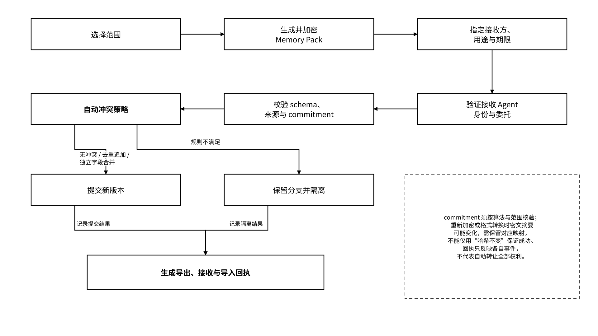

# 3.2 状态模型与生命周期

## 3.2.1 Memory、State Object 与 Artifact

Agent State 是总称，State Object 是 Vault 中的通用载体，Memory、Task State、Checkpoint、Trace 和 Artifact 可由不同类型的 State Object 承载。Memory 是后续任务可复用的信息，Artifact 是文档、代码、报告或数据集等成果。只有用户明确选择确权、授权交付或交易时，Artifact 或 Memory Pack 才进一步建立状态资产表示；可保存、可交付与可交易是不同能力，不表示每份状态都应依次资产化。

| 类型           | 定义                  | 示例            | 写入要求                                                                  |
| ------------ | ------------------- | ------------- | --------------------------------------------------------------------- |
| Memory       | 经准入策略校验后可供后续任务复用的信息 | 偏好、项目事实、决策与理由 | 区分来源事实、摘要、推断与策略准入记录                                                   |
| Task State   | 当前任务可恢复的业务状态        | 阶段、依赖、待办、约束   | 与具体版本和任务标识绑定                                                          |
| State Object | Vault 中的通用载体        | 任意受管状态记录      | 使用统一 schema\_version、owner、namespace、version、policy\_ref 与 commitment |
| Artifact     | 可交付成果               | 文档、代码、报告、数据集  | 保留输入引用、生成主体、版本与验收结果                                                   |

持久化 State Object 的 Schema 使用 `schema_version=memo.state_object/1`，通用字段包括 `object_id`、`type`、`owner`、`namespace`、`version`、`parent_refs`、`provenance`、`policy_ref`、`content_ref`、`commitment`、`created_at`、`expires_at` 和 `proof_refs`。第 4.1.1 节给出完整对象示例；写入命令与客户端加密前载荷分别说明，不把省略服务端生成字段的命令当作完整持久化对象。

| 字段               | 语义与约束                                                                          |
| ---------------- | ------------------------------------------------------------------------------ |
| `object_id`      | 稳定的逻辑对象标识；对象更新保留该标识                                                            |
| `schema_version` | 对象封装格式的版本，与业务对象版本不同                                                            |
| `version`        | 服务端分配的不透明、唯一且不可变的版本标识，如 `v_001`；客户端不得递增或按字面排序                                  |
| `parent_refs`    | 直接父版本的 `object_id` / `version` 引用；初始版本为空数组                                     |
| `provenance`     | 对象形式的来源记录；来源和依赖放在此处，与版本父子关系分开                                                  |
| `content_ref`    | 加密内容引用；由内容定位接口解析，解密位置、封装类型与接收方由密钥策略限定                                          |
| `commitment`     | 包含 `algorithm`、`scope`、`value`；示例为 `sha256` 与 `scope=ciphertext`，只对指定密文封装核验一致性 |
| `proof_refs`     | 创建该对象版本时已知证据的不可变快照；异步证据存入按 `(object_id, version)` 索引的 Proof Registry，查询时合并展示   |

Memory 采用自动准入机制。抽取结果先作为候选记录保存来源，策略引擎依据 Owner 预先签署的用途与范围，依次校验来源签名、输入依赖、字段模式、敏感数据规则、写入权限和冲突策略；通过后生成可检索的规范记忆版本，未通过则拒绝或保留在隔离命名空间，并记录原因。

`confirmation_status=confirmed` 表示通过指定准入策略，`confirmation_method=policy_validation` 表示自动策略校验，`confirmed_by` 记录执行该校验的服务身份，`confirmation_policy_ref` 绑定具体准入规则。该状态不替代事实核验，摘要与推断仍保留各自来源类型。被修正、取代、撤销和删除的记录通过独立生命周期事件表达；检索默认只使用满足有效期、授权和准入条件的版本。

## 3.2.2 Checkpoint、Version 与 Trace

三类记录共同说明如何在约定边界保存工作，并在依赖满足时恢复业务状态：

| 对象         | 解决的问题                | 最低记录要求                                           | 边界            |
| ---------- | -------------------- | ------------------------------------------------ | ------------- |
| Checkpoint | 任务中断后从哪里恢复           | 任务阶段、输入引用、依赖版本、待办与恢复条件                           | 不是任意运行环境的完整镜像 |
| Version    | 状态如何演进、比较和回滚         | 父版本、修改者、时间、变更摘要、对象承诺                             | 版本号不等于存储证明    |
| Trace      | Agent 如何调用模型、工具并产生结果 | Agent DID、instance\_id、run\_id、工具版本、调用、结果摘要、外部动作 | 不等同于模型私密思维链   |

Checkpoint 引用一组确定版本的 State Object；Trace 记录这些版本的生成过程；Proof 按明确命题提供核验材料。恢复范围受 Schema、适配器、可访问依赖与外部动作状态约束。跨模型恢复不承诺相同输出，也不表示任意运行环境都能从同一检查点继续。

并发更新使用乐观锁和预期父版本条件。无冲突时提交新版本；独立字段按类型规则合并；追加型数据按稳定业务键去重追加。无法满足合并规则时保留隔离分支，读取继续使用策略选定的已准入版本，或在不存在合格版本时拒绝读取；写入返回明确冲突状态，不能无声覆盖。合并生成的新版本在 `parent_refs` 中记录全部直接父版本。

版本关系构成可分支的父版本图，版本字符串不承担时间或因果排序。Trace 与 Checkpoint 引用实际使用的对象版本，恢复流程按这些固定引用读取；异步证据追加到 Proof Registry，不改变已持久化的对象和 Checkpoint。

## 3.2.3 Memory Pack、Handoff 与迁移

Memory Pack 是受权导出的状态包，可包含对象清单、必要内容或内容引用、schema、版本、来源、策略与证据指针。它服务于 Handoff 和迁移，不自动携带全部权限或转移所有权。接收方应使用自己的身份和委托访问受管资源；包内的用途和期限说明不自动形成对离线明文副本的强制控制。

_图 12｜Memory Pack 的范围选择、接收验证与冲突处理_

<figure><figcaption></figcaption></figure>

Memory Pack 至少包含：

* manifest、schema 与包版本；
* 对象 ID、类型、命名空间和确定版本；
* 加密内容或受限内容引用；
* provenance、直接父版本引用与候选、准入、隔离等运行状态；
* 委托、用途、期限与不允许的操作；
* commitment、回执、`proof_refs` 快照与 Proof Registry 的受限查询引用；
* 缺失、过期或不兼容字段报告。

导入控制器在接收方委托范围内执行去重追加、独立字段合并或分支隔离，并将成功、拒绝和隔离对象分别写入导入报告。训练、再共享和市场交付通过各自独立的授权操作与用途规则校验。导出作为事件记录，源对象可以继续保持可用；导出结果、授权状态、对象删除状态与数据密钥轮换进度分别表达。

迁移应保留逻辑对象标识、直接父版本图、来源、权限引用和证据关联。若密文原样复制，可按原承诺核验；若重新加密或转换格式，密文 commitment 可能变化，应记录旧新封装、摘要映射、相关版本和转换回执。不得将新密文摘要与旧摘要不同直接归为损坏，也不得把发生变化的对象静默报告为原版本未变。
