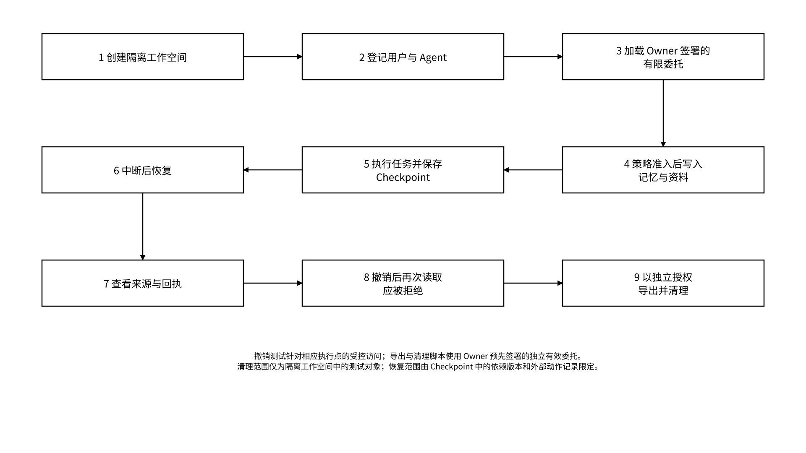

# 4.1 快速开始

## 4.1.1 第一个可持续的 Agent 任务

首个教程采用 Local Vault + Gateway 的本地配置，执行记忆自动准入、检查点保存、任务恢复、来源与回执核验、指定 Agent 委托撤销，以及独立授权下的导出与清理。Owner 预先签署测试范围的委托，任务脚本按用途与操作边界自动运行；本地状态保存和回执验证通过本地后端完成，证明锚定按配置作为异步步骤执行。

_图 13｜第一个可持续 Agent 任务的验证流程_

<figure><figcaption></figcaption></figure>

**前置条件**：

* 独立测试目录，不使用用户已有工作目录作为示例清理目标；
* 一个用户身份和一个 Agent DID，或在开发环境中使用明确标注的测试主体；
* 与签名服务清单匹配的 Local Vault、Gateway 与 SDK 配置；
* 仅限测试数据，不在教程中使用生产主钱包私钥；
* 固定测试命名空间、依赖版本、预算上限、预期输出与限定清理路径。

**客户端加密前载荷示例**：以下项目要求经来源与准入策略校验后，在客户端或策略指定的受控环境中加密，生成内容引用与密文承诺。载荷与对象封装分层处理，普通运行日志只记录受限摘要和对象引用。

```json
{
  "kind": "project_requirement",
  "text": "项目交付必须包含来源和验收记录"
}
```

**持久化后的 State Object 示例**：

```json
{
  "schema_version": "memo.state_object/1",
  "object_id": "mem_project_a_001",
  "type": "memory",
  "owner": "did:memo:user:example",
  "namespace": "project/a",
  "version": "v_001",
  "parent_refs": [],
  "provenance": {
    "source_type": "user_input",
    "source_refs": ["source://project/a/brief"],
    "producer_agent_did": "did:memo:agent:example",
    "producer_instance_id": "instance_example",
    "producer_run_id": "run_20261016_001",
    "confirmation_status": "confirmed",
    "confirmation_method": "policy_validation",
    "confirmed_by": "did:memo:service:policy-engine",
    "confirmation_policy_ref": "policy_project_a_memory_admission_v1"
  },
  "policy_ref": "policy_project_a_v1",
  "content_ref": "encrypted://content/mem_project_a_001/v_001",
  "commitment": {
    "algorithm": "sha256",
    "scope": "ciphertext",
    "value": "<digest>"
  },
  "created_at": "2026-10-16T02:00:00Z",
  "expires_at": null,
  "proof_refs": []
}
```

`version` 是服务端分配的不透明、唯一且不可变的版本标识，`v_001` 表示其字符串形式；`schema_version` 表示封装格式。`parent_refs` 只记录直接父版本，来源与依赖放在 `provenance` 中。准入字段由策略引擎生成并绑定准入策略，客户端提交的来源声明按签名与依赖规则校验，不能自行提升准入状态。

`commitment.scope=ciphertext` 表示摘要针对指定密文封装，重新加密或转换格式时创建新版本并记录旧新承诺映射。引用参数来自环境配置或持久化结果，`<digest>` 由客户端按指定算法对加密封装计算后注入。`proof_refs` 保留创建时证据快照，异步证据按 `(object_id, version)` 写入 Proof Registry，读取时合并展示而不修改该版本。

**自动验证规则**：依赖对象版本和恢复条件满足时，脚本从 Checkpoint 恢复业务状态；另一未授权 Agent 的受管读取返回拒绝；独立导出委托只导出允许范围内的对象和允许、拒绝回执；撤销记录在指定执行点持久化后，后续受控请求返回拒绝。Memory Pack 的清单校验排除未选择命名空间、用户根密钥和 Agent 身份私钥；接收方内容密钥封装绑定接收方、用途和期限，并在导入时自动核验。

## 4.1.2 使用 SDK / REST 读写状态

三种接入方式复用同一语义：SDK 封装签名和 Schema；REST 承接服务集成；MCP 承接 Agent 工具调用。受管请求携带主体、实例、运行、委托、目标、操作、用途和请求标识；写入请求同时绑定幂等信息与预期版本。入口适配器把请求规范化后送入同一策略引擎，兼容验证对相同请求断言一致的授权决定、对象版本与业务状态。

**写入接口契约**：此例更新稳定对象 `chk_project_a_001`，以 `v_003` 作为预期父版本。请求携带业务载荷和授权上下文，服务端生成版本、时间与准入结果，持久化对象遵循第 4.1.1 节的封装。客户端使用注册表中的 Gateway 基地址拼接以下相对路径，并校验凭证受众与服务身份。

```http
POST /v1/state/objects
Authorization: Bearer <limited-token>
Memo-Request-Proof: <signed-request-proof>
Idempotency-Key: op_checkpoint_save_001
Content-Type: application/json
```

```json
{
  "request_id": "req_example_001",
  "operation_id": "op_checkpoint_save_001",
  "agent_did": "did:memo:agent:example",
  "instance_id": "instance_example",
  "run_id": "run_20261016_001",
  "delegation_id": "dlg_example",
  "namespace": "project/a",
  "operation": "write",
  "purpose": "continue_project_work",
  "expected_parent_version": "v_003",
  "object": {
    "schema_version": "memo.state_object/1",
    "object_id": "chk_project_a_001",
    "type": "checkpoint",
    "owner": "did:memo:user:example",
    "namespace": "project/a",
    "parent_refs": [
      { "object_id": "chk_project_a_001", "version": "v_003" }
    ],
    "provenance": {
      "source_type": "tool_result",
      "source_refs": ["state://task_project_a_001/v_002"],
      "producer_agent_did": "did:memo:agent:example",
      "producer_instance_id": "instance_example",
      "producer_run_id": "run_20261016_001",
      "confirmation_status": "candidate"
    },
    "policy_ref": "policy_project_a_checkpoint_v1",
    "content_ref": "encrypted://content/checkpoint_payload_001",
    "commitment": {
      "algorithm": "sha256",
      "scope": "ciphertext",
      "value": "<digest>"
    },
    "expires_at": null
  }
}
```

**响应示例**：下例表示业务写入成功、回执材料可获取、后台证明处于处理队列。回执或证明的 `available` 只表示材料可获取，客户端仍需按类型验签或验证。

```json
{
  "request_id": "req_example_001",
  "operation_id": "op_checkpoint_save_001",
  "decision": "allow",
  "business_status": "succeeded",
  "object_id": "chk_project_a_001",
  "version": "v_004",
  "commitment": {
    "algorithm": "sha256",
    "scope": "ciphertext",
    "value": "<digest>"
  },
  "receipt_id": "rcpt_example",
  "receipt_status": "available",
  "proof_status": "pending"
}
```

`proof_status=pending` 表示证明处于排队、生成或锚定流程，不能单独证明业务已经成功；本例的写入成功由 `business_status=succeeded` 表达。客户端应分别处理业务、回执和证明状态，不因后台锚定或存储证明延迟重做已成功写入。`decision=allow` 只表示策略允许，即使存储或外部服务执行失败，它也可能仍为 `allow`。

| 字段                       | 含义与约束                                                                                                                   |
| ------------------------ | ----------------------------------------------------------------------------------------------------------------------- |
| `request_id`             | 一次请求尝试的标识；重试形成新的请求尝试记录                                                                                                  |
| `operation_id`           | 同一可重试业务操作的标识；对应 `Idempotency-Key`，同一操作重试时保留                                                                             |
| `instance_id` / `run_id` | 执行实例 / 一次任务运行；不得互相替代                                                                                                    |
| `receipt_id`             | 签名回执标识，不等同于请求、业务操作或任务标识                                                                                                 |
| `business_status`        | `not_executed`、`succeeded`、`failed`、`unknown`；结果未知时先查询和对账                                                               |
| `receipt_status`         | `available`、`pending`、`failed`；只有材料确实可取时才声明可获取                                                                          |
| `proof_status`           | `not_requested`、`pending`、`available`、`failed`；材料可取不等于验证通过                                                              |
| `payment_status`         | MEMO 结算状态映射：`not_required`、`required`、`verified`、`settled`、`failed`、`unknown`、`refund_pending`、`refunded`；独立于业务、回执和证明状态 |

同一 `operation_id` 不能被复用于内容不同的新操作。`v_004` 只是本例服务端返回的不透明版本字符串，不表示客户端可由 `v_003` 推算下一版本。

本接口通过 `Memo-Request-Proof` 头承载由 SDK 生成的请求签名封装；签名格式、密钥标识和规范化规则由请求证明配置固定。封装绑定主体、实例、服务受众、网络域、方法与目标、规范化业务载荷摘要、`operation_id`、请求时间窗及独立的 `request_nonce`。Gateway 使用 Agent DID 绑定的签名公钥校验封装、时间窗与 nonce 唯一性。委托中的 `nonce` 只用于签发登记去重，有效委托可在范围与期限内多次使用；`request_id` 用于关联日志，与请求证明分别校验。

合法重试生成新的 `request_id`、请求时间和 `request_nonce`，保留 `operation_id` 与 `Idempotency-Key`。业务账本按 Owner、命名空间和业务操作域原子登记幂等键、稳定业务指纹和执行状态；指纹覆盖目标、动作、用途、版本前提、载荷承诺及计费意图，排除逐请求标识、请求时间、签名和令牌。同键同指纹复用既有执行状态，同键不同指纹返回冲突；并发请求使用原子占位防止重复执行。返回既有结果或查询操作状态时，仍重新校验当次委托、用途和撤销状态。

**客户端要求**：

* 为可重复写入提供 `operation_id` 对应的幂等键，并区分每次 `request_id`；
* 使用 `expected_parent_version` 或 ETag 避免静默覆盖；
* 验证回执或响应的实际签名、Schema 版本以及指定算法和范围下的 commitment；
* 仅重试明确标记为可重试的错误；
* 不在日志中输出 token、私钥、明文状态或完整授权凭证。

## 4.1.3 错误处理、示例与验收

错误接口按业务、回执、证明和结算分别返回状态与稳定错误码。客户端区分“请求未执行”“执行失败”“执行结果未知”和“业务成功、证据处理中”，按下表选择查询、拒绝、退避或补偿路径，避免重复操作和重复扣款。

| 类别   | 示例错误                                      | 客户端动作                                           |
| ---- | ----------------------------------------- | ----------------------------------------------- |
| 认证   | `IDENTITY_INVALID`、`SIGNATURE_EXPIRED`    | 重新认证，不自动扩大权限                                    |
| 委托   | `DELEGATION_MISSING`、`DELEGATION_REVOKED` | 停止本次操作；仅在取得 Owner 签署的独立有效委托后提交新请求               |
| 策略   | `PURPOSE_NOT_ALLOWED`、`OPERATION_DENIED`  | 不重试；展示最小拒绝原因                                    |
| 对象   | `OBJECT_NOT_FOUND`、`VERSION_CONFLICT`     | 检查可见范围；按规则去重追加、字段合并或保留隔离分支                      |
| 存储   | `BACKEND_UNAVAILABLE`、`WRITE_NOT_DURABLE` | 先查询 operation\_id 对应业务状态，再按幂等规则退避；满足持久化条件后才报告成功 |
| 回执   | 本地回执恢复中或保存失败                              | 按 receipt\_status 查询或恢复记录；不得因此重复已成功业务           |
| 证明   | `PROOF_PENDING`、`ANCHOR_DELAYED`          | 异步轮询或订阅，不回滚已成功业务                                |
| 外部动作 | `SIDE_EFFECT_UNKNOWN`                     | 先对账，不盲目重试                                       |

自动化验证配置包含组件版本、环境、输入样本、预期输出、允许与拒绝路径、重试规则、费用上限、清理范围和断言。验证器以隔离命名空间执行请求，按结果检查版本、权限、幂等与恢复语义；清理作业仅处理该次验证创建的对象和受限凭证。
