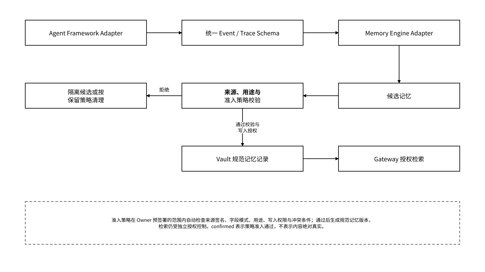
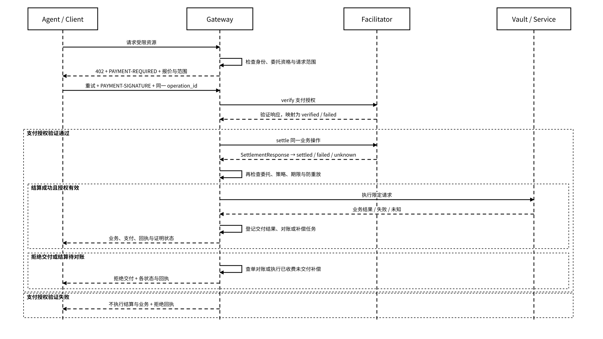

# 4.2 集成与适配

## 4.2.1 MCP 与 MEFS MCP Server

MEFS MCP Server 是文件上传、按内容标识检索与获取的接入层；Agent Gateway MCP 是状态对象、授权、撤销、交接、回执与 Proof 查询的接入层。两者使用独立服务身份和工具清单。客户端从服务清单加载协议版本、传输配置、工具输入输出 Schema、凭证受众和授权操作映射，工具调用经统一策略上下文校验后进入相应后端。

| 工具类别 | 工具接口                                                              | 输入输出与策略职责                                                            |
| ---- | ----------------------------------------------------------------- | -------------------------------------------------------------------- |
| 文件存储 | upload、retrieve、按 CID 获取                                          | 接收加密内容或受限内容引用，返回内容标识、承诺与保存状态；校验对象范围和读写授权                             |
| 状态读取 | list\_state / search\_memory / get\_state                         | 输入命名空间、对象版本或查询范围，返回授权且满足准入策略的记录；执行 read / search 规则                  |
| 状态写入 | put\_state / create\_checkpoint                                   | 按类型写入 memory、checkpoint、artifact，绑定预期父版本与 operation\_id；返回业务、回执与证明状态 |
| 交接   | build\_memory\_pack / export\_memory\_pack / import\_memory\_pack | 生成或校验 manifest，限定接收方、用途与期限；按 export / import 授权执行迁移和冲突处理             |
| 权限   | inspect\_delegation / request\_delegation / revoke\_delegation    | 查询允许披露的委托，校验匹配 Owner 签署的授权，按授权主体权限登记撤销事件                             |
| 证据   | get\_receipt / verify\_receipt / get\_proof\_reference            | 查询受限回执与 Proof Registry，返回证据类型、命题、引用、签发者与独立验证结果                       |

工具名与授权操作分开：授权操作使用 `read/write/search/export/import/delete/train/share/execute_external`。例如 `create_checkpoint` 工具对应 `write` 操作，仍需核验目标命名空间、对象范围和用途；工具存在不表示调用者自动取得该操作权限。

远程 MCP 采用短期受限凭证和受众校验，本地 stdio 由隔离进程和目录白名单限制访问。主钱包身份签名与 Agent 执行凭证分别保管。传输适配器按服务清单选择 stdio、Streamable HTTP 或明确声明的 SSE 兼容配置；加载时校验协议版本、传输与认证组合。`request_delegation` 只匹配或提交 Owner 已签署的授权材料，不能自行扩展权限；缺少有效授权时返回拒绝。

MCP 工具返回结构化结果，不把授权策略藏在自然语言描述中。越权、过期凭证和用途不匹配必须进入负向测试。

## 4.2.2 Agent 框架与记忆引擎适配

框架适配器把宿主的会话、工具调用和生命周期事件映射到统一接口，公共签名、授权上下文与重试逻辑由 SDK 承接。记忆引擎负责候选记忆抽取、整理或检索，Vault 负责规范记录、来源、版本、权限和删除语义。向量库、知识图谱或摘要模型通过适配器交换对象引用和派生索引；切换时自动校验来源、权限、删除传播和导出清单，校验失败则保留当前索引并隔离该适配配置。

_图 14｜框架事件到候选记忆与授权检索的适配路径_

<figure><figcaption></figcaption></figure>

适配器最低要求：

* 保留会话、消息角色、时间和分支；
* 工具调用与观察结果通过稳定 ID 关联；
* 附件缺失或过期时显式报告；
* 保留来源平台和导入批次，不把规范化记录冒充原始证据；
* 支持删除、撤销与重新构建派生索引；
* 未经训练授权，不将普通读取内容导出为训练数据。

记忆引擎替换测试至少比较时态、来源、权限、删除、冲突和导出字段。检索质量可以不同，但不能因为换引擎丢失权限与 provenance。

## 4.2.3 x402 / MEMO Facilitator 结算接入

x402 / MEMO Facilitator 承接付费读取、存储、流量、任务或状态资产交付的支付授权验证与结算。Gateway 完成资格预检后返回 HTTP 402 与 `PAYMENT-REQUIRED`；客户端在预设预算和用途范围内生成支付授权，通过 `PAYMENT-SIGNATURE` 重试 Gateway。Gateway 调用 Facilitator 执行 verify，通过后执行 settle，再校验委托和交付条件。一次业务操作跨多次 HTTP 请求保持同一 `operation_id`；支付、身份、解密能力和业务用途授权分别校验，Facilitator 不访问状态明文，也不替代资源授权。

本方案采用“验证支付授权 → 结算 → 再鉴权 → 交付”的顺序。签名报价绑定资源范围、网络、资产、金额、有效期和业务操作；交付失败、授权变化或结算结果未知分别进入补偿或对账路径。

_图 15｜x402 结算接入与资源交付条件时序_

<figure><figcaption></figcaption></figure>

结算适配配置绑定报价有效期、网络与资产、预算上限、收款方、支付授权防重放规则、幂等映射和补偿责任。每次支付尝试记录 `request_id`，业务账本以 `operation_id` 关联报价、授权、结算、交付和退款记录。同一业务操作重试查询既有结算结果，不再次消费已使用的支付授权。

MEMO 内部 `payment_status` 使用 `not_required / required / verified / settled / failed / unknown / refund_pending / refunded`，Gateway 的支付适配器将外部响应映射为这些状态。`verified` 仅表示支付授权通过，业务保持 `not_executed`；结算结果未知时记录 `payment_status=unknown`、`business_status=not_executed`，先查单与对账。只有结算为 `settled` 且当次授权复查通过后才执行请求。

结算已成功而业务结果未知时保持 `payment_status=settled`、`business_status=unknown`，查询原业务操作，不重复结算或立即按失败退款。已结算但授权失效，或对账确定交付失败时，补偿器创建幂等退款或冲正任务并记录 `refund_pending`；取得与原操作、金额和接收方匹配的可核验完成结果后才记录 `refunded`，失败或未知继续按补偿策略查询。策略决定、业务结果、回执和证明状态分别保存。网络选择、gas 代付、托管和跨链由独立适配配置决定，Gateway 在接受报价前自动核验对应端点、链 ID、资产与责任参数。
