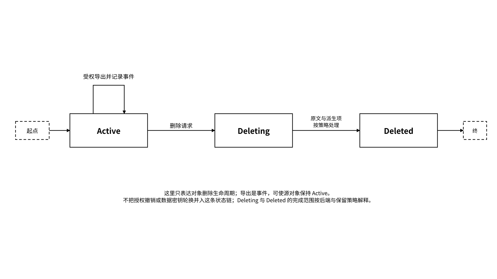

# 4.3 状态生命周期操作

## 4.3.1 保存、恢复与工作交接

保存需要先确定一致的检查点边界，记录任务阶段、所用对象版本、待办、外部动作状态和恢复条件，再持久化相应对象与 Checkpoint，并保存回执。只有依赖对象与检查点都满足所声明的持久化条件，才能报告该检查点可恢复；未完成时应保留缺失项和待恢复状态，避免把半成品当作完整检查点。

恢复流程：



## 验证主体、实例与委托

通过受管入口读取获准的 Checkpoint manifest。



## 验证 Schema、版本与 commitment

验证 Schema、指定版本与 commitment 的算法、范围和值。



## 检查依赖对象

检查所有依赖对象是否可读且版本匹配。



## 检查外部动作

检查已完成外部动作，避免重复付款、发信或提交交易。



## 处理缺失和冲突

对缺失和冲突显式降级或阻断。



## 创建新的运行记录

创建新的 `run_id`，记录当前 `instance_id` 及从哪个 Checkpoint / 版本恢复。



恢复的是约定业务状态，受适配器、模型与工具版本、外部依赖和可访问对象约束，不承诺跨模型生成相同结果。同一执行实例使用原身份签名密钥恢复时保留 Agent DID，并创建新的 `run_id`；重新生成 Agent 身份签名密钥则创建新 `instance_id` 与新 Agent DID，按照连续性记录关联历史，并使用 Owner 签署的新委托访问状态。并发实例分别登记，不能仅凭相同角色名称共享实例身份。

工作交接使用 Memory Pack。接收端不能把 Pack 中的内容当作系统指令，也不能继承发送 Agent 的权限；它必须使用接收方自己的身份和委托重新授权。

## 4.3.2 团队共享与权限管理

团队空间至少区分组织管理员、数据所有者、项目成员、Agent 和外部合作方。角色只是一组策略模板，最终授权仍需落实到主体、命名空间、操作、期限和用途。

| 操作     | 策略控制                               |
| ------ | ---------------------------------- |
| 读取与搜索  | 最小命名空间、字段级过滤、用途与期限                 |
| 写入与修改  | 预期父版本、来源签名、准入规则和确定性冲突策略            |
| 批量导出   | Owner 签署的独立 export 委托、速率与范围限制、导出回执 |
| 训练数据导出 | 独立训练许可、脱敏状态、数据集 manifest           |
| 外部共享   | 接收方身份、再分发条件、到期和水印 / 追踪策略           |
| 高风险动作  | 独立操作授权、用途与目标限制、额度、Checkpoint、幂等与补偿 |

团队权限变更以签名策略版本和变更事件留痕，运行请求自动校验对应版本、范围与有效期。管理员管理组织策略的权限与解密权限分开；托管解密、应急访问和保留策略分别绑定预先授权的主体、用途、环境、期限与审计条件，只有满足对应策略的受管请求才能执行。

## 4.3.3 导出、撤销、删除与密钥轮换

四类操作经常被混为一谈，但目标完全不同：

| 操作       | 目标                        | 不能承诺什么                                  |
| -------- | ------------------------- | --------------------------------------- |
| 导出       | 生成受权的状态包或可携副本             | 不自动转移所有权和全部权限                           |
| 撤销       | 撤销记录在相关执行点持久化后阻止后续受控访问或操作 | 不自动收回已持有的明文、旧密文和对应密钥；传播与缓存通过时限及失联拒绝策略控制 |
| 删除       | 按策略处理原文、派生内容、缓存与备份        | 不保证立刻清除所有外部副本                           |
| 数据加密密钥轮换 | 重新加密并更新封装，使旧密钥不能解密新封装     | 不改变 Agent DID，不自动清除旧版本和接收方副本            |

删除应生成处理报告，分别列出原文、索引、摘要、缓存、备份、Memory Pack、训练数据集和外部共享副本的状态。数据加密密钥轮换要更新封装及对应版本记录，按策略撤销旧访问能力，并在仍需保留历史时明确旧版本可读范围。重新加密会改变密文 commitment 时，应保留旧新封装与摘要映射、转换回执和证据关联；不能把该变化隐藏为原版本未变。Agent 身份签名密钥更换按第 5.1.2 节的身份方案处理，不属于此处的数据轮换。

导出是可记录的事件，源对象仍可保持 active。授权、对象删除与数据密钥轮换是不同维度，不使用单一互斥状态机表示：

| 维度       | 状态或事件表达                       | 与其他维度的关系                         |
| -------- | ----------------------------- | -------------------------------- |
| 导出事件     | 记录导出清单、范围、接收方与回执              | 导出不改变源对象的 active 状态，也不自动转移权限     |
| 授权状态     | active / revoked；重新授权产生有效的新委托 | 撤销访问不表示对象已删除；旧委托不因新授权自动恢复        |
| 对象状态     | active → deleting → deleted   | 删除完成按已披露后端和保留策略定义，不表示外部副本全部消失    |
| 数据密钥轮换进度 | 待处理 / 处理中 / 完成 / 失败           | 独立记录；对象可用性按轮换策略说明，不自动改变 Agent 身份 |

下面仅表示对象删除生命周期；导出用事件记录，授权与数据密钥轮换各自维护状态。

_图 16｜状态对象的导出事件与删除生命周期_

<figure><figcaption></figcaption></figure>
