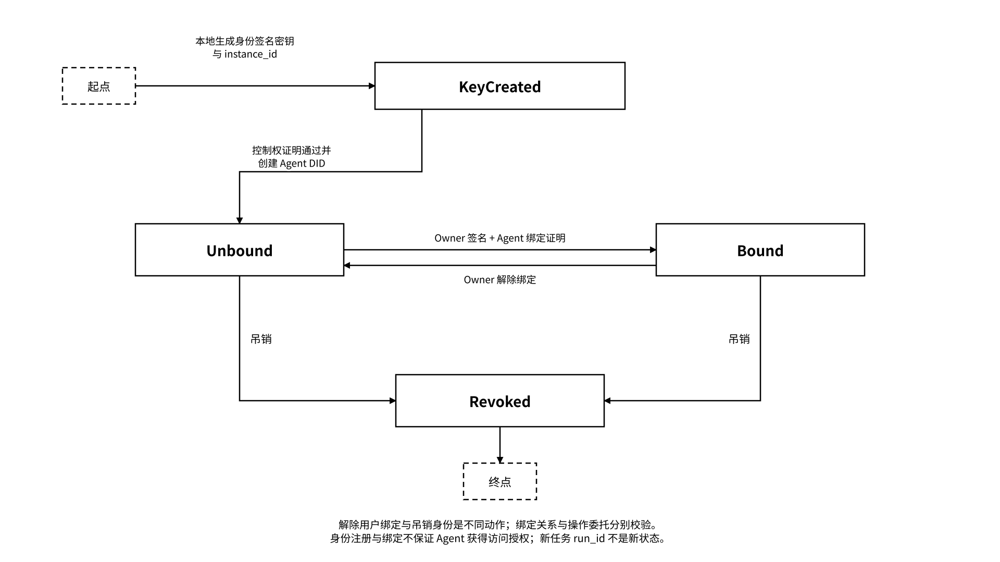
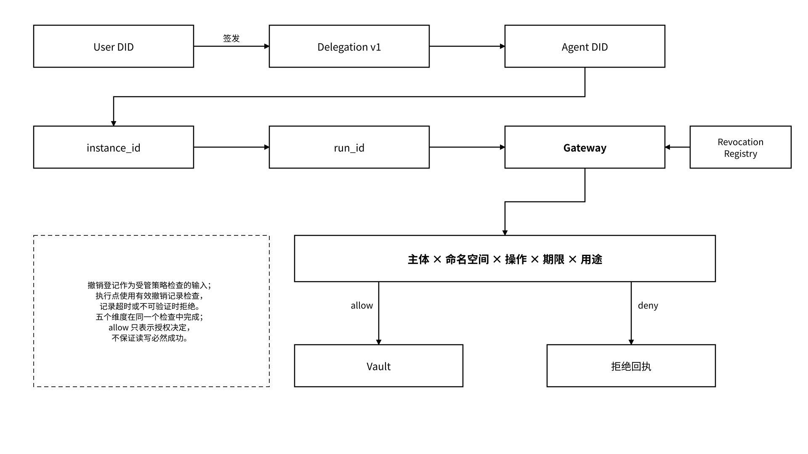

# 5.1 用户身份、Agent 身份与策略

## 5.1.1 用户身份：钱包、账户 DID 与数据所有权

用户身份表示数据所有者、授权发起者和最终控制主体，账户 DID、钱包与 Data Wallet 提供身份和密钥控制入口。企业场景可以由组织身份、成员身份和管理员策略共同参与，但必须说明谁能代表组织授权。Data Wallet 在用户本地生成密钥，并为不同存储系统分别管理内容加密密钥。密钥配置记录持钥主体、保护方式、解密环境、恢复授权和有效期：本地模式在 Owner 设备解封，受控托管模式在策略允许的密钥执行点解封；执行点只向匹配的主体和受控环境释放限时内容密钥。

| 能力   | 用户身份负责                    | 不自动包含                                |
| ---- | ------------------------- | ------------------------------------ |
| 认证   | 证明当前请求者控制钱包或账户凭证          | 对任意状态的访问权                            |
| 所有权  | 关联状态所有者或合法管理主体            | 明文必然由平台不可见                           |
| 授权   | 为指定 Agent 签发有限委托          | 永久会话或无限再委托                           |
| 撤销   | 策略执行点应用撤销并返回生效回执后停止后续受控访问 | 追回接收方已取得的明文、旧密文与对应密钥，或保证全网零传播延迟      |
| 密钥控制 | 按密钥用途制定签名、加解密、更换或托管策略     | 业务用途、训练与再共享许可；数据加密密钥更换不等于 Agent 身份更换 |

登录签名与授权签名必须分开。登录只证明“当前用户控制这个账号”；委托签名需要绑定 Agent、能力、命名空间、用途、期限、nonce 与网络域，避免被重放到另一项授权。

身份恢复和数据解密恢复分别配置。账号恢复流程恢复身份控制权；历史数据的解密恢复使用独立的密钥备份与恢复授权。托管、社交恢复和企业应急访问通过预设恢复主体、签名阈值、用途、时间锁和审计范围控制，自动校验通过后执行对应恢复动作。

## 5.1.2 Agent 身份：Agent DID、ERC-8004 与运行主体

Agent DID 的身份方案按“Agent 身份签名密钥 + 执行实例”的粒度标识执行主体。逻辑 Agent 可以表示持续的服务或角色；`instance_id` 标识其执行实例，`run_id` 标识一次具体任务运行，二者不得等同。模型、框架、名称和版本是可变描述属性，属性变化本身不创建新 DID；重新生成 Agent 身份签名密钥并形成新实例时，应创建新的 Agent DID。

Agent DID 固定绑定创建时的身份签名公钥与执行实例；更换身份签名密钥时创建新 `instance_id` 与新 Agent DID。新旧身份通过连续性记录关联：正常路径由旧、新实例分别签名，记录旧新 DID、实例、公钥引用、生效时间和原因，并由 Owner 委托策略自动校验；旧身份密钥不可用时，由预设恢复授权签署独立恢复声明并关联新身份，恢复声明不表示旧身份已签名。历史凭证和声誉记录继续绑定其原始 DID，查询可沿连续性记录展示历史，不重写原记录或复制授权。Owner 为新 DID 签署新的有限委托，Gateway 校验新委托后授予相应权限。

任务恢复创建新 `run_id`，不自动改变 Agent DID。原身份签名密钥与同一 `instance_id` 的受控恢复保持 DID；新的并发实例使用独立身份签名密钥与 DID，避免多个执行主体共用实例身份。Vault 内容加密密钥用于保护状态内容，其轮换不改变 Agent DID，也不与身份签名密钥更换混称。

身份解析使用版本化身份记录。Agent 身份记录绑定 DID、身份签名公钥、`instance_id`、签名算法标识、创建时间、服务端点与吊销引用；解析器从身份注册表取得签名记录，校验签名、摘要、有效期和吊销状态后提供验证方法。DID 的编码与规范化规则由注册表中的身份配置标识固定，解析失败或配置不匹配时拒绝认证。

Agent 身份管理遵循以下规则：

* 用户 DID 前缀使用 `did:memo:user:`；Agent DID 前缀使用 `did:memo:agent:`；
* Agent 身份签名密钥由指定 skill 在 Agent 本地生成，平台不生成、不保管身份私钥；
* 私钥默认加密保存，缺少主密钥时不得静默降级为明文；
* 创建 Agent DID 先验证 Agent 对 challenge 的控制权签名；
* 未绑定 Agent 只能证明密钥控制，不能证明它属于谁；
* 用户 DID 与 Agent DID 独立创建，二者通过绑定或委托关系连接。

_图 17｜Agent DID 的创建、用户绑定与吊销状态_

<figure><figcaption></figcaption></figure>

身份生命周期区分密钥创建、未绑定、已绑定和已吊销状态；已吊销 DID 保持终止状态。身份密钥更换或密钥丢失后的身份重建生成新实例与新 DID，连续性记录或独立恢复声明在身份注册表中关联旧新身份，形成可查询的历史关系；原密钥与同一实例的受控恢复保持原 DID。解除用户绑定不等于吊销身份，也不替代对已有委托的独立撤销；绑定与操作授权需分别校验。

ERC-8004 可作为跨组织发现、注册、信誉或验证记录的扩展，但不参与 MEMO Agent DID 的基本创建、绑定和验证逻辑。应区分三件事：Agent 能被发现；Agent 获得用户授权；某项任务通过验收。

## 5.1.3 用户—Agent 委托链、最小权限与撤销

委托把用户最终控制权与 Agent 执行身份连接起来，Owner 在运行前签署用途、范围、期限与风险约束，策略引擎按该授权自动执行。下例定义 MEMO 委托载荷，字段使用 snake\_case。签名配置与接口版本由服务注册表绑定；签名覆盖除 `signature` 外的完整规范化载荷，包括网络域、主体、范围、策略引用、期限和 nonce，验证方使用同一配置生成字节序列并验签：

```json
{
  "delegation_id": "dlg_example",
  "issuer": "did:memo:user:example",
  "subject": "did:memo:agent:example",
  "scope": {
    "namespace": "project/a",
    "operations": ["read", "write"],
    "purpose": "continue_project_work"
  },
  "policy_ref": "policy_project_a_checkpoint_v1",
  "not_before": "2026-10-16T02:00:00Z",
  "expires_at": "2026-10-17T02:00:00Z",
  "allow_redelegation": false,
  "revocation_ref": "revocation://dlg_example",
  "network_domain": "<signature-domain>",
  "nonce": "<unique-nonce>",
  "signature": "<signature>"
}
```

本例 `policy_ref` 指向的策略将 `write` 限定为本任务的 Checkpoint 保存，并约束对象类型、命名空间和任务归属。`create_checkpoint` 是工具名，对应授权操作 `write`；常用授权操作为 `read/write/search/export/import/delete/train/share/execute_external`。Agent DID、`instance_id`、`run_id` 和实际使用的策略版本应在请求与回执中关联。模板中的网络域由已验签的环境配置注入，nonce 由签发器生成，签名由 Owner 的签名器在载荷规范化后生成。委托登记按签发者与 nonce 去重：相同载荷返回既有委托，复用 nonce 但载荷不同则拒绝。有效委托可在其范围与期限内用于多次请求；每次请求另外绑定独立 `request_nonce`、时间窗、主体、实例、服务受众、网络域、方法、目标、业务载荷摘要与 `operation_id`，通过请求证明校验防重放。请求签名封装和幂等业务指纹遵循[4.1.2](/broken/pages/8a5b481a582195e2bc031837f88b8d24f9555b38#c4-1-2)；委托登记 nonce、身份控制 challenge、请求 nonce 和外部支付授权 nonce 按各自协议分别验证。未解析的模板参数或不匹配的签名域直接拒绝。

最小权限要求：

* 通配命名空间只用于 Owner 预签管理员委托，并受独立操作白名单、期限与审计策略约束；
* 读取、写入、导出、训练、再共享、删除和外部动作分别授权；
* 再委托默认关闭；开启时限制链长、范围和到期时间；
* 每次受管请求重新检查委托和撤销状态，在实际交付或执行前复查可能变化的条件；
* 委托变更保留策略版本，回执绑定实际使用的版本；
* 紧急撤销优先阻断相关受管访问，后续按策略执行数据加密密钥轮换和派生数据处理；身份签名密钥泄露另按身份方案处置。

撤销由相关策略执行点应用并返回生效回执，随后阻止受控请求；策略服务记录生效时间、覆盖范围、缓存与传播延迟。无法取得满足时限和签名要求的撤销状态时，拒绝受影响的受管请求与密钥释放，并记录策略状态错误。已经取得的明文、旧密文与对应密钥不自动收回。读取许可不包含训练或再共享许可；已有明文的后续使用通过受控环境、合同与审计约束，用途字段本身不构成对不受控终端的技术限制。

_图 18｜用户委托、执行实例与最小权限检查_

<figure><figcaption></figcaption></figure>
