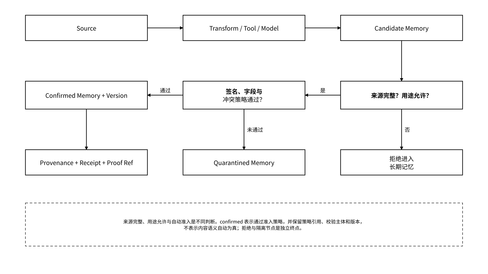

# 5.2 来源与核验

## 5.2 来源与核验

### 5.2.1 数据来源、存储完整性与版本核验

数据来源核验记录上传者、来源系统、采集时间、文件 hash、对象版本、内容引用、存储承诺、保存周期与 MEFS / Meeda 证明。Agent 状态还需要对版本绑定、引用连续性、删除语义和新对象适配分别验证，确保文件级核验与状态生命周期正确衔接。

核验需要回答：

1. 这是哪个稳定业务对象的哪个版本；
2. 内容引用能否解析，原文是否仍可访问；
3. commitment 的 `algorithm`、`scope`、`value` 是否与指定对象版本及封装一致；
4. 数据由谁上传、从何处导入、经历了哪些转换；
5. 存储证明覆盖哪个时间窗口和后端；
6. 对象是被篡改、自然到期、按策略删除，还是后端暂不可用。

CID、commitment、凭据与 proof 不能混称。CID 是内容引用，commitment 是与明确算法和范围绑定的承诺对象，凭据是主体签发的记录，proof 是支持特定命题的验证材料。对象示例的 `scope=ciphertext` 只核验指定密文封装；迁移中的重新加密或格式转换可能改变摘要，需要旧新封装与版本映射及转换回执。

验签确认签发者对记录的签名，Merkle 包含证明确认指定回执属于已承诺批次，存储证明核验其覆盖时间内的保存命题；这些核验不自动证明事件真实发生、日志没有漏记、来源内容真实或成果验收通过。证据材料 `available` 只表示可获取，还需按类型检查发行者、算法、版本、时间范围与信任条件。

### 5.2.2 Agent 记忆来源、生成链路与引用校验

进入长期记忆的内容必须区分来源类型和认知状态。这是记忆治理的第一道闸：先分类，再决定能不能进长期记忆。

| 类型          | 示例              | 默认处理                                    |
| ----------- | --------------- | --------------------------------------- |
| 用户提供事实      | 项目目标、明确偏好       | 保留提交者签名与原始引用，按来源和用途策略自动准入               |
| 外部检索内容      | 网页、数据库、文件       | 记录 URL / object ref、获取时间与版本             |
| 工具生成结果      | 编译、计算、查询结果      | 绑定工具、参数、schema 与 observation            |
| 其他 Agent 提供 | 协作 Agent 的结论或成果 | 记录 producer Agent、委托与自动验收规则的结果          |
| 模型摘要        | 对已有资料的压缩        | 记录父引用与模型版本，不冒充原文                        |
| Agent 推断    | 基于输入和模型推理形成的判断  | 标记推断类型、证据引用和置信信息；按用途与风险策略准入或隔离，不标记为来源事实 |

_图 19｜记忆来源检查、自动准入与证据记录_

<figure><figcaption></figcaption></figure>

`provenance` 使用对象结构，包含 `source_type`、`source_refs`、`producer_agent_did`、`producer_instance_id`、`producer_run_id` 和 `confirmation_status`。`confirmation_status` 的运行值为 `candidate / confirmed / rejected / quarantined`，分别表示候选、通过准入、拒绝与隔离。通过自动准入时，`confirmation_status=confirmed`、`confirmation_method=policy_validation`、`confirmed_by=did:memo:service:policy-engine`，并以 `confirmation_policy_ref` 记录实际执行的准入策略。`confirmed` 表示符合该策略，不表示事实语义自动为真。模型与工具版本、来源和依赖对象的确定版本、转换步骤及时间按对象类型补充。`parent_refs` 仅记录直接父版本，不能代替 provenance 中的来源或依赖。引用断裂、签名无效或字段不合规时进入拒绝或隔离分支。

版本冲突按策略确定性处理：独立字段合并；追加型数据按稳定键去重；冲突无法满足合并规则时保留分支并隔离，由读取规则选择可读版本或拒绝该次写入，防止无声覆盖。`proof_refs` 保存对象创建时的证据快照；后续证明写入以 `(object_id, version)` 为索引的 Proof Registry，查询时合并展示，保持对象版本不可变。

### 5.2.3 Agent 运行内容、工具结果与成果验收

运行证据聚焦可观察内容，不默认记录或公开模型私密思维过程。统一记录：

* Agent DID、`instance_id`、`run_id`、用户与委托；
* 输入对象 ID 和确定版本；
* 模型、Harness、工具与 schema 版本；
* 工具调用 ID、参数摘要、观察结果与错误；
* 外部动作、`operation_id` 与各次 `request_id`、动作状态和对账结果；
* 输出对象、commitment 与保存状态；
* 验收服务身份、规则版本、输入证据、校验结果和签名声明。

成果验收与运行成功分别记录。工具接口返回成功是该工具对执行结果的报告；验收服务根据任务契约自动核对输出格式、业务约束、引用完整性和外部结果，逐项产生通过、失败或证据不足的结果，按策略提交成果、拒收或隔离。Attestation 记录验收结论，并绑定发行者、验证方法与证据引用；发行者仅复述自身结论时，记录类型标为自声明。

训练流水线建立从原始轨迹、脱敏转换、数据集 manifest、训练运行、评测到 AgentRelease 的来源链，并在各环节自动校验用途授权和版本引用。读取权限不能绕过训练用途授权。
