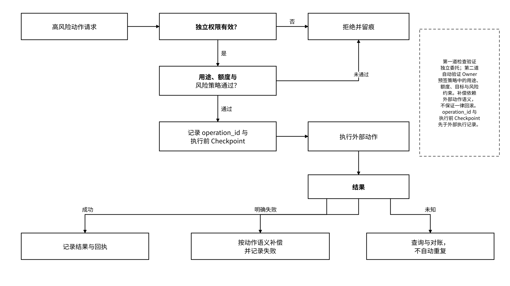

# 5.3 Agent 运行与风险

## 5.3.1 运行轨迹、决策内容与可观测性

可观测性覆盖请求、授权、对象、工具、存储、证明和外部动作。日志分三类：

* **操作日志**：服务健康、延迟、错误和资源使用；
* **审计日志**：主体、委托、策略决定、对象、操作与结果；
* **运行轨迹**：模型与工具调用、观察结果、输出和外部动作。

日志应使用 Agent DID、`instance_id`、`run_id`、`operation_id`、`request_id`、`object_id`、`version`、`receipt_id` 和 `proof_batch_id` 关联。其中 `request_id` 标识一次请求尝试，`operation_id` 标识同一可重试业务操作并对应幂等键，`receipt_id` 标识签名回执。敏感内容使用 hash、受限引用或脱敏摘要，不把完整提示、密钥或用户隐私复制到普通日志系统。

策略 `decision=allow/deny` 与 `business_status=not_executed/succeeded/failed/unknown` 分别记录；本地回执保存结果使用 `receipt_status=available/pending/failed`，后台证明使用 `proof_status=not_requested/pending/available/failed`，支付结果使用 `payment_status=not_required/required/verified/settled/failed/unknown/refund_pending/refunded` 独立记录。证明面异步锚定不替代本地回执持久化。审计存储失败或结果未知时，将受影响的 `operation_id`、缺失记录类型与重试时间写入恢复队列，自动查询、补全或报告失败；证据处理不重复已经成功的业务动作。

关键指标包括授权拒绝率、撤销传播时间、版本冲突率、写入持久化失败、Proof 延迟、存储证明失败、外部动作未知状态、导出与删除积压。SLO 阈值从部署策略加载，遥测服务按时间窗口计算观测值、触发告警与恢复动作，并保留测量环境、样本窗口和配置版本。

## 5.3.2 提示注入、记忆污染与模型漂移

Agent 引入了状态持续积累和自动执行带来的额外风险，例如不可信内容影响工具行为或长期记忆；数据丢失、密钥泄露与服务可用性风险仍然存在。下表定义主要风险、控制机制和自动验证记录；威胁用例、契约测试与运行遥测共同检查控制效果：

| 风险   | 典型后果            | 控制方式                               | 证据                    |
| ---- | --------------- | ---------------------------------- | --------------------- |
| 提示注入 | 不可信内容改变工具或授权行为  | 来源分级、内容与指令隔离、工具前二次策略判断             | 输入来源、策略版本、允许 / 拒绝回执   |
| 记忆污染 | 错误推断进入长期状态并反复传播 | 事实 / 摘要 / 推断分型，来源及签名自动准入、冲突隔离与版本回滚 | 父引用、生成者、准入策略、准入状态、版本链 |
| 模型漂移 | 同一任务在模型升级后行为改变  | 固定版本、兼容矩阵、基准评测和分阶段发布               | 模型版本、配置、评测结果、回滚点      |
| 工具漂移 | 参数或返回 schema 变化 | 工具 schema 版本化、契约测试和灰度发布            | 工具版本、schema、调用与错误     |
| 派生泄露 | 摘要或图谱推断出原本不可读事实 | 权限感知索引、撤销后重建、推断泄露测试                | 输入权限、派生对象与重建记录        |

外部内容默认是数据而不是系统指令。Memory Pack、网页、文件和其他 Agent 输出都不能自行提升权限、改变预算或修改系统策略。

## 5.3.3 密钥、越权、外部副作用与故障恢复

密钥安全基线：身份私钥不离开所属本地或受控签名环境；默认加密保存；缺少主密钥时拒绝将身份私钥降级保存为明文；安装 skill 固定版本并验证签名 / 校验值；平台不得在日志、遥测或错误中接收私钥。内容加密密钥、身份签名密钥与其保护密钥按用途分别管理，密钥配置明确持钥者、解密位置、轮换或更换方式和恢复授权，加载时校验签名、用途与环境绑定。

高风险动作使用 Owner 预签的独立权限与自动风险策略，分别限定用途、目标域名或合约、金额、对象范围、有效期和幂等规则。以下动作只有在对应约束全部通过后才进入执行：

* 付款、资产转移与合约交易；
* 发信、发布内容与通知外部人员；
* 修改生产系统或删除数据；
* 批量导出、训练数据导出和对外共享；
* 创建新凭据、修改策略或允许再委托。

_图 20｜高风险外部动作的授权、检查点与结果处理_

<figure><figcaption></figcaption></figure>

故障恢复必须区分控制面、数据面、本地审计存储、证明面和外部系统的失败。恢复演练至少覆盖：Gateway 不可用、存储后端部分故障、回执保存结果未知、Proof 延迟、密钥丢失、撤销传播失败、重复请求和外部动作结果未知。外部动作是否可补偿或回滚取决于实际服务语义，不默认承诺失败可逆。安全事件应记录影响对象、主体、版本、时间范围、补救与用户通知。
