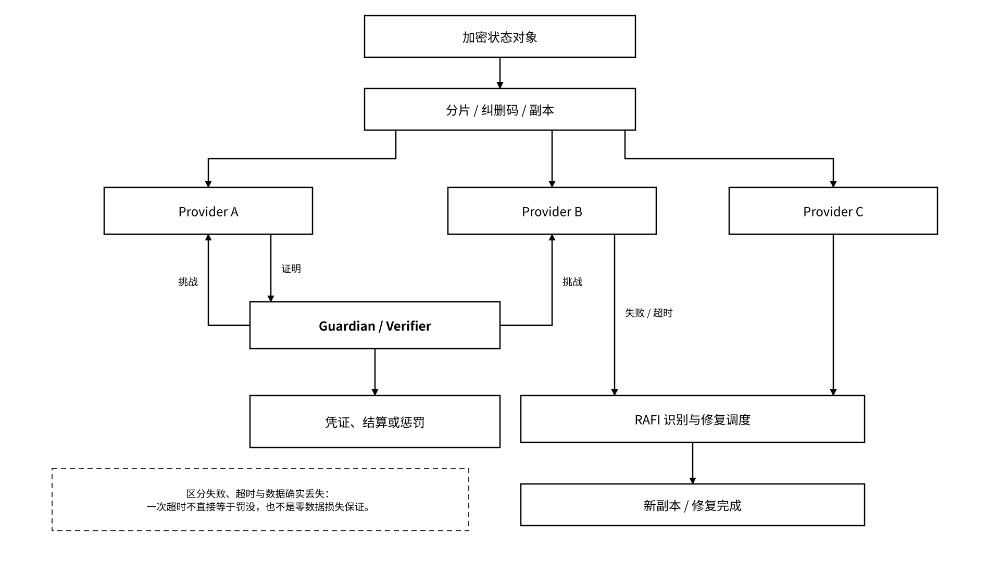

# 6.1 MEMO Protocol 与 MEFS

## 6.1.1 六层协议与网络架构

MEMO Protocol 包含数据存储、计算、验证、执行、身份和智能六个能力域。Agent State Layer 按状态请求的职责组织上层流程；两套分层表达不同层次的职责，不是可直接互换的实现模块。

网络可从三类职责理解：

* **结算层**：角色注册、群组管理、质押和费用结算；
* **数据管理 / 验证层**：聚合订单信息、挑战、凭证与修复调度；
* **存储层**：保存加密数据、响应读取与证明请求。

Vault 通过 MEFS 后端适配器提交加密状态对象，适配器映射对象版本、内容封装、存储订单和生命周期；Gateway 对受管入口的请求执行身份与策略检查，调用 Protocol 的身份与执行接口；Proof 接入验证、挑战与链上锚定接口。文件存储服务使用独立的版本化文件接口，状态服务在其上增加对象、委托与证据语义。三平面通过独立凭据、受限服务账户和调用审计明确跨组件信任关系。

## 6.1.2 用户、提供者、守护者与节点

节点角色由守护者组织挑战，并根据可验证结果触发相应结算，使支付与协议凭据关联。网络配置固定角色权限、群组成员、挑战周期、验证阈值、争议窗口和结算规则；验证者检查签名、随机性来源、时间窗口与重复挑战。角色分工本身不保证参与者独立，串谋与集中化风险通过参与者隔离、轮换策略、交叉验证和有时限的争议流程约束。

| 角色           | 网络职责               | Agent 状态场景中的职责               | 关键风险           |
| ------------ | ------------------ | ---------------------------- | -------------- |
| 用户           | 提交数据、支付费用、请求读取     | 状态所有者、委托发起者、费用支付者            | 密钥丢失、误授权、费用不足  |
| 提供者          | 提供存储并响应挑战          | 保存加密状态块、对象版本和交接包             | 离线、证明失败、数据不可达  |
| 守护者          | 数据管理、匹配、挑战、凭证与修复协调 | 协调状态存储订单、挑战与修复               | 集中化、错误调度、长期不响应 |
| Light / 验证节点 | 按对应协议验证证明或发起挑战     | 按证明类型配置验证 Proof 引用、挑战结果与存储状态 | 错误挑战、版本不一致     |

节点以版本化部署配置启动，配置包含网络标识、角色、硬件资源、系统要求、端口、账户、质押与余额阈值、费用和健康检查。启动器自动校验网络与合约代码标识、资源容量、余额和角色资格；检查失败则保持隔离。停止、升级和回退使用独立的排空、快照、版本校验和恢复步骤。

网络治理配置分别规定角色兼任矩阵、群组准入与退出、公开节点接入、代付额度和测试资产分发。节点加入时校验配置签名、角色冲突和资格；退出时结清订单、完成受控数据交接并撤销运行凭据。

## 6.1.3 冗余、修复、RAFI 与存储证明

MEFS 的可靠性设计使用复制、纠删码等冗余方式，并通过挑战、证明、修复和结算连接数据保存责任与节点激励。RAFI（风险感知故障识别）对不同故障规模的条带采用差异化识别阈值，优先识别和修复风险较高的数据块。该机制将故障识别与修复调度相连：根据条带冗余余量、故障分布和证明失败记录设置优先级，先恢复接近容错边界的条带。遥测按算法版本、工作负载与故障模型记录识别时延、修复流量、不可达窗口和恢复结果，用于调整阈值与资源配额。

_图 22｜分片存储、节点挑战与 RAFI 修复关系_

<figure><figcaption></figcaption></figure>

Agent 状态会增加版本与生命周期要求：证明必须绑定 `object_id`、`version`、`commitment` 的算法与范围，以及适用时间窗口；被正常删除或到期的对象不能被误判为节点丢失。修复若恢复相同加密封装，应按原承诺核验，并在 Proof Registry 中为原 `object_id` / `version` 追加新的证明记录；若发生重新加密或格式转换，密文摘要可能变化，应记录新旧封装、摘要映射和转换回执，按版本规则保存关系，不得静默替换原版本。副本修复、对象版本更新和证据更新是不同操作。
