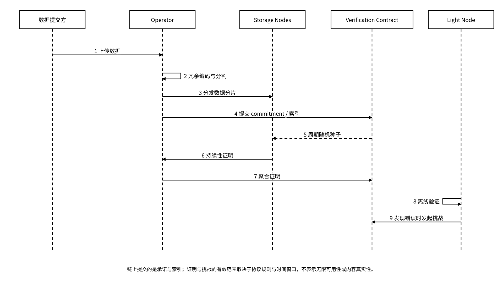
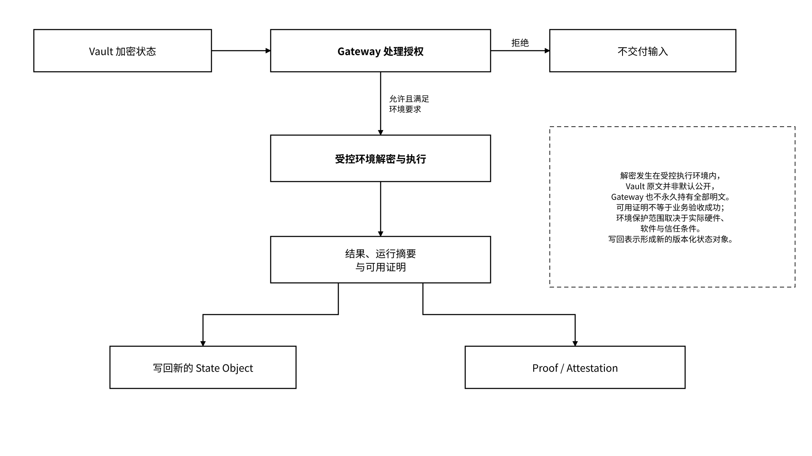

# 6.2 Meeda 与计算基础设施

## 6.2.1 Meeda / DA 总览与 Lightnode API

Meeda 是 MEMO 的数据可用性（DA）层，主要用于为链下数据提供存储性证明，主要组件包括 Operator、Storage Node、验证合约和 Light Node。其设计将数据保留在链下：以 KZG 承诺绑定约定编码范围内的数据，并将承诺与必要的元数据登记到链上；数据经分片并以纠删码或多副本冗余保存，使节点作恶或失职的代价更高。承诺登记本身不证明数据可下载或内容真实。

存储性证明按以下机制运转：



## 随机抽样

验证合约按约定周期生成伪随机数，据此选定本周期被抽查的文件或分片。



## 限时出证

Storage Node 须在约定时限内针对被抽查对象提交可用性证明；超时视为挑战失败，并触发惩罚。



## 聚合提交

同一周期和验证方案的证明由 Storage Node 聚合为可验证批次，连同聚合承诺与覆盖范围一并提交，以降低链上成本。



## 乐观验证

合约默认已提交的证明有效，仅在被挑战时才执行验证。



## 自适应核验

越新的数据核验越密，近期数据可做全面挑战，较早的数据按抽样核验；抽样所能提供的保证取决于协议参数与故障假设。



## 争议裁决

Light Node 无需下载全部数据即可核验可用性，发现异常时可发起挑战；争议按多轮交互式乐观验证逐步缩小范围，直至定位到出错的承诺。诚实的挑战者获得奖励，出错的节点受到惩罚。



Light Node 按已验签的网络配置校验挑战资格、挑战窗口、奖励条件和裁决规则，并将挑战记录绑定协议版本与对应承诺。上述核验只在协议假设与时间窗口内成立，不表示无限期的可用性。

证明聚合接口采用固定的证明结构配置，提交证明、批次承诺与覆盖范围。成本模型分别计量证明字节数、提交频率、链上验证和挑战费用；分片数量、数据规模与工作负载影响提交和验证总量。消息编码、周期、挑战窗口和批次规模由协议配置固定，节点收到不匹配消息时拒绝处理。

_图 23｜Meeda 数据分发、聚合证明与挑战时序_

<figure><figcaption></figcaption></figure>

Lightnode API 使用注册表提供的服务地址与鉴权配置，按提交、获取、验证和挑战查询四类操作组织接口。请求绑定协议版本、对象或数据引用、commitment 与网络域；响应分别记录数据可获取性、证明验证结果、过期原因或错误码。大小限制、超时和重试预算从接口配置加载。Operator、Storage Node 和 Light Node 使用各自的角色配置与服务账户，健康检查和能力清单参与客户端路由。

Agent 私有状态不因为使用 DA 技术就应公开。只有适合公开验证的承诺、证明和最小索引进入链上；内容按 Vault 加密与授权规则处理。MEMO 自有 `commitment` 对象应注明 `algorithm`、`scope`、`value`；Meeda 或合约的原生承诺结构沿用对应规范，不因名称相同就视为同一种算法或承诺范围。

## 6.2.2 FileProof 与合约接入

FileProof 是 Meeda 存储性证明的合约接口，组织文件承诺、元数据、证明、挑战、质押与结算。合约注册表绑定链 ID、合约地址、代理及实现地址、代码标识、ABI 与事件模式；调用器校验注册表签名和链上标识后执行。承诺、证明、凭据、抽样和挑战分别表达不同事实；有链上记录不等于数据始终可下载。

| 概念           | 作用                          | 接口与验证约束                       |
| ------------ | --------------------------- | ----------------------------- |
| Commitment   | 绑定指定编码或加密封装范围内的 blob / 文件内容 | 算法、编码、版本、明文或密文范围，以及迁移转换时的新旧映射 |
| Proof        | 支撑约定时间窗口内的存储命题              | 生成者、验证者、周期和失败条件               |
| Challenge    | 对证明或可用性提出质疑                 | 发起资格、时限、成本与裁决                 |
| Credential   | 签发者对上传、验证或服务事件作出的记录或声明      | 签发主体、声明范围、撤销和可访问性；验签不自动证明事件真实 |
| FileProof 合约 | 登记、提交、挑战与结算                 | ABI、事件、权限、代理 / 实现地址           |

接入配置绑定 DA 适配器、验证器和 FileProof 接口的版本组合，并固定数据保留期、验证规则和安全账户。数据读取或证明失败时停止依赖该数据的受影响处理，按超时预算重取并校验；超过预算进入配置化故障处理，恢复后按已记录索引继续，避免接受缺少可用性证据的数据。升级和关闭流程先排空在途请求、保存索引及证明，再切换经自动兼容验证的配置。合约地址从签名注册表解析，并在调用前校验链 ID 和代码标识。

## 6.2.3 算力平台、TEE 与受控处理

Computing Power Platform 是独立算力服务，为 Agent State Layer 的 L6 Controlled Processing 提供资料解析、向量化、脱敏、分析、回放与训练作业。任务调度按工作负载配置选择执行环境，Gateway 校验用途和委托，密钥执行点校验环境证据后释放限时内容密钥，执行器产生输出和运行摘要，Proof 接收对应声明与验证材料。输入、模型、环境、输出和证据统一关联 `run_id`、`operation_id` 与状态版本。

TEE 可在特定硬件、软件与信任假设下提供隔离执行和远程证明，但“节点支持某种 TEE”不代表所有 CPU / GPU 工作负载都处于相同保护范围。环境配置固定硬件类型、可信基、测量值策略、数据进入与离开方式及运营权限，并列明侧信道等信任边界。受控处理在指定执行环境内解密，密钥执行点只向匹配环境与任务身份释放限时密钥，输出由用途和脱敏策略过滤；任务结束后销毁会话密钥和临时明文。环境验证器核验远程证明，成果验收服务独立检查业务结果。

_图 24｜受控计算的授权、解密与结果证据分流_

<figure><figcaption></figcaption></figure>

训练用途需要独立授权、数据集 manifest、脱敏、冻结评测和模型发布来源链。历史轨迹不会自动变成高质量训练数据，哈希算力证明也不能直接代表任意模型任务性能。
