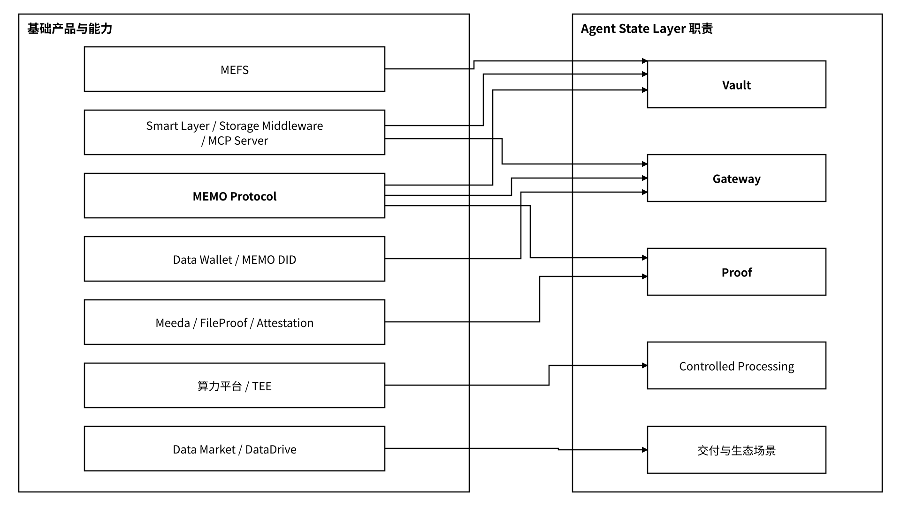

# 6 基础设施与产品职责

MEMO Protocol、MEFS、Data Wallet、Data Market、DataDrive、MEMO DID、Smart Layer、Storage Middleware、Meeda、FileProof、Attestation、算力平台、x402 和节点经济分别对应协议、存储、身份、验证、计算、应用与结算等能力。在 Agent State Layer 架构中，它们通过版本化适配器承担状态存储、身份控制、证据核验、受控处理与结算职责，并按统一对象引用、委托和回执规则协作。


**产品定位：协议网络、加密存储、身份控制、证明服务与应用入口组成可组合的基础设施。** Vault 统一状态对象及 Local / Hosted / MEFS 后端；Gateway 执行受管访问与委托策略；Proof 组织证据、聚合与锚定。服务注册表固定各组件的接口版本、网络域、端点、密钥执行位置和验证配置，适配器在加载与每次调用时自动检查匹配关系。


_图 21｜基础设施与 Agent State Layer 的职责映射_

<figure><figcaption></figcaption></figure>
