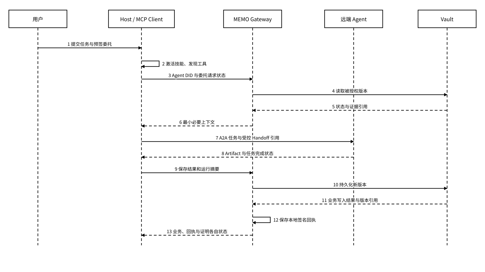
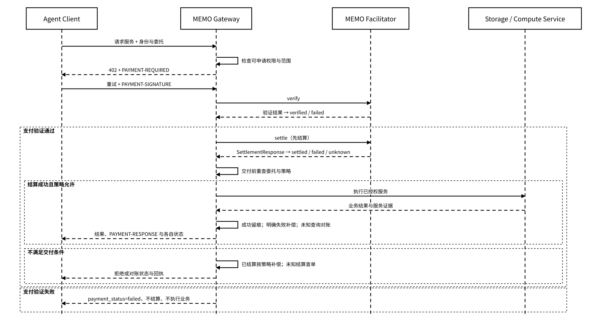

# 7.1 标准组合

## 7.1.1 ERC-8004、ERC-7857 与 ERC-7829

三项 ERC 面向不同问题，不能互相替代，也不能统称为“Agent 身份标准”。[ERC-7829 官方提案](https://eips.ethereum.org/EIPS/eip-7829)的作者信息包含 MEMO Labs 成员，支持“MEMO 生态参与数据资产标准提案”的表述。该提案围绕数据内容、存储元数据和权限元数据扩展 ERC-721；MEMO 的资产适配方案按这些维度映射内容引用、存储期限和读取策略。

| 标准       | 主要对象                                  | MEMO 适配职责                                   | 不应被误解为                           |
| -------- | ------------------------------------- | ------------------------------------------- | -------------------------------- |
| ERC-8004 | Agent 注册、发现、声誉与验证记录                   | Agent DID 的外部发现、服务端点、声誉和验证扩展                | 用户对 Agent 的实时授权系统，或 Agent 能力安全担保 |
| ERC-7857 | 带私有元数据的 AI Agent NFT，以及可验证的转移、克隆和使用授权 | 用户明确选择资产化时，对模型、记忆、角色定义等私有元数据进行受保护交付         | 所有 Vault 状态默认铸造成 NFT             |
| ERC-7829 | 数据资产 NFT、链下数据承诺、大小、到期时间、上传者和读取权限      | 对独立数据对象、Memory Pack 或 Artifact 建立可转移的数据资产引用 | 原文上链，或仅凭 NFT 就能读取密文              |

MEMO 的身份关系由用户身份、Agent DID、执行实例及委托策略组成。Agent 身份方案以“Agent 身份签名密钥 + 执行实例”确定 Agent DID：重新生成 Agent 身份签名密钥并形成新实例时创建新 Agent DID；模型、框架、名称或版本变化本身不创建 DID。`instance_id` 标识执行实例，`run_id` 标识一次任务运行。身份解析器按已验签的身份配置校验 DID、公钥和实例绑定；同一 DID 固定其身份签名公钥。更换身份密钥生成新实例和 DID，经旧、新身份双签且通过 Owner 策略校验的连续性记录关联历史；旧密钥不可用时使用预设恢复授权签署独立恢复声明。历史证据保持原 DID 归属，新身份通过 Owner 新签委托获得权限。Vault 内容加密密钥轮换是独立机制，不改变 Agent DID。

ERC-8004 的注册、声誉和验证记录可用于外部发现与信任评估；用户绑定、Agent 注册和访问委托仍须分别处理。Gateway 对经过受管入口的请求校验委托、资源、动作、时间与风险限制，外部注册记录不直接授予记忆读取权限。

ERC-7857 和 ERC-7829 都属于**选择性资产化接口**。资产策略由 Owner 预签并限定对象、权利范围、接收方和动作；适配器在转移、许可、交易或长期登记请求通过策略校验后，将对应状态摘要、密文引用或私有元数据映射为链上资产。日常对话、临时草稿、密钥、完整运行轨迹和含隐私的记忆不默认资产化。

三项 ERC 的规范引用分别为 [ERC-8004](https://eips.ethereum.org/EIPS/eip-8004)、[ERC-7857](https://eips.ethereum.org/EIPS/eip-7857) 和 [ERC-7829](https://eips.ethereum.org/EIPS/eip-7829)。适配配置记录所采用规范的标识、内容摘要、ABI 和事件映射；配置更新触发契约测试、权限边界测试与历史对象回放，通过后按版本路由生效。

## 7.1.2 MCP、A2A 与 Agent Skills

MCP、A2A 与 Agent Skills 分别解决“如何连接能力”“Agent 之间如何协作”“一项能力如何被打包和说明”，MEMO 则设计这些调用产生的状态如何受控、持久与核验。Gateway 执行授权，Host 按运行配置提供沙箱，Vault 执行持久化；协议适配器将请求映射到这些控制点，契约测试校验其调用与结果映射。

| 规范           | 负责内容                                      | 与 MEMO 的连接点                           | 仍由 MEMO 负责                                 |
| ------------ | ----------------------------------------- | ------------------------------------- | ------------------------------------------ |
| MCP          | Host、Client、Server 之间的资源、提示、工具和扩展交互       | Gateway 暴露状态工具；MEFS MCP Server 暴露存储工具 | Agent DID、用户委托、状态版本、审计回执、后端持久化             |
| A2A          | Agent Card、任务、消息、Artifact、流式更新和跨 Agent 协作 | Handoff 发起、跨组织任务派发、Artifact 交付        | Memory Pack 内容、密钥封装、接收方独立授权、后续受控访问的撤销和存储证明 |
| Agent Skills | `SKILL.md`、脚本、参考资料和资产的可移植能力包              | 将 MEMO 保存、恢复、核验流程打包成可发现技能             | 技能是否获准执行、对哪些状态有权操作、执行后证据如何保存               |

_图 26｜MCP、Agent Skills 与 A2A 协作的状态保存时序_

<figure><figcaption></figcaption></figure>

Proof 聚合与锚定异步完成，未单列于本图；Gateway 的本地回执持久化与 Vault 的对象写入仍须分别记录结果。

适配器通过兼容性配置固定协议版本、传输方式、认证模式、工具清单和扩展。MCP 适配配置参照 [2026-07-28 规范](https://modelcontextprotocol.io/specification/2026-07-28)及其[变更说明](https://modelcontextprotocol.io/specification/2026-07-28/changelog)，采用无状态请求核心，将 Tasks 作为显式扩展处理。旧式初始化握手、协议会话、流式恢复和能力协商由独立版本适配器隔离，不通过更改版本字符串混用行为。MEMO 业务状态继续由 Vault 持久化，Gateway 为每次请求解析身份、委托、策略和幂等关联。

A2A 的任务完成不等同于 Vault 写入成功。交接应分别检查状态写入、回执持久化和证明处理结果；`business_status=succeeded` 且 `proof_status=pending` 时，不应重复执行已成功的写入。回执或证明材料可获取也不代表其内容已通过验证。A2A 适配配置参照 [v1.0.0 规范](https://a2a-protocol.org/v1.0.0/specification/)，将 Task、Message、Artifact 和取消请求映射到任务信封、确定状态版本及回执；自动测试覆盖正常完成、取消、流中断恢复、部分交付与重复请求。

Agent Skills 中的说明、脚本和资源都应视为输入，而不是天然可信代码。技能导入流水线自动记录包哈希、来源、许可证、所需工具、网络要求和静态检查结果，并校验包签名与允许执行范围。按[官方格式规范](https://agentskills.io/specification)解析 `SKILL.md`，将 `allowed-tools` 作为工具要求元数据，由 Host 的执行策略决定允许集合。受管工具调用继续经过 Gateway，Host 按环境配置执行沙箱、网络和文件权限控制；外部 Host 的调用只有接入对应控制点后才形成受管记录。

## 7.1.3 x402、支付与授权的边界

x402 利用 HTTP `402 Payment Required` 表达机器可读的支付要求，可用于按次购买 API、存储、计算或证明服务。支付检查与资源授权分别进行。MEMO Facilitator 负责支付验证与结算，Gateway 负责受管资源授权。支付注册表绑定方案、网络、资产、收款方、Facilitator 端点、金额单位与版本；适配器自动校验注册表签名、网络域、报价有效期和收款条件，拒绝未解析或不匹配的配置。

客户端调用链如下；一次业务操作可以包含多次 HTTP 请求：



## 客户端请求 Gateway

Gateway 先检查调用者可申请的权限、资源范围和风险策略。



## 返回支付要求

需要付费时，Gateway 返回 402 和价格、网络、资产、收款方、支付方案。



## 客户端重试 Gateway

客户端依据报价生成支付载荷，携带 `PAYMENT-SIGNATURE` **重试 Gateway**，不向 Facilitator 直接请求状态。



## 验证并结算支付

Gateway 调用 Facilitator 验证支付载荷，验证通过后调用结算；Facilitator 不承担资源授权，也不读取业务状态。



## 交付前重新检查授权

本方案采用先结算、后交付。结算成功后，Gateway 在执行或交付前重新检查委托、策略与撤销状态，全部通过后提供服务。



## 保存业务回执

保存业务回执，分别关联支付、业务、交付、本地回执和 Proof 状态。验证失败不结算；结算未知先查单与对账；已结算但明确无法交付时进入退款或冲正流程，结果未知时保持原操作并查询，不重复执行业务。



_图 27｜x402 支付验证、结算与交付前授权复查_

<figure><figcaption></figcaption></figure>

[x402 官方 HTTP 402 说明](https://docs.x402.org/core-concepts/http-402)确认 V2 使用 `PAYMENT-REQUIRED`、`PAYMENT-SIGNATURE` 和 `PAYMENT-RESPONSE` 三个支付通信头；[客户端/服务端说明](https://docs.x402.org/core-concepts/client-server)和[Facilitator 说明](https://docs.x402.org/core-concepts/facilitator)确认由客户端重试资源服务端，再由服务端验证支付或调用 Facilitator。外部头名与 `SettlementResponse` 等原生对象名保持规范写法，不改为 MEMO 的 snake\_case。

本方案固定“支付验证 → 结算 → 授权复查 → 执行及交付”的顺序。支付验证失败终止结算；`verified` 时业务保持 `not_executed`。结算结果未知时记录 `payment_status=unknown`、`business_status=not_executed`，先查单和对账。结算为 `settled` 且授权复查通过后才执行服务；若此时业务结果未知，保持 `payment_status=settled`、`business_status=unknown`，查询同一 `operation_id`，不重复结算或按未知结果退款。

结算成功后授权失效，或对账确定交付失败时，按订单补偿策略创建幂等退款或冲正任务并进入 `refund_pending`。取得与原操作、金额和接收方匹配的可核验完成结果后才记录 `refunded`；失败或未知保留补偿状态及错误记录，继续查询与对账。Gateway 的支付适配器完成内部状态映射，支付通信头、身份令牌、委托证明和幂等键分别校验。

MEMO 以 `operation_id` 关联同一业务操作及 `Idempotency-Key`，每次请求尝试使用独立 `request_id`；`receipt_id` 与 `run_id` 分别标识回执和任务运行。重试先查询同一操作的执行及支付状态，并用原操作结果完成幂等响应，不能重新消费已使用的支付授权。MEMO 内部 `payment_status` 统一为 `not_required / required / verified / settled / failed / unknown / refund_pending / refunded`，它是对支付流程的内部映射，不是 x402 原生字段，也不替代 `business_status`、`receipt_status` 或 `proof_status`。
