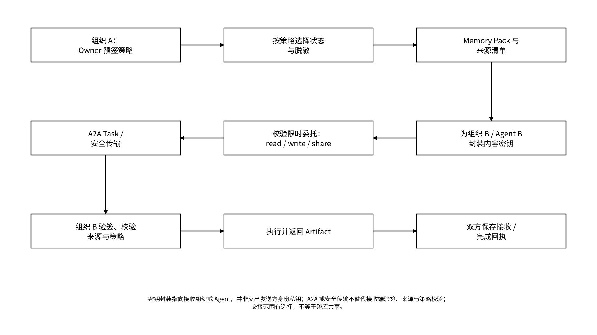

# 7.2 证明与协作扩展

## 7.2.1 Attestation Server

Attestation Server 将特定链下事件或证据组织成可验证声明，例如“某一版本由指定 Agent 在某个受控环境生成”“某个工具响应的摘要为给定哈希”“某次 TEE 运行满足指定测量值”。它是 Proof 的证据接入组件；声明可信度取决于发行者、证据来源、验证方式和声明范围。

下列定义 MEMO Attestation 的签名声明结构。`statement_commitment` 绑定声明主体、类型、状态引用、实例、任务与环境等声明字段的规范化内容；签名覆盖除 `signature` 外的完整声明载荷，包括承诺、发行者、签发与过期时间。规范化方式、字段白名单和签名套件由版本化声明配置固定，生成端与验证端使用同一配置：

```json
{
  "schema_version": "memo.attestation/1",
  "subject": "did:memo:agent:example",
  "claim_type": "memo.runtime.result",
  "statement_commitment": {
    "algorithm": "sha256",
    "scope": "canonical_statement",
    "value": "<digest>"
  },
  "state_ref": { "object_id": "mem_project_a_001", "version": "v_001" },
  "instance_id": "instance_example",
  "run_id": "run_20261016_001",
  "environment": { "type": "controlled", "measurement": null },
  "issued_at": "2026-10-16T02:00:00Z",
  "expires_at": "2026-10-17T02:00:00Z",
  "issuer": "<attester-id>",
  "scheme": "signature",
  "signature": "<signature>"
}
```

本例的 `statement_commitment` 绑定规范化声明，和 State Object 对密文封装计算的 `commitment` 是不同对象；不能只比较两个 `value` 就视为同一种证明。声明配置按验证方案要求不同证据：`signature` 方案提供发行者公钥引用与签名；TEE 方案另外提供环境报告、测量值、信任链及绑定任务的随机挑战；ZKP 方案另外提供验证密钥标识、公开输入、证明对象和电路版本。验证器按方案执行完整证据检查，缺少必填证据即拒绝，不以替换 `scheme` 字符串改变验证规则。

验证者不仅要验证签名，还要检查发行者信任级别、声明范围、证据新鲜度、吊销状态、环境测量值、状态版本和重放风险。链上可保存发行者注册、吊销根或摘要；完整证据、日志和隐私数据保留在链下。验签只能证明相应签名主体签署过该声明；Merkle 包含证明不自动证明事件真实、日志没有漏记或业务结果正确。发行者复述 Agent 自身声明时，证据记录标记为“自声明”；独立验收记录绑定实际验收服务、规则版本与输入证据。

## 7.2.2 跨组织协作与受权交接

跨组织交接使用“任务信封 + Memory Pack + 接收方密钥封装 + 双方回执”，在身份域、策略域与存储域之间传递最小必要状态。Owner 预签交接策略，源端按任务目的选择、脱敏并封装对象；接收端自动验签、核验来源和权限后执行。

_图 28｜跨组织状态交接与双方回执保存_

<figure><figcaption></figcaption></figure>

交接清单固定：任务目的、可见对象、被排除对象、用途限制、允许工具、有效期、最大费用、允许产生的外部副作用、成果格式、销毁要求和争议处理方式。本图的 `write` 只授予约定成果区域的写入，`share` 只覆盖向约定接收方交付成果，不能扩展为对来源状态任意再共享。接收方不得从“可读”推断出“可训练、可再分发或可转售”；跨模型接续限于 Schema、适配器、外部依赖和授权允许的业务状态，不保证输出相同。

导出或交接事件本身不删除源对象；交接失败时源状态保持原状。目标方完成签名校验、对象完整性校验和密钥解封后，自动生成接收回执；部分导入记录缺失项并隔离不完整对象。若重新加密或转换格式导致密文 commitment 改变，应保留旧新封装映射及转换回执。接收方独立取得授权，新 Agent DID 不自动继承发送方或旧身份的委托。

权限到期或撤销由相关策略执行点应用并返回生效回执，随后阻断受控请求。策略服务记录各执行点的传播时间，无法取得满足时限和签名要求的撤销状态时，拒绝受影响的受管请求与密钥释放，并记录策略状态错误。Gateway 的授权判定与密钥释放分别执行；部署配置明确各执行点、持钥主体和环境要求，密钥释放点再次校验委托、用途、撤销状态与接收环境。对已经获得的明文，或已经持有的旧密文及对应密钥，应通过受控环境、合同和审计措施降低二次泄露风险；撤销与内容密钥轮换都不能远程收回这些材料。

## 7.2.3 知识、经验与训练数据授权

Agent 记忆可以包含事实、用户偏好、工作方法、反馈、工具结果和生成内容。它们的权利基础不同，不能用一份宽泛的“数据授权”覆盖全部用途。把权利拆细，是让用户敢把记忆交给 Agent 的前提。

| 权利动作                    | 示例                   | 默认策略                               | 记录的证据              |
| ----------------------- | -------------------- | ---------------------------------- | ------------------ |
| 读取（`read` / `search`）   | 为当前任务检索一段已准入记忆       | 最小范围、限时允许                          | 用户委托、查询范围、访问回执     |
| 追加（`write`）             | 保存本次任务结论             | 写入候选区，通过来源、用途、签名与冲突策略后准入           | 生成者、来源、准入策略与状态、版本  |
| 推理使用（用途约束）              | 在受控环境中用私有知识生成结果      | 对 `read`、`write` 及必要外部操作按任务和环境分别授权 | 模型、环境、输入摘要、输出摘要    |
| 训练 / 微调（`train`）        | 用数据更新模型参数            | 默认禁止；通过预签 train 委托与数据集用途策略授权       | 许可文本、数据清单、版本、用途和期限 |
| 再分发（`export` / `share`） | 将 Memory Pack 提供给第三方 | 默认禁止                               | 接收者、范围、许可证、交接回执    |
| 资产化 / 交易                | 铸造或许可数据资产            | Owner 预签资产策略限定对象与动作                | 所有权依据、权利范围、承诺与合约事件 |

来源链应能从派生对象回溯到原始来源和每次变换，但不强制暴露全部私密内容。若数据许可不允许训练，受管运行系统必须在策略层阻止数据进入相应训练流水线；这不等于能够阻止外部终端滥用已经获得的明文。删除或撤销请求应按各自生命周期触发原始对象、派生索引、缓存、交接包和仍可控制的训练集快照处理，并记录执行结果；不承诺所有后端同时完成，也不承诺撤回已经不可逆写入模型参数的影响。
