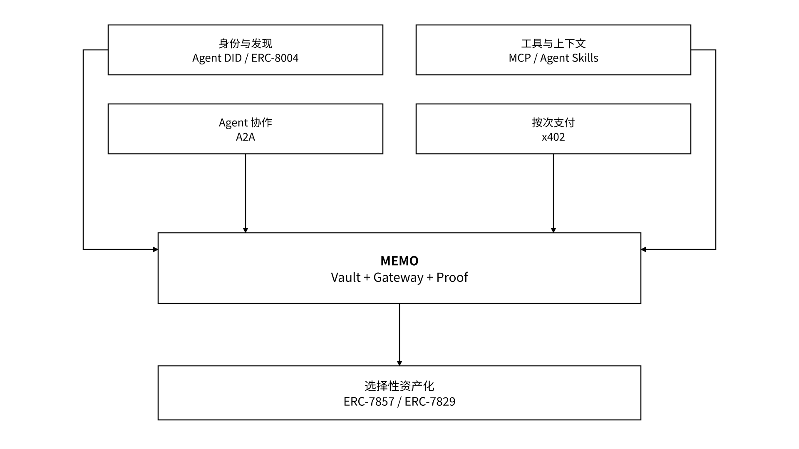

# 7 标准与开放集成

MEMO Agent State Layer 把“身份与发现、工具调用、Agent 协作、状态保存、证据核验、支付结算”拆成可以组合的职责：外部标准提供通用互操作方式，MEMO 的产品设计负责受管状态的长期控制、权限执行、持久化与证据组织。开放集成的目标是让状态服务可以连接不同生态，同时保留明确的授权与数据边界。


**产品定位：以版本化适配器连接身份、工具、协作、支付与选择性资产化协议。** 每种适配器固定规范配置、传输、认证方式、字段映射和自动兼容测试；运行时读取已验签的服务注册表，校验配置后路由请求。资源授权、状态版本、本地回执和 Proof 处理分别执行，保持业务边界。


_图 25｜开放标准与 MEMO 状态层的职责组合_

<figure><figcaption></figcaption></figure>
