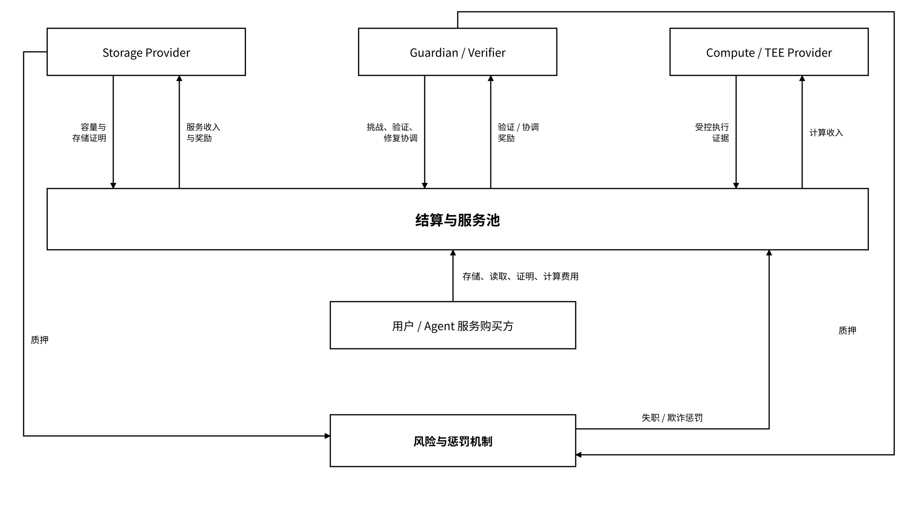
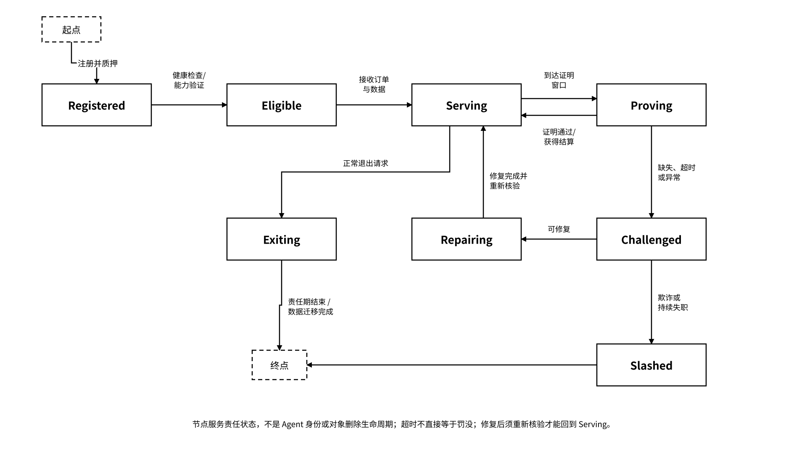

# 8.3 Tokenomics 与治理

### 8.3.1 MEMO、质押与结算层

经济层按“服务—证明—结算”连接用户、存储提供者、守护者 / 验证者、计算服务和协议治理。服务订单定义数量、质量、证明窗口、费用及补偿条件；计量器和验证器输出可核对记录，结算器依合同参数结转收入、质押和惩罚。

结算资产由 Asset Descriptor 定义符号、类型、网络、合约、精度、接受范围与费用规则，并通过签名和链上代码校验绑定。Gateway 根据报价中的接受资产选择支付路径，资源访问仍依赖独立委托。资产描述、用户权限和经济分配属于不同配置域。

_图 29｜服务费用、节点贡献、质押与结算关系_

<figure><figcaption></figcaption></figure>

质押提高失职或作恶成本，技术证明、冗余和恢复机制承担服务核验与可靠性职责。奖励依据可验证容量、存储响应、有效挑战、修复结果和受控计算证据分配，并结合真实服务需求计量。节点关联、虚假流量、自我交易和重复证明通过去重、关联分析与挑战规则识别。

账户余额、链上直接结算、x402 和企业账单通过四类支付适配器接入统一账本。费用关联报价、Owner 授权、`operation_id`、服务证据与退款或争议状态。公开链保存必要结算信息，任务原文留在链下；地址、金额和时间的披露范围由隐私配置控制，关联风险进入审计策略。

### 8.3.2 分配、激励与冷启动

经济分配采用参数化模型。设分配基数 `S = 300,000,000`，份额按下表计算；供应、分配、释放和归属规则以签名经济配置与执行合约绑定，计算器检查份额总和、资产精度和预算上限。

| 分配项       | 模型比例 | 以 S 计算的额度   | 执行规则                 |
| --------- | ---- | ----------- | -------------------- |
| 分配基数      | 100% | 300,000,000 | 配置参数 `S`，用于预算和释放仿真   |
| 基金会       | 15%  | 45,000,000  | 国库用途、接收账户、锁定与支出策略    |
| 投资者       | 10%  | 30,000,000  | 归属曲线、解锁条件与接收账户       |
| 流动性       | 15%  | 45,000,000  | 市场范围、额度、账户及调拨规则      |
| 生态 / 存储激励 | 60%  | 180,000,000 | 服务绩效、释放曲线、奖励上限和反滥用策略 |

经济配置声明供应控制方式、分配账户、归属和释放函数、通胀或销毁规则、国库权限、暂停条件及变更时间锁。分配额满足 `allocation_i = S × ratio_i`，四类分配比例之和为 100%；释放计算按时间和绩效条件取可用额度，禁止超出对应预算。模型输出用于配置模拟、规则验证和账本核对。

冷启动机制分为流程验证、容量引导与需求驱动三种激励配置。流程验证使用无价值测试资产；容量引导设置节点、容量和期限上限，以服务与证明记录释放奖励；需求驱动将实际服务收入纳入分配，按补贴比例与需求阈值调整激励预算。各配置执行女巫攻击、节点关联、虚假订单和自我交易检测，并按规则触发减补或停补。Agent 状态激励关联可恢复状态、有效交接、证明和服务质量，不以写入量单独决定奖励。

### 8.3.3 节点经济、挑战与治理

节点责任形成“注册 / 质押—接单—提供服务—提交证明—挑战与修复—结算或惩罚”的运行闭环。协议配置绑定节点资格、挑战规则、证明窗口、服务费用和退出责任；结算器以服务记录和挑战结果为依据执行相应规则。

_图 30｜存储节点服务、证明、修复与退出状态_

<figure><figcaption></figcaption></figure>

挑战配置包括采样频率、响应窗口、证明算法、证据保留期、复核和申诉规则。监测器记录失败率、恢复时间、地理与运营商集中度；仿真使用这些输入评估误罚、攻击成本和恢复负载。异常进入挑战与复核流程，网络波动、可修复故障和欺诈按不同条件处理。

治理配置覆盖最低质押、奖励与惩罚、证明窗口、算法集合、网络升级和国库支出。变更采用带版本的治理提案，依次执行规则校验、模拟、章程配置的签名或表决门槛、时间锁和执行后状态核对。紧急处置角色只获得漏洞与系统性故障所需的最小权限，授权带期限、范围和审计记录，禁止以紧急权限修改无关资产或用户授权。

运行证据公开范围、默认保留期限、跨组织交接规则、Attestation 发行者准入、受控计算信任列表和资产化条件分别配置。涉及隐私及数据权利的变更需满足预设角色和策略门槛，单一经济权重不能覆盖 Owner 的对象权利与用途限制。策略执行点验证治理版本、作用域和生效时间后加载配置。
