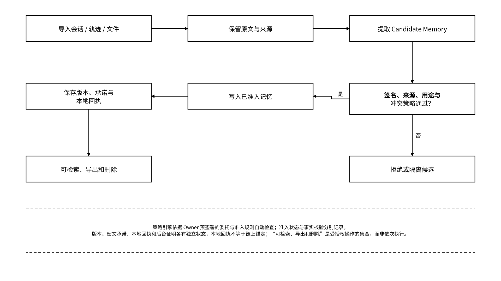

# 9.1 能力组合与部署配置

## 9.1.1 基础配置：可控记忆

> **配置定位：以 Vault、Gateway 和策略引擎组织独立的记忆保存、自动准入、检索、版本化与导入导出，密钥和授权由 Owner 控制。**

基础配置将会话、任务记录、文件和 Trace 导入状态层，保留来源并提取候选记忆。策略引擎依据签名、来源、用途、字段模式、隐私与冲突规则执行自动准入；符合规则的候选进入长期记忆，其他候选被拒绝或隔离并保留原因。

组件与接口包括：

* Vault 状态对象接口，存储后端按 Local、Hosted 或 MEFS 配置选择；
* 会话、任务、基础 Trace 和记忆导入器，保持原始来源引用；
* Candidate Memory 准入策略，分别记录 `candidate`、`confirmed`、`rejected` 和 `quarantined`；
* Memory、State Object、Artifact 的版本与来源 Schema，`provenance.source_refs` 记录来源，`parent_refs` 记录直接父版本；
* 用户密钥或组织 KMS 策略，配置内容加密、备份、数据密钥轮换和恢复；
* Memory Pack 清单、加密封装与导入 / 导出接口；
* REST、MCP、Gateway 和 SDK 的统一操作及错误语义；
* 访问、修改、导出和删除的本地签名回执与恢复队列。

_图 32｜候选记忆自动准入与状态保存流程_

<figure><figcaption></figcaption></figure>

自动验证用同一份带来源的样本完成导入、准入、检索、重启恢复、导出及异地重导入。验证器检查权限外请求被拒绝、候选不会无声覆盖既有版本、索引与缓存按删除策略处理，以及断电后业务提交、回执持久化和证明任务能够分别查询与恢复。

`confirmed` 表示通过指定准入策略，`confirmation_method=policy_validation` 记录处理方式，`confirmed_by` 标识策略引擎；来源真实性和业务事实使用独立的核验规则。规则不满足时保留候选与错误原因，不把自动准入解释为事实自动成立。

迁移核验绑定算法和摘要范围。`content_ref` 使用稳定引用与独立位置映射，同一密文迁移只更新位置映射，原版本和摘要保持不变；重新加密或格式转换创建新对象版本，记录旧新封装、摘要映射与转换回执。导出是独立事件，源对象可保持 `active`；授权状态、删除状态与密钥轮换状态分别管理。后台 `proof_status=pending` 只触发证明任务查询，不重复已经成功的业务写入。

## 9.1.2 协作配置：可携状态、轨迹与证明

> **配置定位：在统一对象与授权机制上，连接执行身份、版本化业务状态、跨主体交接、运行轨迹和可独立核验的证据。**

Checkpoint、任务上下文、Artifact、工具结果摘要和 Trace 保留独立版本关系。`parent_refs` 记录直接父版本，`provenance` 记录来源与跨对象依赖。Memory Pack 按接收者、用途和期限封装相应对象与引用，接收端执行权限、完整性、依赖和冲突检查后恢复约定业务状态。

组件与接口包括：

* 用户身份与 Agent DID 分离，注册、绑定、委托、撤销和身份连续性分别记录；
* Gateway 策略对象约束资源、操作、用途、时间、工具、费用和外部副作用；
* Checkpoint、Version、Trace、Artifact 与 Handoff 的版本化 Schema；
* Memory Pack 清单、接收者密钥封装、部分导入、确定性冲突处理和双向回执；
* Local、Hosted、MEFS 后端间的清单校验、封装映射与迁移回执；
* 访问、来源、运行、存储 commitment、挑战和证明引用的统一关联；
* 故障恢复、幂等重试、链重组、过期和撤销的一致处理；
* Schema 转换器、Compatibility Profile 和自动验证套件。

Agent DID 绑定身份签名公钥与执行实例，逻辑 Agent 可以跨模型持续存在。更换身份签名密钥时创建新实例和新 DID；模型、框架、名称、版本元数据及内容加密密钥变化不改变 DID。正常接续由旧、新实例签署连续性记录并通过 Owner 委托策略校验；旧实例无法签名时使用预设恢复授权签署独立恢复声明。历史回执、声誉证据和运行记录仍绑定原 DID，查询通过连续性引用组合呈现，Owner 为新 DID 签发新委托。

跨 Agent 恢复使用可重放的业务场景：Agent A 保存 Checkpoint，Agent B 通过独立授权取得允许交接的对象，在 Compatibility Profile 指定的模型、框架、工具和依赖中恢复状态并继续生成 Artifact。恢复检查覆盖任务进度、输入引用、依赖版本、外部动作幂等记录与恢复条件；不同模型依据相同业务状态继续任务，其生成结果无需相同。

证据验证器分别核验委托、版本、来源、发送与接收回执及成果规则。签名证明签发者作出了声明，Merkle 包含证明表明记录属于锚定批次，两者均不能单独证明事件真实或日志完整。Artifact 按任务的确定性验收策略或业务验证器判定符合性，验证结果记录规则版本、输入和证据引用。

安全验证覆盖提示注入、恶意 Memory Pack、伪造来源、签名重放、密钥泄露、策略竞态、费用超限和 Provider 离线。撤销传播按各执行点的生效记录和策略期限追踪；交付前重新检查撤销状态。后端转换校验旧新封装、摘要映射、对象标识、父版本图、来源和权限。Proof 按类型、版本、签发者和时间窗口核验，存储命题与内容真实性分别处理。

## 9.1.3 生态配置：框架适配与选择性交付

> **配置定位：以版本化适配器连接 Agent Host、编排框架、记忆引擎、企业系统及数据市场，在统一权限和证据机制下完成协作与授权交付。**

生态配置将外部协议和对象格式映射到 MEMO 的状态、委托、回执与支付契约。服务发现先匹配协议版本、Schema、传输、认证及必要能力，再加载对应适配器和验证规则。

组件与接口包括：

* Agent 框架的 memory、checkpoint、artifact 和 tool adapters；
* MCP、A2A、Agent Skills 与 x402 的版本化映射及互操作测试；
* 企业 IdP、钱包、KMS、审计、数据治理和策略引擎连接器；
* Attestation Server、TEE / 受控计算和多发行者信任策略；
* Data Market 对状态包、知识、经验和成果的选择性授权交付；
* ERC-7857 / ERC-7829 等资产化接口的隔离适配、权利映射和验证规则；
* 服务发现、报价、结算、争议、许可证和使用证据；
* 隐私、安全、经济及运行质量的监测与自动阈值控制。

资产流程只处理 Owner 在签名策略中选定且权利范围满足条件的对象。扫描器检查来源许可、第三方内容、敏感字段、密钥和隐私数据；不满足交付规则的内容从清单中排除或按规则脱敏。资产所有权、读取权、训练权、再分发权、商业用途和服务使用权分别表达，接收者取得的权限由对应委托及许可证确定。

适配验证记录恢复成功率、状态丢失率、授权错误率、Proof 验证率、各执行点撤销延迟和操作可解释性。每项指标绑定样本、计算方法、失败类别、配置与测试时间；阈值由服务等级策略加载。监测器对越界指标执行限流、隔离、降载或回退，适配器数量只作为资产清单统计，不替代行为验证。
