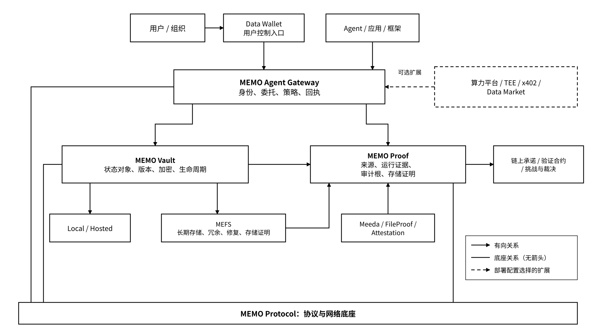

# MEMO Agent State Layer

> **愿景使命：让 AI 助手（Agent）“记得住、接得上、归你管”——它积累的记忆、做到一半的工作和产出的成果，换一个模型也能接着用，而且始终由你自己掌控。**

## 总览与阅读说明

MEMO Agent State Layer（MEMO Agent 状态层）是面向 Agent 长期任务与跨应用协作的可携状态基础设施。它以 MEMO Protocol 为协议与网络底座，通过 Vault、Gateway、Proof 分别组织状态对象、受控访问与可核验证据，并以统一的身份、委托和状态规范连接存储、计算与结算组件。统一对象 Schema 与适配器将业务状态和具体模型、框架解耦；恢复过程按兼容性规则校验对象、执行环境和外部依赖，接续可恢复的任务状态。

手册由产品定位、架构与状态模型、接口契约、部署配置、安全运维、标准适配、经济机制及自动化验证规则组成。各组件通过版本化 Schema、签名注册表和策略配置协同运行，配置加载、访问授权、状态准入、证据核验和故障处理形成完整的技术闭环。

### 如何阅读

| 读者 / 使用目的                | 建议阅读路径                                                                                                                                                                                                                                                                                                                                                                                                     |
| ------------------------ | ---------------------------------------------------------------------------------------------------------------------------------------------------------------------------------------------------------------------------------------------------------------------------------------------------------------------------------------------------------------------------------------------------------- |
| 项目负责人、架构与产品团队            | 先读[核心技术原则](/broken/pages/674d7426d184e2451aed5bc5563a4da4ff3f3833)，再读[第2章产品边界](2-he-xin-chan-pin/)、[第3章架构](3-jia-gou-yu-zhuang-tai-mo-xing/)和[附录B技术规格与配置契约](fu-lu-bji-shu-gui-ge-yu-pei-zhi-qi-yue.md)                                                                                                                                                                                                     |
| 首次了解项目的读者                | 从[第1章](1-kai-shi-liao-jie-memo/)理解项目定位、产品地图与角色入口                                                                                                                                                                                                                                                                                                                                                           |
| Agent / 应用开发者            | [2.2 Vault](2-he-xin-chan-pin/2.2-memo-vault-mian-xiang-duo-hou-duan-de-zhuang-tai-cun-chu.md) → [2.3 Gateway](2-he-xin-chan-pin/2.3-memo-agent-gateway-shen-fen-wei-tuo-yu-zhuang-tai-fang-wen-kong-zhi.md) → [3.1 总体架构](3-jia-gou-yu-zhuang-tai-mo-xing/3.1-zong-ti-jia-gou.md) → [4.1 快速开始](4-kai-fa-zhe-zhi-nan/4.1-kuai-su-kai-shi.md) → [4.2 集成与适配](4-kai-fa-zhe-zhi-nan/4.2-ji-cheng-yu-shi-pei.md) |
| Storage Provider / 节点参与者 | [2.1 Protocol](2-he-xin-chan-pin/2.1-memo-protocol-tong-yi-xie-yi-yu-wang-luo-di-zuo.md) → [6.1 Protocol与MEFS](6-ji-chu-she-shi-yu-chan-pin-zhi-ze/6.1-memo-protocol-yu-mefs.md) → [8.3 Tokenomics与治理](8-jing-ji-mo-xing-yu-can-kao-zi-liao/8.3-tokenomics-yu-zhi-li.md)                                                                                                                                   |
| 企业与生态合作方                 | [2.4 Proof](2-he-xin-chan-pin/2.4-memo-proof-cong-cun-chu-zheng-ming-dao-agent-zheng-ju.md) → [第5章安全与运维](5-memo-de-an-quan-zhi-li/) → [6.2 Meeda与计算](6-ji-chu-she-shi-yu-chan-pin-zhi-ze/6.2-meeda-yu-ji-suan-ji-chu-she-shi.md) → [第7章标准集成](7-biao-zhun-yu-kai-fang-ji-cheng/)                                                                                                                            |
| 旧版 MEMO 用户               | 从[6.3 应用入口与状态接入](6-ji-chu-she-shi-yu-chan-pin-zhi-ze/6.3-ying-yong-ru-kou-yu-zhuang-tai-jie-ru.md)查看产品职责与迁移边界，再查[9.3.2 产品映射与文档迁移](/broken/pages/326cfb68ea76efa4a926aa449ea5b9ad7f21cf95#c9-3-2)                                                                                                                                                                                                           |
| 集成与运维工程师                 | 使用附录A术语、接口与自动验证规则，按附录B配置契约装载并校验部署配置                                                                                                                                                                                                                                                                                                                                                                        |

### 整体产品关系

**MEMO Protocol 是共同底座；Vault、Gateway、Proof 分别承担状态管理、受控访问与证据组织。** MEFS、Meeda、Data Wallet、Data Market、DataDrive 按存储、数据可用性、用户控制和数据交付的职责接入。部署配置选择相应后端与扩展组件，注册表提供组件发现、版本约束和连接参数。

_图 01｜MEMO Agent State Layer 产品与基础设施关系_

<figure><figcaption></figcaption></figure>

用户通过控制入口管理身份、密钥和委托；Agent 或应用通过受管 Gateway 发起请求。Vault 负责对象与存储后端，Proof 组织与明确命题相关的证据；链上只承接必要登记、承诺、验证与结算。图中的连接不意味着每种部署都具有相同密钥托管、故障隔离或证明能力，具体边界见3.3。

### 产品定位、部署配置与接口契约

| 维度    | 技术定义                                             | 运行机制                            |
| ----- | ------------------------------------------------ | ------------------------------- |
| 产品定位  | Protocol 协议底座；Vault 状态管理；Gateway 受控访问；Proof 证据组织 | 组件职责与接口在注册表中声明，按部署配置组合          |
| 部署配置  | Local、Hosted、MEFS 后端；持钥方式、解密位置、隔离和保留策略           | 启动时加载签名配置，自动校验依赖、身份、后端能力与安全约束   |
| 接口契约  | API、SDK、Schema、协议版本、传输方式、认证模式和功能集合               | 适配器按能力清单协商；不匹配的请求返回确定错误并保持已有状态  |
| 自动化验证 | Schema 校验、签名与委托验证、版本一致性、幂等、故障恢复和证据核验             | 结果绑定组件版本、配置摘要与测试条件，作为运行准入和可观测记录 |

产品说明直接定义职责、输入输出、约束和异常处理。第4章给出调用与恢复流程，第8章定义对象 Schema、接口映射、Registry 与计量规则；部署过程从签名注册表解析版本、地址和参数，并通过自动检查建立组件间的兼容关系。外部标准由适配器映射至 MEMO 的身份、授权、状态和结算模型。
