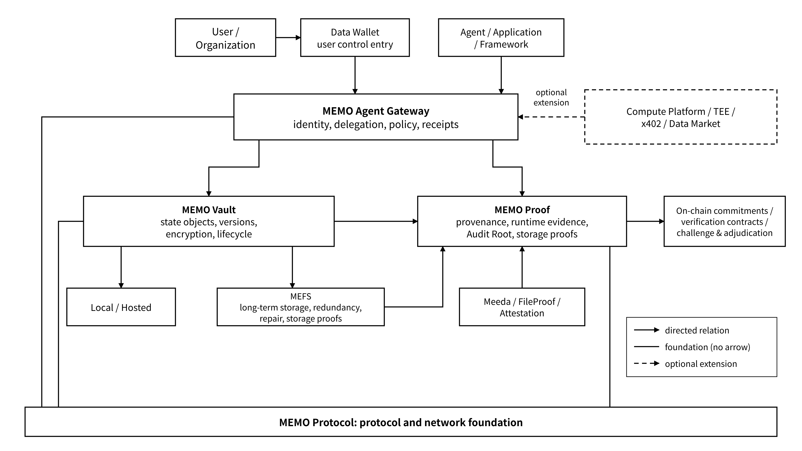

# README

**Product Architecture and Technical Design · 2026-10-16**

> **Vision and mission: let your AI agent remember, pick up where it left off, and stay under your control. Its memories, half-finished work and results carry over even when you switch models, and you always hold the keys.**

## Overview and Reading Guide

The MEMO Agent State Layer is portable state infrastructure for long-running agent tasks and cross-application collaboration. It uses MEMO Protocol as the protocol and network foundation; Vault, Gateway and Proof organize state objects, controlled access and verifiable evidence respectively; and unified identity, delegation and state specifications connect the storage, computation and settlement components. A unified object schema and adapters decouple business state from any particular model or framework; the recovery process validates objects, the execution environment and external dependencies against compatibility rules, and resumes the task state that can be recovered.

The handbook covers product positioning, architecture and the state model, interface contracts, deployment configuration, security and operations, standards adaptation, economic mechanisms and automated validation rules. Components run together through versioned schemas, signed registries and policy configuration; configuration loading, access authorization, state admission, evidence verification and failure handling form a complete technical loop.

### How to Read This Handbook

| Reader / purpose                              | Suggested reading path                                                                                                                                                                                                                                                                                                                                                                                                        |
| --------------------------------------------- | ----------------------------------------------------------------------------------------------------------------------------------------------------------------------------------------------------------------------------------------------------------------------------------------------------------------------------------------------------------------------------------------------------------------------------- |
| Project leads, architecture and product teams | Start with [Core Technical Principles](preface/core-principles.md), then [Chapter 2 on product boundaries](2-core-products/), [Chapter 3 on architecture](3-architecture-and-state-model/) and [Appendix B, Technical Specifications and Configuration Contracts](appendix/appendix-b.md)                                                                                                                                     |
| First-time readers                            | Begin with [Chapter 1](./) for the project positioning, product map and role entry points                                                                                                                                                                                                                                                                                                                                     |
| Agent / application developers                | [2.2 Vault](2-core-products/2.2-memo-vault-multi-backend-state-storage.md) → [2.3 Gateway](2-core-products/2.3-memo-agent-gateway-identity-delegation-and-state-access-control.md) → [3.1 Overall Architecture](3-architecture-and-state-model/3.1-overall-architecture.md) → [4.1 Quick Start](4-developer-guide/4.1-quick-start.md) → [4.2 Integration and Adaptation](4-developer-guide/4.2-integration-and-adaptation.md) |
| Storage providers / node participants         | [2.1 Protocol](2-core-products/2.1-memo-protocol-unified-protocol-and-network-foundation.md) → [6.1 Protocol and MEFS](6-infrastructure-and-product-responsibilities/6.1-memo-protocol-and-mefs.md) → [8.3 Tokenomics and Governance](8-economics-and-reference/8.3-tokenomics-and-governance.md)                                                                                                                             |
| Enterprise and ecosystem partners             | [2.4 Proof](2-core-products/2.4-memo-proof-from-storage-proofs-to-agent-evidence.md) → [Chapter 5 on security and operations](5-security-governance-and-operations/) → [6.2 Meeda and Computing Infrastructure](6-infrastructure-and-product-responsibilities/6.2-meeda-and-computing-infrastructure.md) → [Chapter 7 on standards integration](7-standards-and-open-integration/)                                            |
| Users of earlier MEMO versions                | See [6.3 Application Entry Points and State Access](6-infrastructure-and-product-responsibilities/6.3-application-entry-points-and-state-access.md) for product responsibilities and migration boundaries, then [9.3.2 Product Mapping and Documentation Migration](9-capability-profiles-support-and-community/9.3-community-and-compatibility-management.md#c9-3-2)                                                         |
| Integration and operations engineers          | Use [Appendix A, Terminology, Interfaces and Automated Validation Rules](appendix/appendix-a.md), and load and validate the deployment configuration according to the [Appendix B configuration contract](appendix/appendix-b.md#b-1)                                                                                                                                                                                         |

### Overall Product Relationships

**MEMO Protocol is the common foundation; Vault, Gateway and Proof take on state management, controlled access and evidence organization respectively.** MEFS, Meeda, Data Wallet, Data Market and DataDrive connect according to their responsibilities for storage, data availability, user control and data delivery. The deployment configuration selects the corresponding backends and extension components, and the registry provides component discovery, version constraints and connection parameters.

_Figure 01: Relationship Between MEMO Agent State Layer Products and Infrastructure_

Users manage identity, keys and delegation through the control entry point; an Agent or application sends requests through the managed Gateway. Vault is responsible for objects and storage backends, and Proof organizes the evidence related to a defined claim; the chain carries only the necessary registrations, commitments, verification and settlement. The connections in the figure do not mean that every deployment has the same key custody, fault isolation or proof capability; see [3.3](3-architecture-and-state-model/3.3-trust-boundaries.md) for the precise boundaries.

### Product Positioning, Deployment Configuration and Interface Contract

| Dimension                | Technical definition                                                                                                                   | Operating mechanism                                                                                                                                |
| ------------------------ | -------------------------------------------------------------------------------------------------------------------------------------- | -------------------------------------------------------------------------------------------------------------------------------------------------- |
| Product positioning      | Protocol is the protocol foundation; Vault manages state; Gateway provides controlled access; Proof organizes evidence                 | Component responsibilities and interfaces are declared in the registry and combined by deployment configuration                                    |
| Deployment configuration | Local, Hosted and MEFS backends; key custody mode, decryption location, isolation and retention policy                                 | A signed configuration is loaded at startup, and dependencies, identity, backend capabilities and security constraints are validated automatically |
| Interface contract       | API, SDK, schema, protocol version, transport, authentication mode and feature set                                                     | Adapters negotiate according to the capability manifest; a mismatched request returns a deterministic error and existing state is preserved        |
| Automated validation     | Schema validation, signature and delegation verification, version consistency, idempotency, failure recovery and evidence verification | Results are bound to the component version, configuration digest and test conditions, and serve as runtime admission and observability records     |

Product descriptions define responsibilities, inputs and outputs, constraints and exception handling directly. Chapter 4 describes the invocation and recovery flows, and Chapter 8 defines the object schema, interface mappings, registry and metering rules; deployment resolves versions, addresses and parameters from the signed registry and establishes compatibility among components through automated checks. External standards are mapped by adapters onto MEMO's identity, authorization, state and settlement models.
